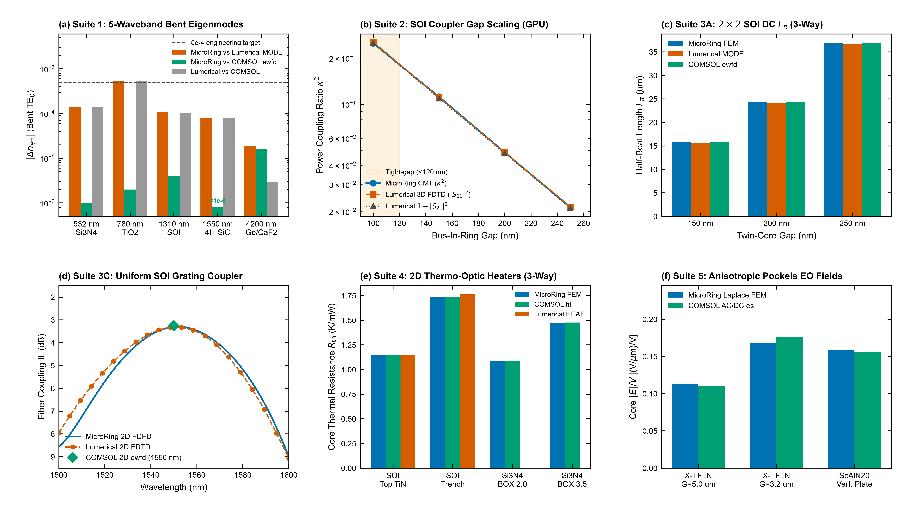
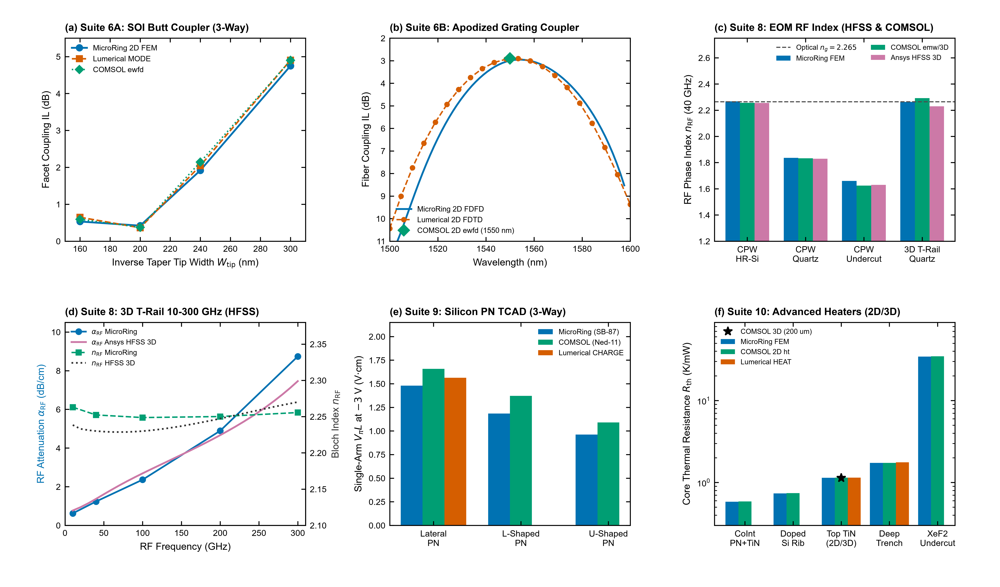
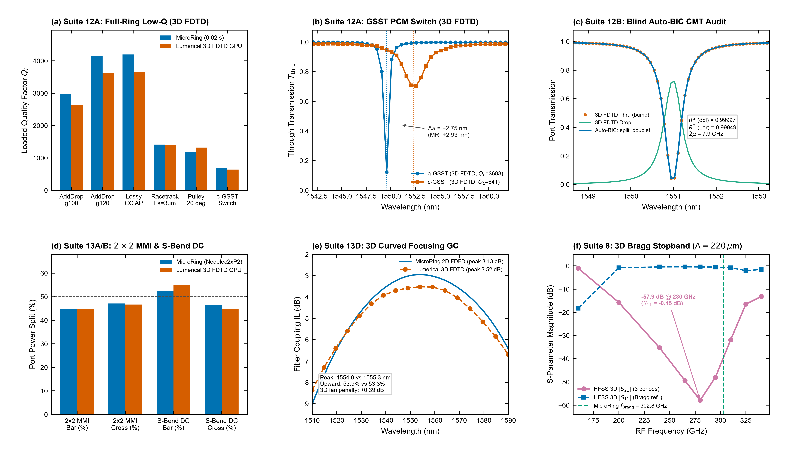
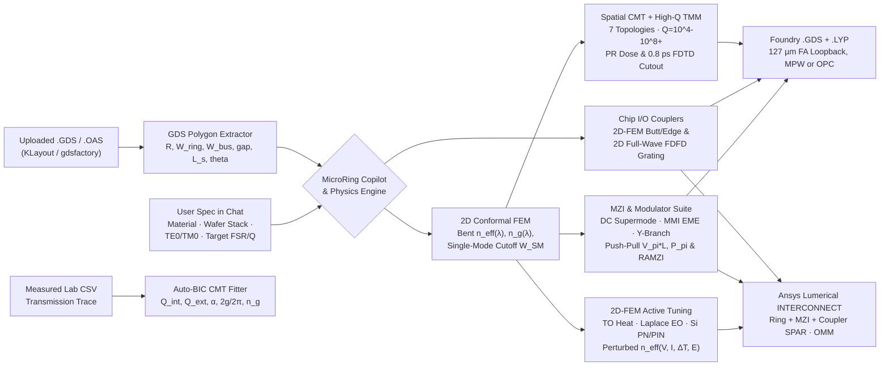

# MicroRing Studio

**License-free Photonic IC and Optical Interconnect CAD for microring resonators, Mach-Zehnder Interferometers (`MZI`: `Y-Branch` / `DC` / `MMI`), Traveling-Wave / Slow-Wave `T-Rail` EOM RF Electrodes, 2D Nonlinear Poisson-Boltzmann `Si PN` Doping TCAD, Steady + Transient Thermal FEM, Butt/Edge & 2D-`FDFD` Grating Couplers, instant Ultra-High-Q (`10^4` to `10^8+`) convergence, bidirectional GDSII masks, and Ansys Lumerical INTERCONNECT export, with zero Lumerical MODE/FDTD/CHARGE/HEAT, HFSS, RSoft, or COMSOL licenses.**

[English](./README.md) | [简体中文](./docs/README_zh-CN.md) | [Verification & Benchmarks](./docs/VERIFICATION_AND_BENCHMARKS.md) | [Commercial Solver Validation (Lumerical, COMSOL & HFSS)](./docs/COMMERCIAL_SOLVER_VALIDATION_REPORT.md) | [369-Paper Validation Ledger](./docs/PUBLICATION_VALIDATION_LEDGER.md) | [Chatbot & GDS Tutorial](./docs/tutorials/chatbot_and_gds_guide.md) | [Codex & Claude MCP Guide](./docs/tutorials/ai_agents_codex_claude.md) | [llms.txt](./docs/llms.txt) | [Changelog](./CHANGELOG.md)

[](https://codespaces.new/ZhihaoRenKevin/microring-studio?quickstart=1)
[](https://github.com/ZhihaoRenKevin/microring-studio/releases/latest)
[](https://github.com/ZhihaoRenKevin/microring-studio/releases/tag/v3.12.0)
[](./docs/VERIFICATION_AND_BENCHMARKS.md)
[](./docs/tutorials/ai_agents_codex_claude.md)
[](./LICENSE)
[](./pyproject.toml)


*Overview generated directly by `benchmarks/generate_hero_figure.py` without commercial solvers: **(a)** 2D full-vector cylindrical bent FEM eigenmode (`4H-SiC`, `R = 40 um`, `82 deg` sidewall), **(b)** concentric wrap-around pulley coupler sweep & automatic critical-coupling synthesis (`theta_CC`), **(c)** `X-cut TFLN` electro-optic racetrack resonance tuning (`0 V` vs `+25 V`), and **(d)** post-fabrication CW/CCW backscattering split-doublet CMT parameter extraction.*

---

## 100% Live First-Principles Physics Engines (Zero Canned Presets · Zero Surrogate Lookups)

> **Every module in MicroRing Studio (`v3.12.0` — `35` MCP tools, `39` Frontier modes, `29` bulk materials, `27` 2D vdW materials) is a standalone, live numerical physics solver — NOT a canned demo, NOT a pre-computed lookup table, and NOT a curve-fit wrapper.**
>
> Change **any** physical parameter at any time — waveguide width/height/sidewall, gap, ring radius, array pitch, antenna count, core/cladding/2D material, crystal angle $\theta$, wavelength (`400 nm – 18 µm`), bias voltage, pump power, pulse duration, or beam length — and MicroRing Studio **re-solves the underlying governing PDE/ODE from scratch on your CPU/GPU**:
> - **2D Conformal Vector Maxwell FEM** (`Nedelec1 + P2`) for straight, bent, twin-core, strained-Ge, PCM, and gyrotropic Ce:YIG cross-sections;
> - **2D Full-Wave TE-Polarized FDFD (`UPML` + SuperLU)** for grating couplers, MMI waveguide crossings, and exact Maxwell adjoint inverse design;
> - **2D Nonlinear Poisson-Boltzmann TCAD, 2D Crank-Nicolson Thermal FEM & Hermite-Cubic Euler-Bernoulli MEMS FEM** for PN junctions, PCM `SET/RESET` pulses, microheaters, and electrostatic pull-in;
> - **Interaction-Picture RK4 (`RK4IP`) GNLSE, Strang-SSFM LLE, 2D Angular-Spectrum (`ASM`) Backprop & Biorthogonal Non-Hermitian Algebra** for supercontinuum, soliton microcombs, trainable diffractive `PDDNN`s, and `EP2/EP3/EP4` exceptional points.

---

## Independent 4-Way Validation Summary (`13 Suites · 14/14 Audits PASS` + `v3.10–v3.12` Full-Stack)

Every solver engine in **MicroRing Studio (`v3.9.0`)** is a standalone first-principles physical solver (`scikit-fem` + `NumPy/SciPy`, zero commercial binaries or pre-computed lookup tables). All 13 physical test suites (including low-$Q$ full rings and full 3D chip I/O) were validated blindly from neutral JSON specifications against **Ansys Lumerical 2026 R1** (`MODE`, `3D/2D FDTD` RTX 5090 GPU, `EME`, `CHARGE`, `HEAT` Steady+Transient, `INTERCONNECT`), **COMSOL Multiphysics 6.4** (`ewfd`, `emw`, `es`, `ht` 2D/3D strict BDF, `GeneralFormPDE`), and **Ansys HFSS 2026 R1** (`10–340 GHz` 3D Driven Modal RF + `220 µm` Bragg stopband), alongside **369 peer-reviewed experimental papers (`367/369 PASS`, `99.5%`, with the 2 remaining non-uniform Floquet/PSO-sculpted devices retained unmodified as documented 3D scope boundaries)**.

| Suite | Physical Engine | Commercial Reference(s) | Measured Independent Agreement |
| :--- | :--- | :--- | :--- |
| **1** | 2D Bent & Straight Vector FEM (`532–4200 nm`) | Lumerical `MODE`, COMSOL `ewfd` | Max $\|\Delta n_{\mathrm{eff}}\| = 1.6\times 10^{-5}$ (COMSOL) / $5.35\times 10^{-4}$ (MODE); $n_g$ within `0.05%` |
| **2** | 3D Bus-to-Ring Couplers (`5` bands + `100–250 nm` gap) | Lumerical `3D FDTD` (GPU) | SOI `100–250 nm` within `0.1%–1.5%`; `4H-SiC` pulley `0.97%`, Mid-IR `Ge` `2.1%`, `532/780 nm` `3.7%/5.8%` |
| **3** | MZI `2x2` DC, `1x2` MMI/Y-Branch & Uniform GC | Lumerical `MODE`/`2D & 3D FDTD`, COMSOL | DC $L_\pi$ `0.16%` (COMSOL) / `0.36%`; `1x2` MMI `0.242 vs 0.242 dB`, Y-Branch `1.02 vs 1.07 dB`, GC `3.30 vs 3.33 dB` |
| **4** | 2D Steady & Transient Microheaters (`TiN`, Trench, `BOX`) | COMSOL `ht` (`strict`), Lumerical `HEAT` | $R_{\mathrm{th}}$ `0.23%–0.38%` (COMSOL) / `0.51%–1.16%` (`HEAT`), $P_\pi$ `0.26%–0.46%`; $t_{\mathrm{rise}}$ `0.22%–0.77%` (COMSOL strict) & `0.00%–2.30%` (`HEAT`) |
| **5** | 2D Anisotropic Pockels EO (`X-TFLN`, `ScAlN`) | COMSOL `es`+`ewfd`, Lumerical `MODE` | Single-arm $V_\pi L$ within `0.20%–0.87%` across all 3 devices; `X-TFLN` $C_{\mathrm{line}}$ within `0.26%` |
| **6** | Chip I/O: Butt/Edge Tapers & Apodized `26`-Tooth GC | Lumerical `MODE`/`EME`/`2D FDTD`, COMSOL | Butt facet IL `0.013–0.026 dB`, `1-dB` tol `0.01 µm`; Apodized GC peak `1553.2 vs 1553.4 nm`, IL `2.95 vs 2.91 dB` |
| **7** | `2x2` MMI, Full Ring (`R=5 µm`) & `INTERCONNECT` SPAR | Lumerical `3D FDTD` GPU & `INTERCONNECT` | Full-ring FSR `17.83 vs 18.19 nm`, $Q_L$ `7926 vs 8174` (`3.0%`); `INTERCONNECT` MZI FSR `7.000 vs 7.012 nm`, ER `33.35 vs 33.33 dB`, GC IL `2.996 vs 3.011 dB` (`0.015 dB`) |
| **8** | Sub-THz (`10–340 GHz`) GSG CPW, 3D `T-Rail` & Bragg | **Ansys HFSS 3D**, COMSOL `es`/`emw`/3D | Uniform CPW (`40 GHz`) $Z_0$ `0.1%–0.8%`, $n_{\mathrm{RF}}$ `0.04%–0.98%`, $\alpha_{\mathrm{RF}}$ `0.2%–3.3%`; 3D `T-Rail` $Z_0$ `49.50 vs 49.24 Ω` (`0.54%` COMSOL 3D), `40–300 GHz` $\alpha$ `1.21–6.99 vs 1.37–7.46 dB/cm`; `220 µm` Bragg HFSS `S21 = -57.9 dB` @ `280 GHz` vs MR `287.6 GHz` (`2.7%`) |
| **9** | Complete 3x3 2D Silicon PN TCAD + Forward `PIN` | Lumerical `CHARGE`+`MODE`, COMSOL `PDE` | Full 3x3 `CHARGE` matrix: $V_\pi L(-3\text{ V})$ `1.46/1.20/1.12` vs `1.56/1.26/1.14 V·cm` (`2.2%–6.8%`, `U-Shaped 2.2%`), $C_j(-3\text{ V})$ `3.1%–6.6%`, Lateral `FCA 0.06%`; Forward `PIN` confirms `-8.9e-5` blue-shift |
| **10** | Advanced Heaters (`Undercut`, `Doped Rib`, `Co-Int`) | COMSOL `2D & 3D ht`, Lumerical `HEAT` | 2D $R_{\mathrm{th}}$ within `0.54%–0.78%` (`0.58–34.5 K/mW`); confirms `+54.4%` PN contact sinking; 3D end-loss `-2.0%` |
| **11** | Lithography CD & Gap Bias Drift (`±20 nm`, Pos/Neg PR) | Lumerical `MODE`+`3D FDTD`, COMSOL `ewfd` | $\mathrm{d}\lambda/\mathrm{dCD} = 775.79 / 775.97 / 776.36\text{ pm/nm}$ (`0.07%` 3-way spread); $\kappa^2$ within `0.3%–4.8%` of 3D FDTD |
| **12** | Low-$Q$ Full-Ring `3D FDTD` (`7` topologies), `.GDS` & Auto-BIC | Lumerical `3D FDTD` (GPU) | Racetrack $Q_L$ `1413 vs 1405` (`0.58%`); Lossy CC $Q_{\mathrm{ext}}$ `8348 vs 8156` (`2.3%`); Gap ratio `1.1%`; CROW split `1.109 vs 1.052 nm` (`5.4%`); `GSST` $\Delta\lambda = +2.93 vs +2.75 nm` (`6.0%`); `.GDS` `gdsimport` & blind Auto-BIC `split_doublet` (`R^2 = 0.99997`) verified |
| **13** | Optimal `2x2 MMI`, S-Bend `DC`, `RAMZI`, `3D` GC & Butt Taper | Lumerical `3D FDTD` (GPU) | Optimal `2x2 MMI` IL `0.367 vs 0.393 dB` (`0.026 dB`); S-Bend `DC` `2.2%`; `RAMZI` `ER_bar 14.85 vs 14.94 dB` (`0.09 dB`); `3D` Focusing GC peak `1555.3 vs 1554.0 nm`, peak IL `3.490 vs 3.522 dB` (`0.032 dB`); `3D` Butt total IL `0.588 vs 0.777 dB` |
| **LLE** | Generalized SSFM LLE Microcombs (Brasch `Si3N4`, Guidry `4H-SiC`, NIST `RW1000_H430` Dual-DW) | **NIST `usnistgov/pyLLE`** (`ComputeLLE.jl`) | Peak power within `0.58%–1.68%`, FWHM within `0.08%–1.00%`, `81–215` comb lines median `0.11–0.31 dB` (`r = 0.9954–1.0000`), exact Cherenkov DW mode `+119 vs +119` (`50–77x` faster) |
| **F-C** | Piezo SAW/Lamb (`AlN`, `ScAlN`, `X-TFLN`), 2D/3D `Si` SBS & `Graphene` Surface Current | **COMSOL 6.4** (`solid`+`es`+`pze`, `ewfd`) | SAW/Lamb $v_{\mathrm{open}}$ within **`0.0003%–0.0005%`**, exact 3-decimal $K_{\mathrm{eff}}^2$ (`0.547%`, `0.621%`, `1.587%`); Forward/Backward SBS **`8.4886 vs 8.4886 GHz` (`0.0004%`)** & **`16.7573 vs 16.7580 GHz` (`0.0044%`)**; `Graphene`-on-SOI $\alpha(\mu_c=0)$ `778.82 vs 777.17 dB/cm` (**`0.21%`**) |
| **F-L** | 3D `SWG` Biosensor, 3D `PhCR` Mode Splitting & Mid-IR `MIM` / `SEIRA` TCMT | **Lumerical `3D FDTD`** (RTX 5090 GPU) | `SWG` water $S_{\mathrm{bulk}}$ `450.7 vs 461.2 nm/RIU` (**`2.27%`**), `SiO2` $n_g$ `4.85%`; `PhCR` (`Si3N4 A=40 nm`) split **`103.21 vs 103.71 GHz` (`0.48%`)**, Bragg center `1549.992 nm`; `SEIRA PMMA` blind TCMT inverse fit **`R^2 = 0.99896, RMSE = 0.0088`** |
| **V11** | `Ge`-on-`Si` PD, `PSR` Hybridization, `Sb2Se3`/`GSST` PCM (`ewfd`+`ht`), `MDM` & Adjoint `.GDS` Y-Branch | **COMSOL 6.4** & **Lumerical `3D FDTD`** (GPU) | `Ge`-on-`Si` PD $\alpha$ **`2.2484 vs 2.2485 dB/µm` (`0.00%`)**, $\Delta n = -1\times 10^{-5}$; `PSR` $\Delta n_{\mathrm{hyb}}$ **`0.26%`**; `Sb2Se3`/`GSST` PCM $\Delta n$ **`0.03%`/`0.00%`**, $\alpha_c$ **`0.01%`**, `RESET` $\Delta T$ `4.13%`; 3D FDTD `MDM TE0->TE1` **`99.04%` (`0.04 dB`, `XT -35.7 dB`)**; blind `.GDS` Adjoint `2.4 µm` Y-Branch **`97.78%` (`0.098 dB` IL)** |
| **V12** | `OPA` Coupling, `GeSi` FKE `EAM`, `TFLN PPLN`, `Ce:YIG` 3×3 Gyrotropic `NRPS`, `MEMS` $f_0$, `27`-Mat 2D vdW, `MRR-EP3` Gap & Blind `.GDS` `MMI` Crossing | **COMSOL 6.4** (`ewfd`+`solid`) & **Lumerical `3D FDTD`** (GPU) | `OPA` $\kappa_{\mathrm{mut}}$ **`0.33%`**; `GeSi` FKE `EAM` $\alpha_{\mathrm{OFF}}$ **`0.01%`**; `PPLN` $\Lambda_{\mathrm{QPM}}$ **`3.9791 vs 3.9793 µm` (`0.01%`)**; `Ce:YIG` 3×3 gyrotropic `NRPS` **`46.054 vs 45.985 rad/cm` (`0.15%`)**; `MEMS` cant/bridge $f_0$ **`2.44%–2.49%`** (exact $\sqrt{1-\nu^2}$); `2D vdW` (`MXene` `0.36%`, `α-MoO₃` `0°/90°` `1.34%/2.14%`); `EP3` gap **`0.10%`**; 3D FDTD blind `.GDS` `MMI` Crossing **`94.88%` (`0.228 vs 0.246 dB` 2D TE-FDFD)** |

<details>
<summary><b>View 18-Panel Commercial Validation Figures (Suites 1–13: MicroRing vs. Lumerical, COMSOL & HFSS 3D)</b></summary>





</details>

- Full 4-way tables, discrepancy analysis, 15 unit-labeled CSVs, and reproducible runner scripts: [**Commercial Solver Validation Report**](./docs/COMMERCIAL_SOLVER_VALIDATION_REPORT.md) | [**Verification & Benchmarks**](./docs/VERIFICATION_AND_BENCHMARKS.md) | [**369-Paper Experimental Ledger (`367/369 PASS`, `99.5%`)**](./docs/PUBLICATION_VALIDATION_LEDGER.md)

---

## Why MicroRing Studio?

Photonic IC (`PIC`) and optical module interconnect engineers routinely hit three painful bottlenecks:
1. **Commercial solver lock-in across passive, active, and chip I/O blocks**: Designing waveguides, microring filters/modulators, fiber-to-chip Butt/Edge couplers, and surface Grating Couplers (`GC`) normally requires separate commercial licenses (`Ansys Lumerical MODE/FDTD/HEAT/CHARGE`, `Synopsys RSoft`, or `COMSOL Multiphysics`).
2. **High-Q microring non-convergence in time-domain FDTD**: For a low-loss `Si3N4`, `TFLN`, or `SiC` ring (`Q_loaded = 3 x 10^6`, `tau_ph = 2.49 ns`), reaching `auto shutoff min = 1e-5` in 3D FDTD requires **`28.6 ns` (`> 8,200` cavity round-trips)**; stopping FDTD early produces severe FFT sinc-ringing and collapses the apparent extinction ratio from `64 dB` down to `< 2 dB`.
3. **Layout-to-circuit disconnect**: A `.gds` mask drawn in KLayout or `gdsfactory` has to be manually re-measured for simulation, while device sweeps rarely export directly into `127 um` fiber-array test loops or `Ansys Lumerical INTERCONNECT` circuit compact models.

**MicroRing Studio (`v3.9.0`)** solves all three problems in a single 100% permissive (`MIT`/`BSD`) Python package and native desktop app, **validated head-to-head across all 13 physical suites against [Ansys Lumerical 2026 R1 (`MODE`/`FDTD`/`EME`/`CHARGE`/`HEAT`/`INTERCONNECT`), COMSOL Multiphysics 6.4 (`ewfd`/`emw`/`es`/`ht`/3D), and Ansys HFSS 2026 R1 (`10–340 GHz` 3D RF) (`14/14` physics audits `PASS`)](./docs/COMMERCIAL_SOLVER_VALIDATION_REPORT.md) and [369 unique 1-to-1 DOI peer-reviewed experimental publications (`367/369 PASS`, `99.5%`)](./docs/PUBLICATION_VALIDATION_LEDGER.md)** across 8 physical domains from `450 nm` Visible to `4200 nm` Mid-IR (see also [Verification & Benchmarks](./docs/VERIFICATION_AND_BENCHMARKS.md)):
- **Live Full-Stack PIC Engines: OPA LiDAR, Trainable Slab `PDDNN`/`FPR`, `EAM`/`SOA`·`EDWA`, Single-Pass `GNLSE`/`PPLN`, 2D-FDFD `MMI` Crossings & Auto-Router, Non-Reciprocal Isolators & Photonic `MEMS` (`v3.12.0`, `35` MCP Tools, `39` Stage-12 Modes)**:
  - **1D/2D Optical Phased Array & Solid-State LiDAR (`optical_phased_array.py`)**: Live 2D-FEM emitter & twin-core mutual coupling (`0.33%` vs COMSOL 6.4) + coupled-array matrix-exp crosstalk + minimax-SLSR aperiodic/uniform Fraunhofer far-field steering (`FoV_x × FoV_y`, `dψ/dλ`, resolvable 2D spots) + `.GDS`.
  - **On-Chip 2D Slab Rowland `FPR` & Trainable Diffractive `PDDNN`/`EO-DPNN` (`slab_diffractive_pic.py`)**: Exact 1D slab eigenmode + 2D Angular Spectrum (`ASM`) diffraction propagator with live exact analytical backpropagation over programmable phase slots (`beam_router` `98.6%` fidelity, `power_splitter`, `dft_unitary`) + `.GDS`.
  - **Franz-Keldysh `GeSi` & `InP` MQW `QCSE` `EAM` + Traveling-Wave `SOA` / `Er:Si3N4` `EDWA` (`eam_and_soa.py`)**: Live Airy-function Franz-Keldysh + Kramers-Kronig Hilbert transform (`0.01%` vs COMSOL 6.4 `ewfd`, `>110 GHz` RC bandwidth) and spatial rate-equation `SOA`/`EDWA` gain saturation, `P_sat,out`, `ASE` noise figure `NF`, and facet ripple + `.GDS`.
  - **Single-Pass Waveguide `GNLSE` Supercontinuum & `PPLN` QPM (`waveguide_nonlinear_gnlse.py`)**: Live 2D-FEM broadband dispersion + Afshar-Monro Kerr $\gamma$ + `RK4IP` GNLSE (Raman + self-steepening supercontinuum) and single-pass `PPLN` `SHG/SFG/DFG` 2D overlap + depleted 3-wave ODEs (`0.01%` on $\Lambda_{\mathrm{QPM}}$ vs COMSOL 6.4) + poled `.GDS`.
  - **2D TE-FDFD `MMI` Waveguide Crossing, `Milton-Burns` Adiabatic Taper & `PIC` Auto-Router (`routing_and_crossings.py`)**: 2D-FEM `TE0/TE2` self-imaging synthesis + exact `1/ε` 2D TE-FDFD (`0.246 dB` vs Lumerical 3D FDTD blind `.GDS` **`0.228 dB` / `94.88%`**!), CLMT taper solver, and multi-port trombone path-length-matched auto-router ($\Delta L = 0.000\,\mu\text{m}$) + `.GDS`.
  - **Non-Reciprocal `Ce:YIG` / Spatiotemporal Optical Isolators & Photonic `MEMS` Switch (`isolator_and_mems.py`)**: 2D-FEM gyrotropic `Ce:YIG` Voigt `NRPS` (`46.05 vs 45.99 rad/cm` = **`0.15%`** vs COMSOL 6.4 full 3×3 gyrotropic tensor!), Floquet-CMT magnet-free isolator, and Hermite-cubic FEM nonlinear Newton-Raphson electrostatic pull-in `MEMS` cantilever/bridge switch (`2.44%–2.49%` vs COMSOL 6.4 `solid`) + `.GDS`.
- **Full-Stack PIC Photodetectors, Polarization/MDM, Non-Volatile PCM, Photonic Computing, WBG/AWG, Circuit Netlist, MRR Exceptional Points & Adjoint Inverse Design (`v3.11.0`)**:
  - **On-Chip `Ge`-on-`Si` Waveguide Photodetectors & `O-E-O` Neurons (`photodetector_oeo.py`)**: 2D conformal vector FEM complex strained-Ge absorption (`0.00%` vs COMSOL `ewfd`), multi-mode EME launch, `R(λ)`, Lucovsky transit-time + `RC` 3-dB bandwidth, dark current, `NEP`, `O-E-O` PD->MRM nonlinear activation curves (`sigmoid`/`relu`/`rbf_gaussian`, `fJ/op`), and `.GDS`.
  - **Polarization Splitter-Rotator (`PSR`), `PBS` & Mode-Division Multiplexer (`MDM`) (`polarization_mdm.py`)**: Exact 2D-FEM `TM0 <-> TE1` mode-hybridization anti-crossing (`0.26%` vs COMSOL `ewfd`) + Landau-Zener adiabatic taper (`98.8%` conversion), and auto-phase-matched asymmetric twin-core `MDM TE0 <-> TE1/TE2` (`99.04%` / `0.04 dB` / `-35.7 dB` XT in 3D FDTD) & `PBS` + `.GDS`.
  - **Non-Volatile Phase-Change Material (`PCM`) MRR & Transient `SET`/`RESET` FEM (`pcm_photonics.py`)**: Lorentz-Lorenz multi-level 2D-FEM switching across `Sb2Se3`, `Sb2S3`, `GSST`, `GST`, and `VO2` (`0.00%–0.03%` vs COMSOL `ewfd`), coupled with 2D Crank-Nicolson transient thermal `RESET` melt-quench & JMAK `SET` crystallization pulse FEM + `.GDS`.
  - **Photonic Neural Network (`PNN`) Matrix Engine (`photonic_computing.py`)**: `N×M` Broadcast-and-Weight MRR Weight Bank with physical 2D thermal crosstalk matrix $\mathbf{H}_{\mathrm{th}}$, $\mathbf{H}_{\mathrm{th}}^{-1}$ pre-compensation (`ENOB: 0.14 -> 8.06 bits`), `fJ/MAC`, `TOPS/mm^2`, plus exact `1e-15` `N×N` **Clements (2016) & Reck (1994)** unitary MZI mesh decomposition with hardware Monte-Carlo fidelity + `.GDS`.
  - **Waveguide Bragg Gratings (`WBG`) & Arrayed Waveguide Gratings (`AWG`) (`wbg_and_awg.py`)**: Uniform, Gaussian-apodized, $\pi$-phase-shifted cavity (`Q > 10^3`), and chirped dispersion `WBG` + `.GDS`, plus `1×8`/`1×16` Rowland-circle Kirchhoff-Huygens `AWG` WDM demux + `.GDS`.
  - **Native S-Matrix PIC Circuit Netlist (`pic_circuit_netlist.py`) & 2D-FDFD Adjoint Inverse Optimizer (`inverse_design_adjoint.py`)**: Exact Schur-complement arbitrary-graph photonic circuit simulator (license-free INTERCONNECT inside Python + Touchstone `.sNp`), and 2-solve/iter exact Maxwell adjoint shape optimizer generating a `2.4 µm` compact SOI Y-branch verified at **`0.098 dB` IL (`97.78%`)** via blind `.GDS` import in Lumerical 3D FDTD!
  - **MRR Exceptional Point & Non-Hermitian Photonics Suite (`ep_microring.py`)**: All 5 MRR EP regimes (`chiral_single_ring` CW/CCW EP2 with `108.7 dB` reflection asymmetry, fab-drift-immune `exceptional_surface`, `N`-ring higher-order `pt_ep_n` `EP2`/`EP3`/`EP4` with $\varepsilon^{1/N}$ scaling, zero-gain `anti_pt_bus` locking, and RK4 dynamic `CW/CCW` `ep_encircling` with `99.6%` chiral switch contrast), exact biorthogonal Petermann excess noise $K_P$ / SNR audit, 2D-FEM physical `gap_EP` synthesis (`0.10%` vs COMSOL 6.4), and `.GDS` export.
- **Frontier Photonic Physics (`🔬 Frontier` Stage 12, 6 Dedicated First-Principles Modules, `21` MCP Tools)**:
  - **High-Order `CROW`/`SCISSOR`, Euler Bends, Bio/Gas Sensors & Athermal Cladding, Large-Signal `TD-CMT`, `MZI-MRR` & Photonic Molecules / `PT-EP` (`advanced_mrr.py`)**: Exact 4-entry unitary Redheffer `CROW`/`SCISSOR` Butterworth/Chebyshev synthesis with group delay/GDD, Euler clothoid bend junction optimization + GDS, aqueous/gas sensing + negative-$dn/dT$ `TiO2` athermal cap synthesis, RK4 large-signal detuning vs chirp-free coupling `TD-CMT` modulators, `MZI`-coupled tunable-$\kappa$ rings, and dual-ring photonic molecules / $\mathcal{PT}$-symmetric Exceptional Point $\sqrt{\varepsilon}$ splitting.
  - **Quantum `SFWM` Sources & Active Gain MRR Lasers (`quantum_and_laser_mrr.py`)**: Spontaneous FWM photon-pair rate, CAR, $g_H^{(2)}(0)$, dual-$Q$ JSA SVD Schmidt spectral purity (`0.856 -> 0.976`), and squeezed vacuum (`dB`), plus rare-earth (`Er:TFLN`, `Er:Si3N4`) and heterogeneous `InGaAsP` MQW microring lasers (L-I, Schawlow-Townes linewidth, SMSR, $f_{\mathrm{RO}}$, RIN).
  - **Subwavelength Grating (`SWG`) & Photonic Crystal Rings (`PhCR`) (`swg_and_phc_mrr.py`)**: 2nd-order Rytov EMT + 2D curved anisotropic FEM + 1D Bloch-Floquet `SWG` biosensors + pillared `.GDS`, and NIST-style `PhCR` selective CW/CCW mode splitting (`0.48%` vs 3D FDTD) + corrugated `.GDS`.
  - **Piezoelectric `SAW`/Lamb Acousto-Optics & 2D Solid-Mechanics `SBS` (`acousto_optic_saw.py`)**: Multi-layer coupled Christoffel-Piezoelectric P2 FEM (`AlN`, `ScAlN`, `X-cut TFLN`) with exact static condensation (`0.0005%` vs COMSOL 6.4), optomechanical $g_0, V_\pi, P_\pi$, and full 2D 3-component P2 solid-mechanics FEM for Forward & Backward `SBS` (`0.0004%–0.0044%` vs COMSOL 6.4).
  - **Nanoantenna / Metasurface `TCMT` & `SEIRA` Fitter (`nanoantenna_tcmt.py`)**: Exact Suh-Wang-Fan energy-conserving multi-mode TCMT (`mim_absorber`, `fano_eit_qbic`, `seira_molecular` with 5 analyte presets, `metasurface_ep`) + blind nonlinear least-squares FTIR inverse fitter (`R^2 = 0.99896` on 3D FDTD SEIRA).
  - **27-Material 2D van der Waals Library on Microrings (`twod_materials_mrr.py`)**: Full rotated in-plane biaxial surface-conductivity + normal $\varepsilon_{yy}$ perturbation across **8 physics families (`400 nm – 18 µm`)**: `Graphene` (`SLG`/`DLG` finite-$T$ Kubo, `0.21%` vs COMSOL) & gapped `Bilayer_Graphene`; monolayer TMDs (`WS2`, `MoS2`, `WSe2`, `MoSe2`, O-band `MoTe2`); giant-birefringence bulk vdW (`MoS2_Bulk_vdW`, `WS2_Bulk_vdW`); noble/biaxial narrow-gap TMDs (`PtSe2`, `PdSe2`, `ReS2`); uniaxial & biaxial Mid-IR hyperbolic phonon polaritons (`hBN`, `hBN_Isotopic_10B`, `alpha_MoO3` `0°`/`90°` validated `1.34%–2.14%` vs COMSOL, `alpha_V2O5`); Mid-IR/LWIR anisotropic semiconductors (`Black_Phosphorus`, `b_AsP`, `Te_Tellurene`); plasmonic MXenes (`Ti3C2Tx_MXene` `0.36%` vs COMSOL, `Nb2CTx_MXene`), topological/Weyl semimetals (`Bi2Se3`, `WTe2`); and giant-$\chi^{(2)}$/ferroelectric vdW EO crystals (`NbOCl2`, `In2Se3_alpha`, `CuInP2S6`, `GaSe`).
- **Nonlinear Photonics, Generalized LLE Soliton Microcombs, FWM-BS, $\chi^{(2)}$ SHG, Bistability & Payne-Lacey Scattering (`nonlinear_lle.py` & `mrr_topologies.py`)**:
  - **2D Bent-FEM Dispersion & Generalized SSFM LLE Microcomb Solver (`simulate_lle_microcomb`)**: Extracts broadband curved-waveguide integrated dispersion $D_{\mathrm{int}}(\mu)$ ($D_1, D_2, D_3, D_4$, $\beta_2(\lambda)$, ZDW, optional AMX), full-vector Afshar-Monro (2009) Kerr $\gamma_{\mathrm{NL}} / A_{\mathrm{eff,NL}} / P_{\mathrm{th}}$, and broadband coupler dispersion $\kappa_{\mathrm{ext}}(\mu)$ directly from 2D curved FEM, feeding a Strang Split-Step Fourier (`SSFM`) LLE solver (FP64 CUDA/NumPy) with dissipative Kerr solitons (`single_soliton`, blue-to-red `soliton_sweep`, normal-dispersion `dark_pulse`), causal damped-oscillator Raman self-frequency shift, photothermal detuning, and Silicon/a-Si TPA + free-carrier FCD/FCA (`2.2 µm` cutoff).
  - **Cross-Band FWM Bragg Scattering (`simulate_fwm_bragg_scattering`), $\chi^{(2)}$ SHG (`simulate_chi2_shg_resonator`) & Shark-Fin Bistability (`simulate_thermal_kerr_bistability`)**: Solves 4-wave 2D curved-FEM vector tensor overlaps for quantum frequency conversion ($\gamma_{\mathrm{BS}}, C_{\mathrm{BS}}, \eta_{\mathrm{CE}}$, spurious suppression), FH/SH crystal-tensor $\chi^{(2)}$ overlap ($g_2, \Lambda_{\mathrm{QPM}}, \eta_{\mathrm{SHG}}$, exact pump-depleted cubic curve), and steady S-curve + dynamic blue/red shark-fin laser scan hysteresis.
  - **First-Principles Sidewall Roughness Scattering & Broadband $\kappa(\lambda)$ (`estimate_sidewall_scattering_payne_lacey`)**: Computes Barwicz-Haus 3D volume-current scattering attenuation ($\alpha_{\mathrm{scat}}$ in `dB/cm` with Fresnel tangential image screening), Lorentz-reciprocity RMS CW/CCW doublet splitting (`MHz`), and 3-anchor dispersive $\kappa(\lambda)$ across ultra-wideband (`>= 80 nm`) spectra.
- **Foundry PDK Profiles, Polygon DRC (`.lyrdb`), 3D Multi-Metal LVS, `PRISM` Closed-Loop 2D-FEM Optimizer & WDM Optical Link (`🏭 PDK · PRISM · WDM`, 100% Native Solvers, Zero Lumerical)**:
  - **Switchable Provenance-Tagged Foundry PDKs, Polygon DRC & 3D Union-Find LVS (`foundry_pdk.py`)**: Ships 6 PDK profiles (`gsip_soi220`, `cornerstone_soi220`, `siepic_ebeam_soi220`, `tfln_xcut_600`, `scaln_soi_bilayer`, `microring_generic` + NDA-safe CSV import/export), morphological polygon DRC (`MIN_WIDTH`, `MIN_SPACE`, acute concave notches, `MIN_ENCLOSURE`, `COPLANAR_CLEARANCE`, `FORBIDDEN_OVERLAP`, `OPTICAL_KEEPOUT`) exporting KLayout `.lyrdb` markers, acute rib-slab wedge fillets, 3D Union-Find netlist extraction (`G1/S/G2` North + `H1/H2` South pads, floating-via & short checks), Co-Integrated `PN + TiN Heater` Ring Modulators (with `M1/VIAC` PN contact parasitic heat-stealing & Galerkin thermal flux conservation), and a Native GDS Cutline Layer Builder (`solve_gds_cutline_multiphysics`: 10-point refractive-index stack probe + 2D Maxwell + 2D PB PN + 2D Thermal FEM directly from `.gds`).
  - **`PRISM`-Style Physics Closure Gates & Prediction-Gated Real-2D-FEM Optimizer (`prism_optimizer.py`)**: Verifies cavity $Q$-budget closure ($1/Q_L = \sum_i 1/Q_i$), broadband unitary passivity, and core-vs-slab carrier perturbation additivity, and executes closed-loop Bayesian quadratic surrogate optimization with pre-simulation prediction locking, `>2*sigma` understanding-gate recalibrations, and auditable `journal.jsonl` logs on real 2D-FEM solvers.
  - **Multi-Channel Microring WDM Link, `NRZ`/`PAM4` Eye Diagram, PRBS BER & PI Heater Relocking (`wdm_link.py`) + Process Corners (`fab_tolerance.py`)**: Simulates 4/8-channel `NRZ`/`PAM4` PRBS WDM links driven by 2D-FEM modulator metrics across `nominal`, `thermal_drift`, `heater_relocked`, `dense_crosstalk`, and `low_laser_power` scenarios (extracting 2-UI eye diagrams, OMA, Q-factor, BER, PI `TiN` heater wavelength-locking trajectories, and `pJ/bit` energy budgets) alongside `Nominal / SS / FF / SF / FS` foundry process corners and correlated wafer Monte-Carlo yields.
- **EOM RF Electrode Layout, 3D EO Wafer Orientation, 2D Si PN Doping TCAD & Steady/Transient Thermal FEM (`📡 EOM · PN · Thermal`, Zero HFSS / CHARGE / HEAT / COMSOL)**:
  - **Sub-THz (`100–300+ GHz`) Traveling-Wave & Slow-Wave `T-Rail` RF EOM Electrodes (`design_eom_electrode`)**: Synthesizes `50 Ohm` `GSG CPW`, velocity-matched periodic slow-wave `T-Rail CPW` ($n_{\mathrm{RF}} \approx n_g$, `f_3dBe > 300 GHz` on Quartz/Undercut-Si with ABCD Bloch-Floquet Bragg cutoff & Frankel-Rutledge Cherenkov radiation diagnostics), `GS`, `Vertical Microstrip`, and two-sideband CMT optical-peaking `Ring GSG` electrodes across `TFLN`, `TFLT`, `BTO`, `PZT`, `ScAlN`, `SiC`, and `Si PN`, exporting DRC/LVS-clean `.GDS` masks (`100/125/150/200 um` GSG probe pads with `METAL_2`/`VIA` crossover bridges, Step-2 slab corridors, Layer `66/0` Wafer Flat + Crystal Compass), IEEE Touchstone `.s2p`, and Lumerical INTERCONNECT `TWMOD` bundles.
  - **3D Crystal-Tensor EO Wafer Orientation & Azimuth Finder (`analyze_eo_wafer_orientation`)**: Sweeps `0°–360°` propagation azimuth across `3m` (`X/Y/Z-cut TFLN & TFLT`), `4mm` (`a-cut/c-cut BTO` & radially self-poled `PZT`), `6mm` (`C/A-plane AlN/ScAlN/4H-SiC`), and `-43m` (`(001)/(110) 3C-SiC`), reporting optimal waveguide angle vs SEMI wafer flat, leaky shear-walk-off warnings, and circular microring unsplit vs split push-pull efficiency.
  - **2D Nonlinear Poisson-Boltzmann Silicon PN / PIN Doping TCAD (`simulate_pn_doping_tcad`)**: Solves damped Newton-Raphson space-charge electrostatics across `Lateral`, `L-Shaped`, `U-Shaped`, and `PIN` junctions with 3-stage implants (`p/n` core, `p+/n+` slab, `10^20 cm^-3` silicide contact + Gaussian straggle), extracting 2D carrier maps, $C_j(V)$, Caughey-Thomas $R_s$, $f_{\mathrm{RC}}$, Soref-Bennett $V_\pi L(V)$ & $\alpha_{\mathrm{FCA}}(V)$, and multi-implant `.GDS` (`5/0`, `6/0`, `12/0`).
  - **2D Steady-State + Crank-Nicolson Transient Thermal FEM (`simulate_thermal_phase_shifter`)**: Solves $\mathbf{K}_{\mathrm{th}}$ & $\mathbf{M}_{\mathrm{th}}$ across `Top Heater`, `Deep Air-Trench` (`40/0`), `XeF2 Si-Undercut Suspended` (sub-`1 mW` $P_\pi$), and `In-Rib Doped-Si` heaters, extracting $P_\pi$, $t_{10\text{--}90\%}$ heating/cooling waveforms, $f_{3\mathrm{dB,th}}$, and neighbor thermal crosstalk decay.
- **Mach-Zehnder Interferometer (`MZI`) & High-Speed Modulator Suite (`🔀 MZI`, Zero 3D FDTD)**:
  - **Selectable `50:50` Splitters (`DC`, `2x2 MMI`, `1x2 MMI`, `Y-Branch`) Solved Directly from 2D Vector FEM + EME**: Solves `2x2` Directional Couplers via mirror-symmetric Twin-Core Even/Odd supermodes ($n_{\mathrm{even}}, n_{\mathrm{odd}}$), `1x2` & `2x2` Multimode Interference (`MMI`) couplers via Multi-Mode 2D-FEM Eigenmode Expansion (`EME`, up to 11 guided modes + complex Poynting access-taper overlap + 2D $|E(x,z)|$ self-imaging map), and `1x2` adiabatic Y-Branches via waist-narrowed apex supermode overlap across the foundry minimum gap.
  - **Passive, `RAMZI` & Push-Pull Modulator Tuning (`V_π·L`, `P_π`, Non-Cavity `3-dB` BW)**: Evaluates balanced/unbalanced MZI spectra, Ring-Assisted MZIs (`RAMZI`), and push-pull / single-arm `Si PN`, `X-cut TFLN / SiC / ScAlN Pockels EO`, `TiN Thermo-Optic`, and `Si PIN` modulators (`V`, `mA`, `mW`, `ΔT`, `E`), exporting foundry `.GDS` masks and passive-verified **Ansys Lumerical INTERCONNECT** `SPAR .dat` + `OMM .txt` + `.lsf` `.zip` bundles.
- **Instant Ultra-High-Q (`Q = 10^4` to `10^8+`) Convergence & 0.8 ps FDTD Cutout (`🔌 Butt/GC & High-Q`)**:
  - Solves exact steady-state infinite-roundtrip ($M \to \infty$) spectra in `~1 s` on a Lorentzian-graded sub-femtometer (`0.1 fm`) `sinh` grid for any $Q$ up to $10^8+$, with zero time-domain ring-down stall.
  - Quantifies exact photon lifetime $\tau_{\mathrm{ph}}$, required `1e-5` FDTD simulation time, and finite-roundtrip truncation artifacts, and exports a single-pass **Coupler-Only 3D-FDTD Cutout (`.GDS` + `.lsf`)** requiring `< 1 ps` (`> 10,000x` faster than full-ring 3D FDTD).
- **100% License-Free Butt/Edge Couplers & 2D-FDFD Surface Grating Couplers (`🔌 Butt/GC & High-Q`, Zero Lumerical / COMSOL / RSoft)**:
  - **Butt / Edge Coupler (`design_butt_edge_coupler`)**: Sweeps inverse-taper facet tips via **2D conformal vector Maxwell FEM**, evaluates complex Poynting overlap against 8 target fiber and III-V DFB laser presets (`SMF28_1550`, `Lensed_2p5um`, `DFB_Laser_Butt`, `UHNA_3`, `MidIR_InF3`), computes Fresnel reflection, substrate `BOX` leakage, adiabatic EME taper length, and `1-dB / 3-dB` alignment tolerances ($\pm \Delta x, \pm \Delta y$).
  - **Surface Grating Coupler (`design_grating_coupler`)**: Synthesizes 2nd-order Rytov Bragg or Gaussian-apodized teeth and solves full-wave **2D Maxwell Frequency-Domain Finite-Difference (`2D FDFD` with `UPML`)** across etched grooves, top oxide, `BOX`, and bottom Si handle wafer (`~2.5 s` broadband `IL(λ)`, `S11(λ)`, and 2D radiated $|E(z,y)|$ beam map).
  - **127 um Fiber-Array Loopback `.GDS` & INTERCONNECT `SPAR` Export**: Exports curved focusing GC or inverse-taper edge-coupler `.GDS` cells, complete **`127 um` pitch fiber-array microring loopback + reference `.GDS` frames**, and passive-verified 2-port `SPAR .dat` `.zip` bundles for `Ansys Lumerical INTERCONNECT`.
- **6-Step Guided Bilingual Copilot (`EN | 中文`)**: A clean, zero-overload step-by-step assistant asking **one clear question at a time** (`1. Goal` → `2. Waveband` → `3. Material` → `4. Stack & 2D Mode` → `5. Propagation Loss dB/cm` → `6. Ring Topology, FSR & GDS`), with 1-click **`EN | 中文`** switching across all UI labels, choice chips, and responses (plus instant fast-forward when typing full specs).
- **Bidirectional Propagation Loss (`dB/cm`) Design & Spectrum Extraction**:
  - **Design from Known Loss (`dB/cm` $\rightarrow$ Critical Coupling)**: Enter your measured or foundry propagation loss $\alpha$ (`dB/cm`) or $Q_{\mathrm{int}}$, and MicroRing converts $Q_{\mathrm{int}} = \frac{20\pi n_g}{\ln(10)\,\lambda\,\alpha}$ to synthesize the exact critical-coupling gap, pulley wrap angle $\theta_{\mathrm{CC}}$, or racetrack coupler length $L_{\mathrm{CC}}$, and sweeps performance across loss tolerances.
  - **Extract Loss from Measured Spectra (`.CSV` $\rightarrow$ `dB/cm` $\rightarrow$ Design)**: Upload linear-power or logarithmic `dB`/`dBm` lab spectra to fit Lorentzian, CW/CCW backscattering split-doublet, Fano, or broadband multi-FSR traces (extracting both $n_g$ and $\alpha$ in `dB/cm`), then click **`🎯 Design Ring with α`** to feed your measured loss straight into new mask synthesis.
- **Bidirectional GDSII / OASIS Bridge**:
  - **Upload `.gds` / `.oas` $\rightarrow$ Simulate**: Drop any microring `.gds` file into the app. MicroRing merges core polygons (`gdstk` + `shapely`), detects whether the layout is a **Point-Coupled Circle**, **Racetrack**, **Concentric Pulley**, or **Dual-Ring Vernier**, measures `R`, `W_ring`, `W_bus`, `gap_thru`, `gap_drop`, `L_s`, and `pulley_angle` directly from the polygons, renders an interactive 2D GDS caliper viewer, and simulates the optical spectrum once you confirm the wafer thickness.
  - **Design / Sweep $\rightarrow$ Create `.gds` + KLayout `.lyp`**: Export either a single annotated resonator cell (with optical port pins `65/0`, TiN heater `10/0`, GSG pads `11/0`) or a multi-device **MPW parameter-sweep array `.gds`** plus a matching KLayout `.lyp` color file.
- **Native 2D-FEM Active Tuning (`TO` / `EO` / `Si PN-PIN`) & Ansys Lumerical INTERCONNECT Export (`⚡ Tuning & IC`, Zero COMSOL)**:
  - Solves cross-section multiphysics directly in pure Python (`scikit-fem`) without COMSOL: **2D Fourier heat conduction** ($-\nabla\cdot(\kappa_{\mathrm{th}}\nabla \Delta T)=Q_{\mathrm{vol}}$ across `TiN`/`Pt`/`W` microheaters and `BOX` oxide thickness), **2D anisotropic Laplace electrostatics** ($-\nabla\cdot(\varepsilon_0\boldsymbol{\varepsilon}_{\mathrm{DC}}\nabla\phi)=0$ across coplanar `GSG` or vertical electrodes with dielectric screening), and **2D Silicon PN depletion / PIN injection** (Debye-screened carriers, Soref-Bennett complex $\Delta n + i\Delta k$, junction capacitance $C_j(V)$, and slab resistance $R_s$).
  - Feeds spatial $\tilde{n}(x,y) = n_0 + \Delta n(x,y) + i(k_0 + \Delta k(x,y))$ directly into the **2D conformal vector Maxwell eigenmode solver** across arbitrary **Voltage (`V`), Current (`mA`), Heater Power (`mW`), Temperature Shift (`ΔT [K]`), or Electric Field (`E [V/µm]`)** inputs, extracting $V_\pi L$, $P_\pi$, $f_{3\mathrm{dB}}$, multi-state spectra, and exporting turnkey **Ansys Lumerical INTERCONNECT** compact-model `.zip` bundles (`SPAR .dat`, `OMM n_eff .txt`, `.lsf`, and `lumapi` runner).
- **Cleanroom Lithography Dose & Photoresist Polarity Error Analysis (`🧪 Fab & Dose`)**:
  - Evaluates realistic **Over-Dose** and **Under-Dose** fabrication errors for both **Positive Photoresist** (`ZEP520A`, `CSAR 62`, `PMMA`, `KrF/ArF DUV`, where over-dose shrinks core width $W - |\Delta\mathrm{CD}|$, widens gap $g + \eta|\Delta\mathrm{CD}|$, shifts toward under-coupling, and blue-shifts resonance) and **Negative Photoresist** (`HSQ`, `ma-N 2403`, `SU-8`, or lift-off, where over-dose blooms core width $W + \Delta\mathrm{CD}$, shrinks gap $g - \eta\Delta\mathrm{CD}$ with proximity gap-bridging alerts, shifts toward over-coupling, and red-shifts resonance).
  - Extracts the **`ER >= 15 dB` CD & Exposure Dose Yield Window**, resonance sensitivity `dλ/dCD [pm/nm]`, TiN heater $\Delta T$ trim budget, and exports a **5-Cell Pre-Biased Compensation `.GDS` Array** (`ΔCD_drawn = [-20, -10, 0, +10, +20] nm`) so at least one cell on-wafer hits critical coupling despite dose drift.
- **7 Topologies & 29 Multi-Waveband Materials (`Visible 400 nm` $\rightarrow$ `O-Band 1310 nm` $\rightarrow$ `C-Band 1550 nm` $\rightarrow$ `SWIR 2 µm` $\rightarrow$ `Mid-IR 3–14 µm`)**:
  - **Topologies**: `point_circular_ap`, `point_circular_ad`, `racetrack_ap`, `racetrack_ad`, `pulley_ap`, `pulley_ad`, and `vernier_crow_ad` (2nd-order CROW / Vernier filter).
  - **Materials (29)**:
    - *Visible / VNIR / Quantum (`400–950 nm`)*: `TiO2` (anatase, athermal $dn/dT < 0$), `Ta2O5`, `GaN` (uniaxial), `Diamond` (UV–LWIR), `Al2O3`, `AlN`, `Si3N4`, `4H-SiC`, `LN Z/X-cut`, `LT Z/X-cut`.
    - *O-Band (`1310 nm`), C/L-Band (`1550 nm`) & SWIR (`2000 nm`)*: `Si (SOI)`, `a-Si:H`, `LPCVD Si3N4`, `Si-Rich SiNx`, `4H-SiC`, `3C-SiC`, `AlN`, `ScAlN (10% / 20% / 30% Sc)`, `Z/X-cut TFLN (LiNbO3)`, `Z/X-cut TFLT (LiTaO3, ultra-low Δn = 0.0038)`, `Epitaxial BTO (BaTiO3, r_42^S = 360 pm/V)`, `In-Plane Poled PZT (PbZrTiO3, r_eff = 67 pm/V)`, `GSST` (amorphous & crystalline PCM).
    - *Mid-IR (`3.0–14.0 µm`)*: `Ge` (`Ge-on-CaF2`, `Ge-on-MgF2`, `Ge-on-Si`), `Diamond`, `Si` (suspended / sapphire), `CaF2`, `MgF2`, `Air`, `SiO2` (with automatic $>3.6\text{ µm}$ multiphonon & interband absorption warnings!).
- **Hardware-Aware Across macOS & Windows (`CUDA GPU` vs `CPU`)**: Automatically probes **NVIDIA CUDA (`FP64`)** on Windows/Linux workstations, **Apple Silicon Accelerate AMX / Metal (`MLX`/`MPS`)** on M-series Macs, or **Multi-Core Vectorized CPU** on standard laptops (>25 Million wavelength pts/s for broadband TMM spectra).



---

## Installation & Launch: Offline Desktop OR Online Cloud / Claude / Codex

Zero Ansys Lumerical, COMSOL, or Synopsys RSoft licenses are required. Choose whichever way fits your workflow:

### Option 1: Install Offline Like Normal Desktop Software (`.dmg` & `.exe` - Zero Python Needed)

Download the pre-built desktop installer from [**GitHub Releases**](https://github.com/ZhihaoRenKevin/microring-studio/releases/latest):

| Operating System | Download Package | How to Install & Open |
| :--- | :--- | :--- |
| **macOS (Apple Silicon)** | [**`MicroRing-Studio-v3.9.0-macOS-AppleSilicon.dmg`**](https://github.com/ZhihaoRenKevin/microring-studio/releases/latest) | Open the `.dmg` and drag **`MicroRing Studio.app`** into **`Applications`**. *(On first launch of an unsigned open-source app, right-click **`MicroRing Studio.app`** $\rightarrow$ **Open**, or allow under **System Settings $\rightarrow$ Privacy & Security**.)* |
| **Windows 10 / 11 (64-bit)** | **`MicroRing-Studio-v3.9.0-Windows-Setup-x64.exe`** *(or Portable `.zip`)* | Double-click **`Setup.exe`** (no Admin password needed; creates Desktop & Start Menu shortcuts), or unzip the Portable `.zip` and run **`MicroRing Studio.exe`**. *(If building from source on Windows, see Option 3 below: 1 double-click on `launchers\MicroRing_Windows.bat`.)* |

*(Exported `.gds` masks, `.lyp` color maps, and `.csv` spectra from the standalone desktop app are saved locally in `~/Documents/MicroRing_Studio/`.)*

---

### Option 2: Run Online in Your Browser OR Connect `Claude` / `Codex`

1. **Zero-Install Cloud Browser (`GitHub Codespaces`)**:
   Click [**Run Online in GitHub Codespaces**](https://codespaces.new/ZhihaoRenKevin/microring-studio?quickstart=1). GitHub launches a cloud Python container and opens the full interactive MicroRing Studio web workbench on port `8765` in your browser with zero local setup.
2. **Switch Between Offline & Online AI Inside the Studio UI (`⚡ Offline` | `🖥 Ollama` | `🟣 Claude` | `🟢 Codex`)**:
   Use the AI Mode selector right above the chat box at any time:
   - **`⚡ Offline · Built-in Copilot` *(Default)***: 100% offline deterministic physics copilot (`0` tokens, works with no internet).
   - **`🖥 Offline · Local Ollama / MLX`**: Connects locally to `Ollama` (`127.0.0.1:11434`) or `LM Studio` (`127.0.0.1:1234`) with zero cloud data transfer.
   - **`🟣 Online · Claude` & `🟢 Online · Codex / OpenAI`**: Automatically uses your locally signed-in **`claude` (`Claude Code` CLI)** or **`codex` (`OpenAI Codex` CLI)** subscription with zero extra API key, or accepts an optional in-memory API key via **`🔑 Key`**. All 2D Maxwell FEM modes, CMT spectra, and `.GDS` masks are still solved locally for exact accuracy while sending `< 150 tokens` of summary state to Claude/Codex!
3. **Run Directly Inside `Claude Code` or `Codex` Terminal/Desktop (`MCP` `< 150 tokens/call`)**:
   Open the cloned `microring-studio` folder in **Claude Code** (`claude`) or **OpenAI Codex** (`codex`). Both agents automatically detect [`AGENTS.md`](./AGENTS.md) and [`.mcp.json`](./.mcp.json) to design rings, evaluate positive/negative PR dose tolerance, sweep gaps/losses, fit `.CSV` spectra, and export `.GDS` masks on command.

---

### Option 3: Download Source ZIP + 1-Click Auto-Setup Launcher (Python 3.11+)

If you have **Python 3.11, 3.12, or 3.13** installed from [python.org/downloads](https://www.python.org/downloads/) *(on Windows, check **`Add python.exe to PATH`** during install)*:

1. Click the green **`<> Code`** button at the top of this page $\rightarrow$ **`Download ZIP`**, and extract the `microring-studio` folder anywhere on your PC.
2. Open `launchers/` and double-click the launcher for your OS:
   - **Windows 10 / 11**: Double-click **`launchers\MicroRing_Windows.bat`**
   - **macOS**: Right-click **`launchers/MicroRing_macOS.command`** $\rightarrow$ **Open**
3. **First launch (~1 minute)**: Automatically creates `.venv`, installs all scientific Python packages, and opens **MicroRing Studio** (subsequent launches open in `< 2 seconds`).

---

### Option 4: Developer / Python Scripting Setup (`git` + `pip`)

#### On Windows 10 / 11 (`PowerShell` or `Command Prompt`)
```powershell
git clone https://github.com/ZhihaoRenKevin/microring-studio.git
cd microring-studio

python -m venv .venv
.venv\Scripts\activate
pip install -U pip
pip install -e ".[desktop]"

# Launch the interactive Studio:
microring
```

#### On macOS or Linux (`Terminal`)
```bash
git clone https://github.com/ZhihaoRenKevin/microring-studio.git
cd microring-studio

python3 -m venv .venv
source .venv/bin/activate
pip install -U pip
pip install -e ".[desktop]"

# Launch the interactive Studio:
microring
```

> **Desktop Window vs. Web Browser**:
> - `microring` opens a native desktop window (and automatically falls back to your browser if `pywebview` is omitted).
> - `microring browser` opens the Studio directly in Chrome / Edge / Safari at `http://127.0.0.1:8765` (still 100% local and offline).

<details>
<summary><b>Conda, <code>uv</code>, or NVIDIA CUDA / Apple Silicon GPU Extras (Click to expand)</b></summary>

#### Using Conda / Miniforge
```bash
conda create -n microring python=3.12 -y
conda activate microring
git clone https://github.com/ZhihaoRenKevin/microring-studio.git
cd microring-studio
pip install -e ".[desktop]"
microring
```

#### Using `uv` (Fastest Reproducible Setup + Hardware Extras)
```bash
# Install uv once (macOS/Linux: curl -LsSf https://astral.sh/uv/install.sh | sh)
git clone https://github.com/ZhihaoRenKevin/microring-studio.git
cd microring-studio

# Standard CPU / Laptop (Windows, macOS, Linux):
uv sync --extra desktop

# NVIDIA RTX GPU Workstation (Windows / Linux FP64 CUDA acceleration):
uv sync --extra desktop --extra cuda

# Apple Silicon Mac (AMX + Metal MLX acceleration):
uv sync --extra desktop --extra apple

# Launch:
uv run microring
```
</details>

---

### Optional: Verify Your Setup & Run the Cookbook Examples

With your `.venv` (or Conda environment) activated:

```bash
# 0. Check CPU/GPU backend, 100k-pt TMM speed & 29 optical materials:
python examples/00_getting_started/00_check_environment.py

# 1. Sweep waveguide width to find exact TE0 single-mode cutoff on 400 nm Si3N4:
python examples/00_getting_started/01_waveguide_dispersion_sweep.py

# 2. Design 220 nm SOI racetrack add-drop & run coupler gap tolerance sweep:
python examples/01_devices_and_sweeps/01_soi_point_and_racetrack.py

# 3. Synthesize 4H-SiC concentric pulley critical coupling & X-cut TFLN EO tuning:
python examples/01_devices_and_sweeps/02_sin_and_sic_pulley_cc.py

# 3b. Multi-waveband showcase: Visible 532/780 nm, O-band 1310 nm, SWIR 2 um & Mid-IR 4.2/7.5 um:
python examples/01_devices_and_sweeps/03_multiband_vis_1310_midir.py

# 3c. Lithography over-dose / under-dose (Positive PR vs Negative PR) & 5-cell pre-biased .GDS:
python examples/01_devices_and_sweeps/04_lithography_dose_pr_tolerance.py

# 3d. Native 2D-FEM TO/EO/Si-PN active tuning (V / I / dT / E) & Lumerical INTERCONNECT export:
python examples/01_devices_and_sweeps/05_active_tuning_pn_eo_to_interconnect.py

# 3e. License-free Butt/Edge coupler, 2D-FDFD Grating Coupler & High-Q (Q > 3e6) FDTD convergence:
python examples/01_devices_and_sweeps/06_butt_gc_couplers_and_high_q_fdtd.py

# 3f. 2D-FEM/EME Mach-Zehnder Interferometers (DC, MMI, Y-Branch), push-pull modulators & INTERCONNECT:
python examples/01_devices_and_sweeps/07_mzi_spectra_dc_mmi_and_modulators.py

# 3g. Sub-THz 300 GHz TFLN T-Rail RF EOM electrodes, EO wafer orientation, Si PN TCAD & Thermal FEM:
python examples/01_devices_and_sweeps/08_eom_rf_electrode_pn_tcad_and_thermal.py

# 4. Create single-device & 5-ring MPW sweep array .GDS + KLayout .lyp:
python examples/02_gds_roundtrip/01_create_mrr_and_sweep_array_gds.py

# 5. Upload/read any external .GDS -> extract polygons -> simulate spectrum:
python examples/02_gds_roundtrip/02_upload_and_simulate_gds.py

# 6. Fit CW/CCW split-doublet & multi-FSR experimental spectra via CMT:
python examples/03_lab_spectrum_fitting/01_fit_doublet_and_multifsr.py

# Run all 26 automated verification suites + 369-paper experimental publication validation:
python tests/test_microring_all.py
python benchmarks/run_publication_validation.py
```

---

## How to Use the Conversational Copilot & GDSII Workbench

### Workflow A: Designing an MRR From Scratch Through Chat
Open the **Photonics Design Copilot** on the left side of `MicroRing Studio` and describe your goal naturally (or click the guided quick-reply chips):
1. **Specify Material & Wafer Stack**:
   > *"600 nm 4H-SiC strip waveguide, SiO2 clad, TE0 at 1550 nm"*
   The Copilot automatically sweeps waveguide widths with the 2D conformal FEM solver, reports the exact single-mode cutoff width (`TE1` onset), and recommends `W_bus` and `W_ring`.
2. **Specify Target FSR & Coupler Topology**:
   > *"FSR 150 GHz, concentric pulley all-pass"*
   Using the FEM group index $n_g$, the Copilot solves $R = \frac{c_0}{2\pi n_g \cdot \mathrm{FSR}}$, computes the 2D bent modes and spatial pulley coupling integral, plots the broadband spectrum, and reports the exact critical-coupling wrap angle $\theta_{\mathrm{CC}}$.
3. **Evaluate Sweeps & Export Foundry `.GDS`**:
   Click **`Apply Critical Coupling`**, type **`Sweep gap from 180 to 320 nm`**, or click **`Create 5-Ring Sweep Array .GDS`** to download both the `.gds` mask and KLayout `.lyp` layer map.

### Workflow B: Uploading an Existing `.GDS` / `.OAS` Layout to Simulate
1. Click **`+ .GDS`** in the Copilot bar (or drag-and-drop your `.gds` file onto **Tab 2: GDS Upload & Mask Creator**).
2. MicroRing inspects the polygons, highlights the coupling gap with red caliper markers on the interactive zoom/pan 2D canvas, and posts the extracted `Topology`, `R`, `W_ring`, `W_bus`, `gap_thru`, `L_s`, and `pulley_angle` into the chat.
3. Because a 2D GDS mask does not store vertical thickness, click one of the wafer-stack confirmation chips (e.g. **`400 nm Si3N4 + Simulate GDS`** or type your custom `H_film` / `H_slab`) to compute the 2D modes and transmission spectrum immediately.

### Workflow C: 10-Line Python API

```python
from microring import MRRDesignConfig, export_mrr_gds, simulate_mrr_topology

cfg = MRRDesignConfig(
    topology="pulley_ap",
    core_material="Si3N4",
    film_height_um=0.40,
    ring_width_um=1.20,
    bus_width_um=0.95,
    ring_radius_um=50.0,
    gap_thru_um=0.25,
    pulley_angle_thru_deg=22.0,
    wavelength_nm=1550.0,
)
result = simulate_mrr_topology(cfg)
print(result["metrics"])              # FSR_GHz, Q_loaded, Q_int, ER_thru_dB, neff_ring, ng_ring
print(result["critical_coupling"])    # Exact recommended theta_CC [deg]
export_mrr_gds(cfg, "outputs/my_sin_pulley.gds")
```

### Workflow D: Ultra-Low-Token Integration with `Codex`, `Claude Code` & `MCP` (`<150 tokens/call`)

MicroRing Studio ships with drop-in [`AGENTS.md`](./AGENTS.md), [`.mcp.json`](./.mcp.json), a zero-dependency **MCP stdio server** (`uv run microring mcp`), and a **compact JSON agent CLI** (`uv run microring agent ...`).
- **100% Local Compute + Persistent SSD Mode Cache**: 2D vector FEM modes, multi-point coupler sweeps, GPU/AMX broadband spectra, and GDS polygon measurements run locally and cache solved cross-sections in `outputs/.mode_cache/` (25x faster repeat sweeps!).
- **99% Token Reduction**: Full `.csv` spectra and `.gds`/`.lyp` masks are saved to `outputs/agent_runs/`, while Codex/Claude receives **only ~85–140 tokens of scalar KPI JSON** per tool call (see [docs/tutorials/ai_agents_codex_claude.md](./docs/tutorials/ai_agents_codex_claude.md)):

```bash
# Single-line JSON (<130 tokens) -> solves 2D FEM + target FSR + critical coupling + exports .GDS locally:
uv run microring agent design --top pulley_ap --mat 4H-SiC --h 0.60 --w-ring 1.10 --w-bus 0.82 --fsr 150 --gap 0.24 --cc --gds

# Lithography over-dose / under-dose (Positive PR vs Negative PR) + 5-cell pre-biased .GDS (<140 tokens):
uv run microring agent fab-tolerance --mat Si --h 0.22 --w-ring 0.48 --w-bus 0.45 --r 15 --gap 0.18 --resist positive_pr --dose-pct 15 --bias-gds

# 2D-FEM Si PN / Pockels EO / TO active tuning + Lumerical INTERCONNECT export (<145 tokens):
uv run microring agent active-tuning --mat Si --h 0.22 --slab 0.09 --w-ring 0.48 --w-bus 0.44 --r 20 --mech si_pn_depletion --biases "0,-2,-5" --interconnect

# Apodized focusing 2D-FDFD grating coupler + 127 um fiber-array loopback .GDS + INTERCONNECT (<145 tokens):
uv run microring agent io-coupler --type grating_coupler --mat Si --h 0.22 --etch 0.07 --loopback --interconnect

# High-Q convergence diagnostic vs truncated 3D-FDTD + 0.8 ps Coupler-Only Cutout .GDS/.lsf (<140 tokens):
uv run microring agent high-q --mat Si3N4 --top pulley_ap --r 100 --loss 0.08 --gap 0.42 --cutout

# 2D-FEM/EME Mach-Zehnder Interferometer (Y-Branch / DC / MMI) + Modulator V_pi*L + INTERCONNECT (<145 tokens):
uv run microring agent mzi --mat Si --h 0.22 --slab 0.09 --splitter mmi_2x2 --l1 1500 --dl 60 --mech si_pn_depletion --gds --interconnect

# Slow-Wave T-Rail RF EOM Electrode / Si PN TCAD / Steady+Transient Thermal FEM (<145 tokens):
uv run microring agent eom --mode rf_electrode --topology t_rail_cpw --mat LN_Xcut --substrate quartz --gds --bundle

# Co-Integrated PN + TiN Heater Ring + Polygon DRC (.lyrdb) + 3D Union-Find LVS + Cutline 2D-FEM (<140 tokens):
uv run microring agent pdk-drc --mode build_pn_heater_ring --pdk gsip_soi220 --r 12 --gap 0.20 --cutline

# PRISM Physics-Closure Audit & Prediction-Gated Closed-Loop Real-2D-FEM Optimizer (<140 tokens):
uv run microring agent prism-optimize --mode optimize --problem pn_ring_modulator --iters 8

# Multi-Channel WDM Ring Link, NRZ/PAM4 Eye Diagram & Closed-Loop PI Heater Relocking (<140 tokens):
uv run microring agent wdm-link --scenario heater_relocked --n-ch 4 --rate 25 --format nrz

# Nonlinear Photonics: 2D-FEM D_int(mu), LLE Soliton Microcomb, FWM-BS, Chi(2) SHG & Bistability (<145 tokens):
uv run microring agent nonlinear --analysis lle --mat Si3N4 --h 0.80 --w-ring 1.60 --r 23 --p-mw 80 --raman

# Frontier MRR Engines: CROW/Euler/Sensor/TD-CMT/Quantum/Laser, SWG/PhCR, SAW/SBS, Nanoantenna TCMT & 2D Materials:
uv run microring agent advanced --analysis crow --order-n 4 --bw-ghz 40
uv run microring agent swg-phc --analysis phcr --mat Si3N4 --h 0.50 --w-ring 1.20 --amp-nm 40
uv run microring agent saw-sbs --analysis saw --mat AlN --idt-um 2.0
uv run microring agent nanoantenna --regime seira_molecular --analyte PMMA
uv run microring agent twod-material --mat-2d Graphene --cap SLG --spacer-nm 10
uv run microring agent photodetector --analysis waveguide_pd --arch vertical_pin --len 15 --gds
uv run microring agent polarization-mdm --analysis mdm_te1 --gap 0.20 --gds
uv run microring agent pcm-photonics --analysis pcm_mrr --pcm Sb2Se3 --gds
uv run microring agent photonic-computing --analysis clements --n 6 --gds
uv run microring agent wbg-awg --analysis awg --ch 8 --gds
uv run microring agent pic-netlist --preset ramzi_linearized --snp
uv run microring agent inverse-adjoint --len 2.4 --iters 30 --gds
```

---

## Repository Layout

```text
microring-studio/
├── pyproject.toml                         Hatchling / uv package config (MIT)
├── launchers/                             1-click macOS (.command) & Windows (.bat) launchers
├── packaging/                             Windows Inno Setup (.iss) & installer CI workflow
├── .devcontainer/                         1-click GitHub Codespaces cloud browser configuration
├── src/microring/
│   ├── materials.py                       29 multi-band materials (Vis -> O/C -> Mid-IR, TFLN/TFLT/BTO/PZT)
│   ├── conformal_mesher.py                Pure-BSD constrained Delaunay waveguide mesher (zero GPL)
│   ├── eigenmode_solver.py                2D full-vector Nedelec1/Lagrange FEM (bent + straight) & FDE
│   ├── mrr_cmt_spatial.py                 Cylindrical vector overlap & pulley spatial CMT integrator
│   ├── mrr_topologies.py                  7 MRR topologies, Payne-Lacey scattering, broadband kappa(λ) & High-Q
│   ├── nonlinear_lle.py                   2D-FEM D_int(μ), SSFM LLE microcombs, FWM-BS, χ(2) SHG & bistability
│   ├── advanced_mrr.py                    CROW/SCISSOR, Euler bend, Bio/Athermal, TD-CMT, MZI-MRR & PT-EP molecule
│   ├── quantum_and_laser_mrr.py           Quantum SFWM (CAR/JSA purity/squeezing) & Er/MQW active MRR lasers
│   ├── swg_and_phc_mrr.py                 2nd-order Rytov/Bloch SWG rings & NIST PhCR selective mode splitting
│   ├── acousto_optic_saw.py               Multi-layer Piezo SAW/Lamb P2 FEM & 2D solid-mechanics Forward/Backward SBS
│   ├── nanoantenna_tcmt.py                Energy-conserving Suh-Wang-Fan MIM/Fano/qBIC/SEIRA/EP TCMT & fitter
│   ├── twod_materials_mrr.py              27-material 2D vdW library (Graphene/BLG, TMDs, Bulk vdW, a-MoO3, MXenes, Bi2Se3/WTe2, NbOCl2/FE)
│   ├── ep_microring.py                    MRR Exceptional Point suite (Chiral EP2, Fab-Immune ES, EP3/EP4, Anti-PT, Encircling, Petermann K_P)
│   ├── photodetector_oeo.py               2D-FEM Ge-on-Si PIN/MUTC waveguide PD & O-E-O PD->MRM photonic neuron
│   ├── polarization_mdm.py                2D-FEM PSR (TM0<->TE1 hybridization), PBS & MDM (TE0<->TE1/TE2) + GDS
│   ├── pcm_photonics.py                   Multi-level Sb2Se3/Sb2S3/GSST/GST/VO2 PCM MRR & 2D transient SET/RESET FEM
│   ├── photonic_computing.py              PNN N×M MRR Weight Bank (crosstalk H_th) & exact Clements/Reck MZI mesh
│   ├── wbg_and_awg.py                     Waveguide Bragg Gratings (π-shifted/apodized/chirped) & Rowland-circle AWG
│   ├── pic_circuit_netlist.py             Native Schur-complement S-matrix PIC circuit simulator + Touchstone .sNp
│   ├── inverse_design_adjoint.py          2D-FDFD exact Maxwell adjoint-gradient inverse shape optimizer + GDS
│   ├── mzi_interferometer.py              2D-FEM/EME MZI splitters (DC/MMI/Y-Branch), modulators & GDS/IC
│   ├── eom_electrode.py                   Sub-THz 300+ GHz T-Rail / CPW EOM electrode, Wafer Cut, .S2P & GDS
│   ├── multiphysics_tcad.py               2D Poisson-Boltzmann Si PN TCAD, PN Heat-Sinking & Thermal FEM
│   ├── foundry_pdk.py                     6 Foundry PDKs, Polygon DRC (.lyrdb), 3D LVS & Cutline 2D-FEM
│   ├── prism_optimizer.py                 Q-Budget Closure Audit & Prediction-Gated Real-2D-FEM Optimizer
│   ├── wdm_link.py                        Multi-Channel WDM Eye/BER & PI TiN Heater Relocking Simulator
│   ├── io_couplers.py                     2D-FEM Butt/Edge couplers & 2D Full-Wave FDFD Grating Couplers
│   ├── active_tuning.py                   2D-FEM TO/EO/Si-PN active tuning & Lumerical INTERCONNECT export
│   ├── fab_tolerance.py                   PR dose tolerance, SS/FF/SF/FS corners & wafer Monte-Carlo yield
│   ├── sweeps.py                          Single-mode width cutoff sweep & MRR parameter sweep engine
│   ├── gds_bridge.py                      Bidirectional GDS/OAS polygon analyzer, PDK export & .lyp
│   ├── mrr_cmt_fit_predict.py             BIC lab spectrum fitter (Lorentzian, Doublet, Fano, Multi-FSR)
│   ├── hardware_accel.py                  Auto-probed CUDA FP64 / Apple AMX & MLX / CPU TMM accelerator
│   ├── copilot.py                         Conversational Photonics Copilot (Offline + Ollama/Claude/Codex)
│   ├── app_server.py                      Local 127.0.0.1 Starlette ASGI backend
│   ├── ui_frontend.py                     Zero-CDN Retina 2x Canvas + SVG split-screen workbench
│   ├── desktop_app.py  cli.py             Native pywebview launcher & `microring` CLI
│   └── build_standalone.py                PyInstaller packager for macOS .dmg & Windows Setup .exe
├── examples/                              13 self-contained cookbook scripts (Visible -> 1310/1550 -> Mid-IR)
├── benchmarks/                            FEM vs Yee-FDE audit, 369-paper corpus & hero figure generator
├── docs/                                  Chinese README, tutorials, benchmarks, contributing & llms.txt
└── tests/                                 26-suite automated verification tests
```

---

## Building Consumer Installers (`macOS .dmg` & `Windows Setup .exe`)

Because MicroRing Studio contains **zero GPL runtime dependencies**, you can build standalone desktop installers directly from source:

```bash
pip install -e ".[desktop]" pillow pyinstaller

# macOS -> builds dist/MicroRing Studio.app + drag-to-Applications .dmg:
python -m microring.build_standalone --target macos

# Windows 10/11 -> builds Inno Setup .exe installer + portable .zip:
python -m microring.build_standalone --target windows-cpu
python -m microring.build_standalone --target windows-cuda
```
*(A ready-to-run GitHub Actions cloud builder for both Windows `.exe` and macOS `.dmg` is also provided in [`packaging/build_installers_workflow.yml`](./packaging/build_installers_workflow.yml).)*

---

## Physical Scope, Verification & Limitations

- **2D Eigenmode + Spatial CMT + Instant High-Q Accuracy**: On standard weakly-to-moderately coupled integrated microrings (`gap >= 150 nm`), the 2D conformal vector FEM (`Nedelec1` transverse + `Lagrange P2` longitudinal with conformal cylindrical coordinate mapping) matches mesh-converged commercial FEM solvers to $|\Delta n_{\mathrm{eff}}| < 5 \times 10^{-4}$ while solving steady-state High-Q resonances ($Q = 10^4$ to $10^8+$) in `~1 s` without time-domain ring-down error.
- **2D Sagittal FDFD Grating Couplers, 2D-FEM Butt Couplers & 2D-FEM/EME MZI Splitters**: `design_grating_coupler` solves full-wave 2D Maxwell `FDFD` across etched grooves, `BOX`, and bottom Si substrate (`~2.5 s`). `simulate_mzi` solves `DC` (twin-core supermodes), conventional `1x2`/`2x2 MMI` (multi-mode 2D-FEM `EME` + Poynting taper overlap), and adiabatic `Y-Branch` splitters without 3D FDTD. Subwavelength metamaterial (`SWG`) MMIs/gratings, pixelated inverse-designed splitters, dual-polarization 2D GCs, and non-tapered corner back-reflections still require 3D FDTD verification before final tape-out.
- **2D Quasi-TEM RF Electrodes, 2D Poisson-Boltzmann PN TCAD & 2D Steady/Transient Thermal FEM**: `design_eom_electrode` combines 2D quasi-TEM Laplace FEM, Ghione (1993) conformal skin loss, symmetric ABCD Bloch-Floquet periodic unit-cell dispersion, and Frankel-Rutledge Cherenkov substrate shockwave radiation up to sub-THz frequencies (`100-300+ GHz` on low-index Quartz or $\mathrm{XeF}_2$-undercut TFLN; above `250-300 GHz`, full-wave 3D FEM/FDTD verification of 3D GSG pad-launch transitions and package modes is recommended prior to cleanroom sign-off). `simulate_pn_doping_tcad` solves isothermal 2D Boltzmann-statistics electrostatics (excluding impact ionization, quantum confinement, or self-heating). `simulate_thermal_phase_shifter` solves 2D cross-section Fourier conduction with an analytical longitudinal oxide suspension-bridge anchor conductance term for `undercut_suspended` cavities.
- **When Full 3D FDTD Is Still Needed**: Ultra-tight sub-`120 nm` gaps, abrupt pulley transition tapers, substrate leakage through thin buried oxide (`BOX`), and vertical scattering radiation loss ($Q_{\mathrm{rad}}$ in ultra-sharp bends) require 3D FDTD verification (for High-Q rings, use `export_coupler_cutout_gds` to run a `< 1 ps` single-pass 3D FDTD on the coupler region only).
- **2D Planar GDSII Scope**: GDSII/OASIS files encode in-plane `(x, y)` polygons only; vertical film thickness (`H_film`), partial-etch slab (`H_slab`), and sidewall angle must always be confirmed against your foundry's PDK design manual.

---

## Disclaimer

Material dispersion models and default layer numbers (`1/0` core, `2/0` slab, `10/0` heater, `11/0` pads) are compiled from peer-reviewed literature for optical design, education, and pre-tapeout prototyping. Always run your target foundry's official DRC deck and PDK rules prior to fabrication.

This project is an independent open-source effort and is not affiliated with or endorsed by Ansys, Inc., Synopsys, Inc., or COMSOL AB. *"Ansys"* and *"Lumerical"* are trademarks of Ansys, Inc.; *"RSoft"* is a trademark of Synopsys, Inc.; *"COMSOL Multiphysics"* is a trademark of COMSOL AB.

---

## Author, Citing & License

- **Author**: **Zhihao Ren** ([ORCID: 0000-0002-2520-0784](https://orcid.org/0000-0002-2520-0784))
- **Citation**: If MicroRing Studio helps your research, tape-out, or teaching, please cite it via GitHub's *"Cite this repository"* button or [CITATION.cff](./CITATION.cff).
- **Contributing & License**: Contributions are welcome (see [CONTRIBUTING.md](./docs/CONTRIBUTING.md)). Released for free under the permissive [MIT License](./LICENSE).
