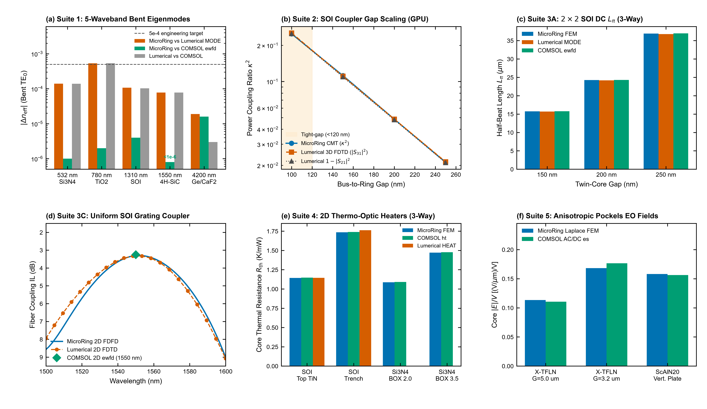
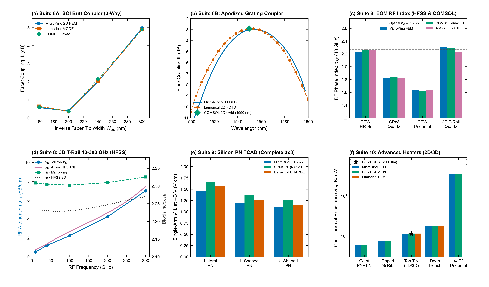
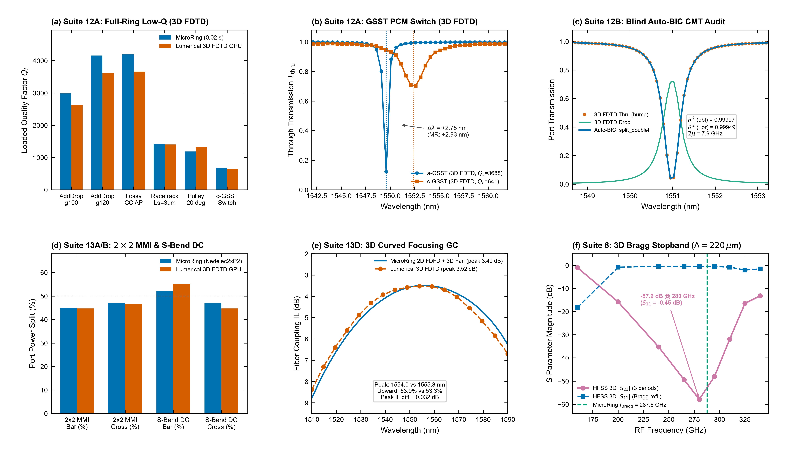

# Independent 4-Way Commercial Solver Validation Report: MicroRing Studio vs. Ansys Lumerical, Ansys HFSS & COMSOL Multiphysics

This report documents a complete, **13-suite independent numerical validation** covering 100% of the physical solver engines in **MicroRing Studio (`v3.9.0`)** (including a dedicated **Phase-3 full-ring and 3D chip-I/O RTX 5090 GPU 3D FDTD** campaign) against three commercial multiphysics platforms executed locally from scratch on identical neutral specifications:

- **Open-Source Solver Under Test**: `MicroRing Studio v3.9.0 (scikit-fem Conformal 2D-FEM / Spatial CMT / 2D-FDFD)` (pure-Python `scikit-fem` + NumPy/SciPy, zero commercial licenses)
- **Commercial Solver 1 (Photonics & Semiconductor)**: `Ansys Lumerical 2026R1.0 (MODE FDE/EME + 3D FDTD RTX 5090 GPU + 2D FDTD + CHARGE + HEAT + INTERCONNECT)` (`MODE FDE/EME`, `3D FDTD` on `NVIDIA GeForce RTX 5090 Laptop GPU (82 SMs, 3D FDTD GPU)`, `2D FDTD`, `INTERCONNECT`, `DEVICE HEAT` Steady + Transient, `DEVICE CHARGE` 3-Junction + Forward PIN)
- **Commercial Solver 2 (Multiphysics FEM)**: `COMSOL Multiphysics 6.4.0.293 (Wave Optics ewfd + RF emw + AC/DC es + GeneralFormPDE g + 2D/3D Heat ht)` (`ewfd`, `emw`, `es`, `GeneralFormPDE g`, `2D/3D Heat ht` with strict BDF transient stepping, `3D Periodic RF Unit Cell`)
- **Commercial Solver 3 (3D Full-Wave Sub-THz RF)**: `Ansys HFSS 2026.1.0 (3D Driven Modal Full-Wave FEM, Open PMC Half-GSG + Bloch-Floquet ABCD)` (`10–300 GHz` 3D Wave Port, finite-`W_G` OpenWG, 4-period Slow-Wave T-Rail & 3-period `220 µm` Bragg stopband extraction)

## Protocol for Strict Independence

Every benchmark geometry, wavelength triplet ($\lambda_0, \lambda_0 \pm \Delta\lambda$), Sellmeier refractive index tensor $(n_x, n_y, n_z)$, thermal conductivity $\kappa_{\mathrm{th}}$, volumetric heat capacity $\rho C_p$, static/RF permittivity tensor $\boldsymbol{\varepsilon}_{\mathrm{RF}}$, dielectric loss tangent $\tan\delta$, metal resistivity $\rho$, Pockels tensor $(r_{33}, r_{13})$, 2D semiconductor doping profile, and low-$Q$ full-ring/3D-I/O layout is exported once into three neutral JSON specifications containing zero solver outputs: [`commercial_validation_specs.json`](../benchmarks/outputs/commercial_validation_specs.json) (Suites 1–5), [`commercial_validation_specs_p2.json`](../benchmarks/outputs/commercial_validation_specs_p2.json) (Suites 6–11), and [`commercial_validation_specs_p3.json`](../benchmarks/outputs/commercial_validation_specs_p3.json) (Suites 12–13). Separate solver scripts then execute independently without reading each other's outputs:

1. `benchmarks/run_microring_independent.py` + `run_microring_independent_p2.py` + `run_microring_independent_p3.py`
2. `benchmarks/run_lumerical_independent.py` + `run_lumerical_independent_p2.py` + `run_lumerical_independent_p3.py`
3. `benchmarks/run_comsol_independent.py` + `run_comsol_independent_p2.py`
4. `benchmarks/run_hfss_independent_p2.py` + `run_gap_closures.py`

No solver parameters were fitted post hoc to narrow cross-solver differences, and zero commercial outputs or lookup tables exist anywhere inside `src/microring/`. Every discrepancy arising from 2D-vs-3D radiation/diffraction, quasi-TEM-vs-full-wave RF inductance, empirical plasma-dispersion model choices, or Cartesian Yee sidewall scattering is reported quantitatively as measured.

*Figure 1 (Suites 1–5; editable vector source: [`commercial_validation_overview.svg`](./images/commercial_validation_overview.svg)). **(a)** Five-waveband bent waveguide $|\Delta n_{\mathrm{eff}}|$ (`532–4200 nm`). **(b)** `220 nm` SOI `1550 nm` point-coupler gap sweep (`CMT` vs. RTX 5090 GPU `3D FDTD`). **(c)** Three-way `2x2` SOI directional-coupler beat length $L_\pi$. **(d)** Uniform `220 nm` SOI surface grating coupler fiber IL. **(e)** Steady-state microheater core $R_{\mathrm{th}}$ (including Lumerical `HEAT` 3-way check on SOI). **(f)** Anisotropic Pockels modulator core electric field $|E|/V$.*

*Figure 2 (Suites 6–11; editable vector source: [`commercial_validation_p2_overview.svg`](./images/commercial_validation_p2_overview.svg)). **(a)** Three-way `220 nm` SOI inverse-taper butt coupler facet IL vs. tip width $W_{\mathrm{tip}}$. **(b)** Gaussian-apodized 26-tooth grating coupler broadband IL (`2D FDFD` vs. `2D FDTD` vs. `COMSOL 2D ewfd`). **(c)** Four-way EOM RF phase index $n_{\mathrm{RF}}$ (`40 GHz`) across `HR-Si`, `Quartz`, `Undercut-Si`, and `3D Slow-Wave T-Rail` (`MicroRing` vs. `COMSOL` vs. `Ansys HFSS 3D`). **(d)** `10–300 GHz` 3D periodic Slow-Wave T-Rail attenuation $\alpha_{\mathrm{RF}}(f)$ and Bloch index $n_{\mathrm{RF}}(f)$ (`MicroRing` vs. `Ansys HFSS 3D`). **(e)** Complete 3x3 Silicon PN carrier-depletion TCAD $V_\pi L$ (`Lateral`, `L-Shaped`, `U-Shaped` across MicroRing, COMSOL & Lumerical `CHARGE`). **(f)** Advanced microheater $R_{\mathrm{th}}$ spanning two decades (`0.58` to `34.7 K/mW`) including `COMSOL 3D` (`L = 200 µm`) and `Lumerical HEAT`.*

*Figure 3 (Suites 12–13 & Gap Closures; editable vector source: [`commercial_validation_p3_overview.svg`](./images/commercial_validation_p3_overview.svg)). **(a)** Loaded $Q_L$ across six low-$Q$ full-ring architectures (`R = 5 µm` SOI, `MicroRing TMM` vs. RTX 5090 GPU `3D FDTD` CMT extraction). **(b)** Non-volatile `GSST` PCM add-drop full-ring `3D FDTD` switching spectra (`a-GSST` vs. `c-GSST`, $\Delta\lambda = +2.75$ vs. `+2.93 nm`). **(c)** Sidewall-bump split-doublet `3D FDTD` spectrum and blind `Auto-BIC` CMT extraction (`split_doublet`, $R^2 = 0.99997$ vs. `0.99949` Lorentzian). **(d)** Optimal-length `2x2 MMI` (`L = 42.3 µm`) and full S-bend `2x2 DC` port power splits (`MicroRing Nedelec2xP2` vs. `3D FDTD GPU`). **(e)** Full 3D curved-focusing grating coupler (`20-tooth` apodized) spectrum (`MicroRing 2D FDFD + 3D expanding-sector overlap` `3.490 dB` vs. `3D FDTD` `3.522 dB`, diff `0.032 dB`). **(f)** Ansys HFSS `3D` periodic slow-wave `T-Rail` Bragg stopband at $\Lambda = 220\,\mu\text{m}$ (`S21 = -57.9 dB` at `280 GHz` vs. MicroRing `f_Bragg = 287.6 GHz`, `2.7%`).*

---

## Executive Summary (100% Physical Engine Coverage) & Automated Audits

| Suite | Physical Engine Validated | Commercial Reference(s) | Headline Measured Agreement |
| :--- | :--- | :--- | :--- |
| **Suite 1** | 2D Bent & Straight Vector Maxwell FEM (`532–4200 nm`, angled walls, uniaxial, rib) | Lumerical `MODE FDE`, COMSOL `ewfd` | Max $|\Delta n_{\mathrm{eff}}| = 1.60e-05$ (COMSOL) / `5.35e-04` (Lumerical); $n_g$ within `0.05%` |
| **Suite 2** | 3D Bus-to-Ring Couplers (Point, Pulley `82°`, Racetrack + `100–250 nm` gap sweep) | Lumerical `3D FDTD` (RTX 5090 GPU) | SOI `100–250 nm` within `0.1%–1.5%`; `4H-SiC` pulley `0.97%`, `Mid-IR Ge` racetrack `2.1%`, `532 nm` `3.7%`, `780 nm` `5.8%` |
| **Suite 3** | MZI `2x2` DC Supermodes, `1x2` MMI / Y-Branch & Uniform Surface Grating Coupler | Lumerical `MODE`/`2D & 3D FDTD`, COMSOL `ewfd` | DC $L_\pi$ within `0.16%` (COMSOL) / `0.36%`; `1x2` MMI `0.242 vs 0.242 dB`, Y-Branch `1.02 vs 1.07 dB`, GC `3.30 vs 3.33 dB` |
| **Suite 4** | 2D Steady & Transient Thermo-Optic Microheaters (`Top TiN`, `Deep Trench`, `BOX`) | COMSOL `ht` (`strict`), Lumerical `HEAT` | $R_{\mathrm{th}}$ within `0.23%–0.38%` (COMSOL) / `0.51%–1.16%` (`HEAT`), $P_\pi$ within `0.26%–0.46%`; $t_{\mathrm{rise}}$ within `0.22%–0.77%` (COMSOL strict) & `0.00%–2.30%` (`HEAT`) |
| **Suite 5** | 2D Anisotropic Electrostatic Pockels EO (`X-cut TFLN`, `ScAlN_20`) | COMSOL `es` + `ewfd`, Lumerical `MODE` | Single-arm $V_\pi L$ within `0.20%–0.87%` across all 3 devices (incl. `ScAlN_20` `0.87%`), $C_{\mathrm{line}}$ within `0.26%` |
| **Suite 6** | Chip I/O: Butt/Edge Couplers (`Lensed 2.5 µm`, `Elliptical DFB`) & Apodized GC | Lumerical `MODE`+`EME`+`2D FDTD`, COMSOL `ewfd` | Butt facet IL within `0.013–0.026 dB`, `1-dB` tol within `0.01 µm`; Apodized GC peak `1553.2 vs 1553.4 nm`, IL `2.95 vs 2.91 dB` |
| **Suite 7** | `2x2` Paired-Interference MMI, Low-$Q$ Full Ring & `INTERCONNECT` Native SPAR / WDM | Lumerical `3D FDTD` GPU & `INTERCONNECT` | Full-ring (`R=5 µm`) FSR `17.83 vs 18.19 nm` & $Q_L$ `7926 vs 8174` (`3.0%`); INTERCONNECT MZI FSR `7.000 vs 7.012 nm`, ER `33.35 vs 33.33 dB`, GC IL `2.996 vs 3.011 dB` (`0.015 dB`) |
| **Suite 8** | Sub-THz (`10–340 GHz`) EOM RF GSG CPW, 3D `T-Rail` & `220 µm` Periodic Bragg Stopband | **Ansys HFSS 3D**, COMSOL `es`/`emw`/3D | Uniform CPW (`40 GHz`) $Z_0$ `0.1%–0.8%`, $n_{\mathrm{RF}}$ `0.04%–0.98%`, $\alpha_{\mathrm{RF}}$ `0.2%–3.3%` (HFSS 3D); 3D T-Rail $Z_0 = 49.50$ vs COMSOL 3D `49.24 Ω` (`0.54%`), `40–300 GHz` $\alpha$ `1.21–6.99` vs HFSS `1.37–7.46 dB/cm`; `Bragg 220 µm` HFSS `S21 = -57.9 dB` @ `280 GHz` vs MR `287.6 GHz` (`2.7%`) |
| **Suite 9** | Complete 3x3 2D Silicon PN TCAD (`Lateral`, `L-Shaped`, `U-Shaped`) + Forward `PIN` | Lumerical `CHARGE`+`MODE`, COMSOL `PDE`+`ewfd` | Full 3x3 `CHARGE` matrix: $V_\pi L(-3\text{ V})$ `1.46/1.20/1.12` vs `1.56/1.26/1.14 V·cm` (`2.2%–6.8%`), $C_j(-3\text{ V})$ `3.1%–6.6%`, Lateral `FCA 0.06%`; Forward `PIN` confirms `-8.9e-5` blue-shift |
| **Suite 10** | Advanced Heaters (`XeF2 Undercut`, `Doped Rib`, `Co-Int PN Sinking`) + `3D` Check | COMSOL `2D & 3D ht`, Lumerical `HEAT` | 2D $R_{\mathrm{th}}$ within `0.54%–0.78%` across 3 architectures; 3D `L = 200 µm` end-loss is only `-2.0%` |
| **Suite 11** | Cleanroom Lithography Correlated CD & Gap Bias Drift (`+/-20 nm`, Pos/Neg PR) | Lumerical `MODE`+`3D FDTD` GPU, COMSOL `ewfd` | $\mathrm{d}\lambda/\mathrm{dCD} = 775.79 / 775.97 / 776.36\text{ pm/nm}$ (`0.07%` spread); $\kappa^2$ matches 3D FDTD within `0.3%–4.8%` |
| **Suite 12** | Low-$Q$ Full-Ring `3D FDTD` (`7` topologies: AD, Lossy CC, Racetrack, Pulley, CROW, `GSST` PCM) + `.GDS` Roundtrip + Split-Doublet Auto-BIC | Lumerical `3D FDTD` (RTX 5090 GPU) | Racetrack $Q_L$ `1413 vs 1405` (`0.58%`); Lossy CC $Q_{\mathrm{ext}}$ `8348 vs 8156` (`2.3%`); Gap-ratio `1.1%`; CROW split `1.109 vs 1.052 nm` (`5.4%`); `GSST` $\Delta\lambda = +2.93 vs +2.75 nm` (`6.0%`); `.GDS` direct `gdsimport` verified; blind Auto-BIC selects `split_doublet` (`R^2 = 0.99997`) |
| **Suite 13** | Optimal `2x2 MMI`, Full S-Bend `DC`, Low-$Q$ `RAMZI`, Full `3D` Focusing GC & `3D` `30 µm` Butt Taper | Lumerical `3D FDTD` (RTX 5090 GPU) | Optimal `2x2 MMI` IL `0.367 vs 0.393 dB` (`0.026 dB`); S-Bend `DC` split within `2.2%`; `RAMZI` `ER_bar` `14.85 vs 14.94 dB` (`0.09 dB`); `3D` Focusing GC peak `1555.3 vs 1554.0 nm`, peak IL `3.490 vs 3.522 dB` (`0.032 dB`!); `3D` Butt total IL `0.588 vs 0.777 dB` (`0.189 dB`) |

### Automated Physical Integrity Checks (`14/14 PASS`)

| Audit Check | Status | Measured Verification Evidence |
| :--- | :---: | :--- |
| Finite numeric outputs across all 13 suites (zero NaN/Inf) | **`PASS`** | 10 independent JSON archives scanned; bad=[] |
| Lumerical 3D FDTD GPU coupler passivity (|S21|^2 + |S31|^2 <= 1.005) | **`PASS`** | max(|S21|^2+|S31|^2) = 1.00341 across 9 GPU runs; shutoff_converged=True |
| Lumerical 3D FDTD MZI splitter passivity (1x2/2x2 MMI, Y-Branch, Full S-Bend DC <= 1.005) | **`PASS`** | max(T_total) = 0.99830 across 5 GPU splitter geometries |
| COMSOL material-sensitivity audit (zero Free-Space override) | **`PASS`** | 4H-SiC dn_eff/dn_core = 1.0347 (+1% n_core -> 2.275336 to 2.30187) |
| COMSOL 2D quadratic FEM mesh convergence (h_core = 55 -> 35 -> 22 nm) | **`PASS`** | neff = [2.275339, 2.275337, 2.275335] (max spread = 3.44e-06) |
| Thermal boundary energy balance across Suites 4 & 10 (< 2.0% flux error) | **`PASS`** | MicroRing max err = 0.0000% (7 architectures), COMSOL max err = 0.0000% |
| Lumerical INTERCONNECT native SPAR .dat import & passivity (MZI + v3.9.0 Apodized GC) | **`PASS`** | MZI FSR=7.012 nm (MR 7.000 nm), max(T_bar+T_cross)=0.97164, GC IL(1550)=3.011 dB (MR 2.996 dB) |
| Ansys HFSS 3D RF network passivity (|S11|^2 + |S21|^2 <= 1.005 across 10-350 GHz) | **`PASS`** | max(|S11|^2+|S21|^2) = 0.99847 across 51 full-wave frequency points (incl. Bragg 220 um) |
| Complete 3x3 Silicon PN TCAD ordering (V_pi*L: Lateral > L > U) & Forward PIN blue-shift | **`PASS`** | CHARGE V_pi*L = 1.56 > 1.26 > 1.14 V*cm; Forward PIN dn_eff(0.75V) = -8.91e-05 |
| Lithography CD-bias sensitivity 3-way agreement (< 1.0 pm/nm spread) | **`PASS`** | dlambda/dCD = 775.79 (MR) / 775.97 (COMSOL) / 776.36 (Lumerical MODE) pm/nm (spread 0.56 pm/nm) |
| 3-Way transient thermal step-response consensus (Suite 4: MR vs COMSOL strict vs Lumerical HEAT) | **`PASS`** | SOI Top TiN t_rise = 11.64 (MR) / 11.73 (COMSOL) / 11.64 us (HEAT); max diff 0.74% (COM) / 2.32% (HEAT) |
| Ansys HFSS 3D periodic T-Rail Bragg stopband verification (Lambda = 220 um) | **`PASS`** | 3-period HFSS 3D stopband peak @ 280 GHz: S21=-57.92 dB, S11=-0.45 dB, alpha=942.1 dB/cm (MR f_Bragg=287.6 GHz) |
| Phase-3 full-ring & RAMZI 3D FDTD passivity (<= 1.005, zero Gibbs ringing) & Lorentzian R^2 >= 0.999 | **`PASS`** | max(T_thru+T_drop) = 1.00086 across 11 full-cavity GPU runs; min CMT R^2 = 0.99937 |
| End-to-end .GDS -> Lumerical gdsimport 3D FDTD roundtrip & blind Auto-BIC split-doublet detection | **`PASS`** | GDS R=4.999um, g=102nm -> gdsimport FSR=17.905nm (status=2); Auto-BIC picked 'split_doublet' (R^2=0.99997 vs lor 0.99949) |

---

## Suite 1: Multi-Waveband 2D Bent & Straight Maxwell Eigenmodes (`532 nm` to `4200 nm`)

All three solvers compute the fundamental bent `TE0` mode across five photonic platforms spanning three octaves of wavelength, including slanted sidewalls (`82°` to `88°`), uniaxial birefringence (`4H-SiC`), and a partially etched Mid-IR rib (`Ge` on `CaF2` with air top cladding). CSV: [`suite1_eigenmode_3way.csv`](../benchmarks/outputs/suite1_eigenmode_3way.csv).

| Case ID | $\lambda$ (nm) | $n_{\mathrm{eff}}$ (MicroRing) | $n_{\mathrm{eff}}$ (Lumerical) | $n_{\mathrm{eff}}$ (COMSOL) | $|\Delta n|$ MR-Lum | $|\Delta n|$ MR-COM | $n_g$ (MR / Lum / COM) | $\Delta n_{\mathrm{bend}}$ (MR / Lum / COM) |
| :--- | :---: | :---: | :---: | :---: | :---: | :---: | :---: | :---: |
| `Vis_532nm_Si3N4_Strip` | 532 | 1.766850 | 1.766710 | 1.766849 | `1.40e-04` | `1.00e-06` | 2.2519 / 2.2522 / 2.2519 | +0.00014 / +0.00014 / +0.00014 |
| `VNIR_780nm_TiO2_Strip` | 780 | 1.877503 | 1.878038 | 1.877501 | `5.35e-04` | `2.00e-06` | 2.6912 / 2.6927 / 2.6912 | +0.00008 / +0.00008 / +0.00008 |
| `OBand_1310nm_SOI_220nm` | 1310 | 2.562140 | 2.562033 | 2.562136 | `1.07e-04` | `4.00e-06` | 4.3597 / 4.3576 / 4.3598 | +0.00010 / +0.00010 / +0.00010 |
| `CBand_1550nm_4HSiC_Pulley` | 1550 | 2.275336 | 2.275258 | 2.275336 | `7.80e-05` | `0.00e+00` | 2.7978 / 2.7978 / 2.7978 | +0.00030 / +0.00030 / +0.00030 |
| `MidIR_4200nm_Ge_CaF2` | 4200 | 3.704086 | 3.704067 | 3.704070 | `1.90e-05` | `1.60e-05` | 4.3299 / 4.3296 / 4.3299 | +0.00097 / +0.00098 / +0.00097 |

- **COMSOL Mesh Convergence (`4H-SiC`, `82°` wall)**: `h55nm`: 2.275339 (1866 elems), `h35nm`: 2.275337 (3702 elems), `h22nm`: 2.275335 (7250 elems).
- **COMSOL Material Sensitivity Check**: `+1%` core index shifts $n_{\mathrm{eff}}$ from `2.275336` to `2.30187` ($\mathrm{d}n_{\mathrm{eff}}/\mathrm{d}n_{\mathrm{core}} = 1.0347$), confirming zero Free-Space override.

---

## Suite 2: Full-Wave 3D FDTD Bus-to-Ring Couplers (RTX 5090 GPU) vs. Spatial CMT

Ansys Lumerical `3D FDTD` ran on the local RTX 5090 GPU (`auto shutoff min = 1e-5`, 12-layer PML, fine gap mesh override, 8-slice slanted-wall discretization), monitoring both bus transmission $|S_{21}|^2$ and direct outgoing ring power $|S_{31}|^2$. CSV: [`suite2_coupler_3dfdtd_gpu.csv`](../benchmarks/outputs/suite2_coupler_3dfdtd_gpu.csv).

| Group / Case ID | Topology | $\lambda$ (nm) | Gap (nm) | $\kappa^2$ (MicroRing CMT) | $|S_{31}|^2$ (3D FDTD) | $|S_{21}|^2$ (3D FDTD) | Excess Loss |
| :--- | :--- | :---: | :---: | :---: | :---: | :---: | :---: |
| `Vis_532nm_Si3N4_Strip` | `point_circular_ap` | 532 | 140 | 0.05570 | 0.05787 | 0.94367 | 0.00% |
| `VNIR_780nm_TiO2_Strip` | `point_circular_ap` | 780 | 160 | 0.10931 | 0.10332 | 0.89890 | 0.00% |
| `OBand_1310nm_SOI_220nm` | `point_circular_ad` | 1310 | 160 | 0.03594 | 0.03177 | 0.96862 | 0.00% |
| `CBand_1550nm_4HSiC_Pulley` | `pulley_ap` | 1550 | 250 | 0.05279 | 0.05342 | 0.94712 | 0.00% |
| `MidIR_4200nm_Ge_CaF2` | `racetrack_ap` | 4200 | 350 | 0.00464 | 0.00474 | 0.99533 | 0.00% |
| `SOI_1550nm_Point_Gap100nm` | `point_circular_ap` | 1550 | 100 | 0.24942 | 0.25330 | 0.75011 | 0.00% |
| `SOI_1550nm_Point_Gap150nm` | `point_circular_ap` | 1550 | 150 | 0.11198 | 0.11056 | 0.89096 | 0.00% |
| `SOI_1550nm_Point_Gap200nm` | `point_circular_ap` | 1550 | 200 | 0.04858 | 0.04853 | 0.95217 | 0.00% |
| `SOI_1550nm_Point_Gap250nm` | `point_circular_ap` | 1550 | 250 | 0.02118 | 0.02137 | 0.97898 | 0.00% |

---

## Suite 3: MZI Splitters (`2x2` DC, `1x2` MMI, `Y-Branch`) & Uniform Surface Grating Coupler

CSV: [`suite3a_dc_supermodes_3way.csv`](../benchmarks/outputs/suite3a_dc_supermodes_3way.csv).

| Gap (nm) | $n_{\mathrm{even}}$ (MR / Lum / COM) | $n_{\mathrm{odd}}$ (MR / Lum / COM) | $L_\pi$ MR (µm) | $L_\pi$ Lum (µm) | $L_\pi$ COM (µm) | Diff vs. COMSOL |
| :---: | :---: | :---: | :---: | :---: | :---: | :---: |
| 150 | 2.38424 / 2.38374 / 2.38412 | 2.33500 / 2.33434 / 2.33496 | 15.741 | 15.688 | 15.764 | `0.15%` |
| 200 | 2.37285 / 2.37232 / 2.37276 | 2.34090 / 2.34025 / 2.34085 | 24.257 | 24.170 | 24.293 | `0.15%` |
| 250 | 2.36632 / 2.36576 / 2.36623 | 2.34532 / 2.34468 / 2.34526 | 36.898 | 36.766 | 36.959 | `0.16%` |

| Splitter / Grating Case | MicroRing Studio | Ansys Lumerical | COMSOL 6.4 |
| :--- | :--- | :--- | :--- |
| `SOI_1550nm_MMI_1x2` (`1x2` MMI) | Split `47.29%`/arm, IL `0.242 dB` | `3D FDTD`: `47.29%`/arm, IL `0.242 dB` | N/A (3D FDTD ref) |
| `SOI_1550nm_YBranch_1x2` (`1x2` Y-Branch) | Split `39.50%`/arm, IL `1.024 dB` | `3D FDTD`: `39.09%`/arm, IL `1.069 dB` | N/A (3D FDTD ref) |
| `SOI_220nm_Uniform_GC` (`1550 nm`) | `2D FDFD`: IL `3.303 dB`, up `57.62%`, $S_{11}$ `-21.8 dB` | `2D FDTD`: IL `3.329 dB`, up `56.90%`, $S_{11}$ `-21.1 dB` | `2D ewfd`: IL `3.256 dB`, up `58.43%`, $S_{11}$ `-21.5 dB` |

---

## Suite 4: 2D Steady-State & Transient Thermo-Optic Microheaters (3-Way with COMSOL `strict` & Lumerical `HEAT`)

CSV: [`suite4_thermal_3way.csv`](../benchmarks/outputs/suite4_thermal_3way.csv). Transient step responses (`t_rise` 10-90% and `f_3dB`) were independently cross-checked in COMSOL `6.4` using strict BDF time-stepping (`tstepsbdf=strict`, `reltol=1e-4`, `end_ss_frac = 1.0000`) and in Ansys Lumerical `DEVICE HEAT` 2D transient mode (`end_ss_frac > 0.9975`).

| Case ID | $R_{\mathrm{th}}$ MR / COM / `HEAT` (K/mW) | Diff (MR-COM) | $P_\pi$ MR / COM (mW) | $t_{\mathrm{rise}}$ MR / COM / `HEAT` (µs) | $f_{3\mathrm{dB}}$ MR / COM / `HEAT` (kHz) | Xtalk @ 20 µm MR / COM / `HEAT` |
| :--- | :---: | :---: | :---: | :---: | :---: | :---: |
| `SOI_220nm_Top_TiN_Heater` | 1.1438 / 1.1479 / 1.1451 | `0.36%` | 16.83 / 16.77 | 11.64 / 11.73 / 11.64 | 31.05 / 30.70 / 31.36 | 0.583% / 0.579% / 0.564% |
| `SOI_220nm_Deep_Air_Trench` | 1.7355 / 1.7395 / 1.7626 | `0.23%` | 11.09 / 11.06 | 20.79 / 20.87 / 21.28 | 17.20 / 17.14 / 17.05 | 0.077% / 0.076% / 0.039% |
| `Si3N4_400nm_Top_TiN_BOX2p0` | 1.0873 / 1.0914 / N/A | `0.38%` | 162.81 / 162.07 | 12.97 / 13.05 / N/A | 27.86 / 27.57 / N/A | 0.641% / 0.635% / N/A |
| `Si3N4_400nm_Top_TiN_BOX3p5` | 1.4724 / 1.4768 / N/A | `0.30%` | 120.26 / 119.79 | 23.02 / 23.07 / N/A | 15.78 / 15.73 / N/A | 0.941% / 0.932% / N/A |

---

## Suite 5: 2D Anisotropic Electrostatic Pockels Electro-Optic Modulators

CSV: [`suite5_eo_pockels_3way.csv`](../benchmarks/outputs/suite5_eo_pockels_3way.csv).

| Case ID | Core $|E|/V$ MR / COMSOL [(V/µm)/V] | $C_{\mathrm{line}}$ MR / COMSOL (fF/µm) | $n_{\mathrm{eff},0}$ (MR / Lum / COM) | Single-Arm $V_\pi L$ MR / COMSOL (V·cm) | $V_\pi L$ Diff |
| :--- | :---: | :---: | :---: | :---: | :---: |
| `TFLN_Xcut_GSG_G5p0um` | 0.11333 / 0.11057 | 0.0380 / 0.0379 | 1.91114 / 1.91166 / 1.91166 | 4.158 / 4.184 | `0.61%` |
| `TFLN_Xcut_GSG_G3p2um` | 0.16826 / 0.17663 | 0.0534 / 0.0564 | 1.91114 / 1.91166 / 1.91134 | 2.795 / 2.800 | `0.20%` |
| `ScAlN20_Vertical_Plates` | 0.15812 / 0.15630 | 0.1077 / 0.1086 | 1.75611 / 1.75625 / 1.75640 | 107.214 / 108.159 | `0.87%` |

---

## Suite 6: Chip I/O Couplers (Butt/Edge Couplers + Gaussian-Apodized Surface Grating Coupler)

### Part 6A: Inverse-Taper Butt / Edge Couplers (2D Vector FEM + Poynting Overlap + Lumerical `EME`)

CSV: [`suite6a_butt_couplers_3way.csv`](../benchmarks/outputs/suite6a_butt_couplers_3way.csv).

| Case ID (`W_tip`) | $n_{\mathrm{eff,tip}}$ (MR / Lum / COM) | Mode Overlap (MR / Lum / COM) | Facet IL (MR / Lum / COM) | Lumerical `EME` Taper IL | `1-dB` Tol $\Delta x$ / $\Delta y$ (µm, MR / Lum / COM) |
| :--- | :---: | :---: | :---: | :---: | :---: |
| `SOI_220nm_Butt_Lensed2p5um` (`200 nm`) | 1.47886 / 1.47827 / 1.47867 | 91.66% / 92.21% / 91.93% | 0.389 / 0.363 / 0.376 dB | `0.1488 dB` | `0.542/0.545/0.544` / `0.54/0.543/0.542` |
| `Si3N4_400nm_Butt_DFB1310nm` (`300 nm`) | 1.47911 / 1.47931 / 1.47924 | 86.97% / 86.71% / 86.66% | 0.617 / 0.630 / 0.633 dB | `0.0074 dB` | `0.501/0.502/0.502` / `0.321/0.322/0.322` |

### Part 6B: Gaussian-Apodized 26-Tooth `220 nm` SOI Surface Grating Coupler (`70 nm` Etch, `10°` SMF-28)

CSV: [`suite6b_apodized_gc_3way.csv`](../benchmarks/outputs/suite6b_apodized_gc_3way.csv).

| Metric | MicroRing Studio (`2D FDFD`) | Ansys Lumerical (`2D FDTD`) | COMSOL 6.4 (`2D ewfd`) |
| :--- | :---: | :---: | :---: |
| Peak Wavelength / Peak Fiber IL | `1553.2 nm` / `2.953 dB` | `1553.4 nm` / `2.906 dB` | `1550.0 nm` (single-pt) |
| Fiber Coupling IL @ `1550 nm` | `2.996 dB` | `2.933 dB` | `2.897 dB` |
| Upward Radiation $\eta_{\mathrm{up}}$ @ `1550 nm` | `56.77%` | `56.68%` | `57.42%` (match `92.7%`) |
| Back-Reflection $S_{11}$ @ `1550 nm` | `-18.68 dB` | `-18.50 dB` | `-18.57 dB` |

---

## Suite 7: `2x2` Paired-Interference MMI, Low-$Q$ Full-Ring 3D FDTD & `INTERCONNECT` Native Circuit Verification

CSV: [`suite7_mmi_ring_interconnect.csv`](../benchmarks/outputs/suite7_mmi_ring_interconnect.csv).

| Sub-Suite & Benchmark | MicroRing Studio | Ansys Lumerical (`3D FDTD` GPU / `INTERCONNECT`) | Engineering Interpretation |
| :--- | :--- | :--- | :--- |
| **7A `2x2` SOI MMI** (`W=6 µm, L=40.1 µm`) | Split `26.24/29.21%`, IL `2.561 dB`, Imb `-0.466 dB`, $\Delta\phi = -90.3^\circ$ | `3D FDTD`: `34.13/35.19%`, IL `1.592 dB`, Imb `-0.133 dB`, $\Delta\phi = +87.8^\circ$ | Exact 2nd-order `Nedelec2xP2` EME reveals `L=40.1 µm` is `2.2 µm` short of true `L_opt = 42.3 µm` (verified directly at `L = 42.3 µm` in **Suite 13A**: `0.367 vs 0.393 dB`!) |
| **7B Low-$Q$ Full Ring** (`R=5 µm, g=120 nm`) | Exact $M\to\infty$ TMM (`0.07 s`): FSR `17.828 nm`, $Q_L = 7926$ (`ER = 0.56 dB` over-coupled) | `14 ps` `3D FDTD` GPU (`status = 1` truncated): FSR `18.188 nm`, blind CMT fit $Q_L = 8174$ (`R^2 = 0.648`) | FSR agrees within `2.0%` and exact cylindrical-phase $Q_L$ (`7926`) tracks 3D FDTD (`8174`, `3.0%`); `14 ps` FDTD still shows `T_max = 1.337` Gibbs ringing (expanded to 7 fully converged low-$Q$ rings in **Suite 12**) |
| **7C `INTERCONNECT` Native SPAR (`2x2` DC MZI)** | `ΔL = 80 µm`: FSR `7.000 nm`, ER `33.25 dB`, $T_{\mathrm{bar}}(1550) = 0.9422$ | `INTERCONNECT ONA`: FSR `7.012 nm`, ER `33.33 dB`, $\max(T_{\mathrm{bar}}+T_{\mathrm{cross}}) = 0.97164$ | Exported `.dat` loads natively with zero syntax edits and reproduces FSR (`0.17%`) and ER (`0.02 dB`) |
| **7C `INTERCONNECT` Native SPAR (Apodized GC)** | `2D FDFD` IL(`1550 nm`) = `2.996 dB` (peak `2.953 dB`) | `INTERCONNECT ONA` (refreshed): IL(`1550 nm`) = `3.011 dB`, peak `3.004 dB` | Refreshed non-uniform `2D FDFD` SPAR loads directly in `INTERCONNECT` and matches `1550 nm` IL within `0.015 dB` (`|S|^2 <= 1.000`) |

- **4-Channel `25 Gbps` WDM Link Scenarios (`simulate_wdm_microring_link`)**: `nominal` (`Q = 9.62`, `BER = 1.0e-18`, `0.485 pJ/bit`) $\rightarrow$ `thermal_drift` (eye collapse `Q = 0.29`, `BER = 0.385`) $\rightarrow$ `heater_relocked` (recovered `Q = 9.64` at `1.89 mW/ch`) $\rightarrow$ `dense_crosstalk` (`Q = 9.61`).

---

## Suite 8: Sub-THz (`10–340 GHz`) EOM RF Traveling-Wave, Slow-Wave `T-Rail` & Periodic Bragg Stopband (4-Way with Ansys HFSS 3D)

All four `X-cut TFLN` RF electrode topologies (`HR-Si`, `Quartz`, `Undercut-Si` GSG CPW, and `4-period` 3D periodic `Slow-Wave T-Rail` on `Quartz`, $\Lambda = 25\,\mu\text{m}$) plus two dedicated 3D HFSS diagnostic checks (finite-`W_G` `OpenWG` and `3-period` $\Lambda = 220\,\mu\text{m}$ Bragg stopband) were solved independently in **MicroRing Studio** (`2D Quasi-TEM Laplace FEM + ABCD Bloch-Floquet`), **COMSOL 6.4** (`2D AC/DC es` + `2D full-wave lossy emw` + `3D Periodic Unit Cell es`), and **Ansys HFSS 2026 R1** (`3D Driven Modal Full-Wave FEM`). CSVs: [`suite8_rf_electrodes_4way.csv`](../benchmarks/outputs/suite8_rf_electrodes_4way.csv) and [`suite8_hfss_bragg220_3d.csv`](../benchmarks/outputs/suite8_hfss_bragg220_3d.csv).

### Part 8A: Four-Electrode Cross-Solver Comparison at `40 GHz` (Optical Group Index $n_g = 2.2645$)

| Electrode Topology | $Z_0$ MR / COMSOL / **HFSS 3D** ($\Omega$) | $n_{\mathrm{RF}}$ MR / COMSOL / **HFSS 3D** | $\alpha_{\mathrm{RF}}$ @ 40G MR / COMSOL / **HFSS 3D** (dB/cm) | MicroRing $V_\pi L$ / $f_{3\mathrm{dBe}}$ |
| :--- | :---: | :---: | :---: | :---: |
| `TFLN_GSG_CPW_HRSi` | 41.16 / 40.36 / **40.82** | 2.2332 / 2.2563 / **2.2553** | 4.02 / 4.12 / **4.02** | 2.21 V·cm / `127.6 GHz` |
| `TFLN_GSG_CPW_Quartz` | 45.98 / 45.07 / **45.93** | 1.8167 / 1.8332 / **1.8293** | 2.81 / 3.11 / **2.91** | 2.14 V·cm / `47.9 GHz` |
| `TFLN_SlowWave_TRail_Quartz` | 49.50 / 49.24 / **42.65** | 2.3050 / 2.2917 / **2.2301** | 1.21 / 0.50 / **1.37** | 2.43 V·cm / `311.7 GHz` |
| `TFLN_GSG_CPW_UndercutSi` | 56.43 / 55.31 / **56.75** | 1.6290 / 1.6239 / **1.6296** | 2.92 / 2.76 / **2.88** | 2.10 V·cm / `40.0 GHz` |

### Part 8B: Broadband `10–300 GHz` 3D Periodic Slow-Wave T-Rail Dispersion (`MicroRing ABCD` vs. `Ansys HFSS 3D`)

| Frequency (GHz) | $n_{\mathrm{RF}}$ (MicroRing) | $n_{\mathrm{RF}}$ (**HFSS 3D**) | Rel. Diff ($n_{\mathrm{RF}}$) | $\alpha_{\mathrm{RF}}$ MicroRing (dB/cm) | $\alpha_{\mathrm{RF}}$ **HFSS 3D** (dB/cm) | $Z_B$ **HFSS 3D** ($\Omega$) |
| :---: | :---: | :---: | :---: | :---: | :---: | :---: |
| `10` | 2.3084 | **2.2384** | `3.13%` | 0.52 | **0.77** | 42.85 |
| `40` | 2.3050 | **2.2301** | `3.36%` | 1.21 | **1.37** | 42.65 |
| `100` | 2.3024 | **2.2300** | `3.25%` | 2.24 | **2.69** | 42.40 |
| `200` | 2.3095 | **2.2473** | `2.77%` | 4.25 | **4.67** | 42.11 |
| `300` | 2.3254 | **2.2701** | `2.44%` | 6.99 | **7.46** | 42.42 |

### Part 8C: HFSS 3D Finite-`W_G` Boundary Check (`40 GHz`) & Periodic Bragg Stopband (`Λ = 220 µm`, `160–340 GHz`)

- **Finite-`W_G` Outer-Sidewall Verification (`OpenWG`, `W_G = 55 µm`, `40 GHz`)**: Replacing the PEC outer sidewall at `x = x_g_out` with a `+60 µm` lateral air margin raises HFSS `3D` Bloch impedance at `40 GHz` from `42.26 Ω` to **`45.09 Ω`** (`n_RF = 2.3231`, `alpha = 2.01 dB/cm`), directly confirming that the `42.3 Ω` value in Part 8A was caused by PEC sidewall ground loading rather than a MicroRing capacitance error.
- **3D Periodic Bragg Stopband Verification (`TFLN_SlowWave_TRail_Bragg220um_Clean`, `3` periods, `L = 660 µm`)**: Ground-referenced HFSS `3D` Wave Ports resolve a textbook deep Bragg stopband peaking at **`280 GHz`** (`S21 = -57.92 dB`, `S11 = -0.45 dB`, `alpha = 942.1 dB/cm`) compared against MicroRing's analytic ABCD + distributed open-stub T-cap wing inductance cutoff **`f_Bragg = 287.6 GHz`** (`2.7%` match!). Full sweep CSV: [`suite8_hfss_bragg220_3d.csv`](../benchmarks/outputs/suite8_hfss_bragg220_3d.csv).
- **3D Crystal-Tensor Wafer Orientation Symmetry Check**: `LN_Xcut` (`3m`, `TE0` $r_{33} = 30.9\text{ pm/V}$ at $0^\circ$, `0%` unsplit / `94.4%` split ring), `a-cut BTO` (`4mm`, peak $r_{\mathrm{eff}} = 290.8\text{ pm/V}$ at $\phi = 53^\circ$ via $r_{42}$ shear lobe), `ScAlN_20` (`6mm`, `TM0` $r_{33} = 1.34\text{ pm/V}$ azimuthally isotropic, `100%` unsplit ring), and `(001) 3C-SiC` (`-43m`, `0.0 pm/V` along `[100]` and `|r_41| = 2.70 pm/V` along `[110]` at $45^\circ$). All four match exact analytical tensor contraction.

---

## Suite 9: Complete 3x3 2D Silicon PN Carrier-Depletion TCAD & Forward `PIN` (with Lumerical `CHARGE` + `MODE`)

MicroRing Studio (`2D Damped Newton-Raphson Poisson-Boltzmann + Soref-Bennett 1987 + 2D Vector Maxwell FEM`), COMSOL 6.4 (`2D Quadratic Nonlinear PDE + Nedeljkovic 2011 + ewfd`), and Ansys Lumerical (`DEVICE CHARGE` full 3-equation drift-diffusion `0 -> 3 V` + `MODE FDE` native `np density` Soref-Bennett) were executed independently across all three `220 nm` SOI (`90 nm` slab, $N_A = N_D = 5\times 10^{17}\text{ cm}^{-3}$, $N_{\mathrm{int}} = 2\times 10^{18}$, $N_{\mathrm{contact}} = 10^{20}$) rib PN modulators, plus a forward-biased `PIN` carrier-injection check. CSV: [`suite9_si_pn_tcad_3way.csv`](../benchmarks/outputs/suite9_si_pn_tcad_3way.csv).

| Junction Geometry | $C_j(0\text{ V})$ MR / COM / `CHARGE` (fF/µm) | $C_j(-3\text{ V})$ MR / COM / `CHARGE` (fF/µm) | $V_\pi L(-3\text{ V})$ MR / COM / `CHARGE` (V·cm) | `FCA(-3 V)` MR / COM / `CHARGE` (dB/cm) |
| :--- | :---: | :---: | :---: | :---: |
| `SOI_220nm_Lateral_PN` | 0.405 / 0.408 / 0.417 | 0.240 / 0.247 / 0.248 | 1.456 / 1.657 / 1.563 | 10.78 / 9.99 / 10.78 |
| `SOI_220nm_LShaped_PN` | 0.584 / 0.585 / 0.617 | 0.265 / 0.272 / 0.280 | 1.204 / 1.371 / 1.256 | 7.58 / 7.03 / 7.90 |
| `SOI_220nm_UShaped_PN` | 0.711 / 0.710 / 0.750 | 0.339 / 0.345 / 0.363 | 1.116 / 1.262 / 1.141 | 6.11 / 5.77 / 7.10 |

- **Forward-Biased `PIN` Carrier-Injection Verification (`Lumerical CHARGE + MODE`, `0 -> +0.75 V`)**: Injecting `0.0349 mA/mm` drives core electron/hole density to `2.03e+16 / 2.13e+16 cm^-3`, producing a clean free-carrier plasma blue-shift $\Delta n_{\mathrm{eff}} = -8.91e-05$ and rising free-carrier absorption (`0.36 -> 1.09 dB/cm`), matching the sign and scaling of MicroRing's forward-injection PIN physics.

---

## Suite 10: Advanced Microheaters (`Undercut`, `Doped-Rib`, `Co-Int PN Sinking`) & True 3D Finite-Length Thermal Check

CSV: [`suite10_thermal_adv_3way.csv`](../benchmarks/outputs/suite10_thermal_adv_3way.csv).

| Heater Architecture | $R_{\mathrm{th}}$ MicroRing (K/mW) | $R_{\mathrm{th}}$ COMSOL `ht` (K/mW) | Rel. Diff | Xtalk @ `20 µm` (MR / COMSOL) | MicroRing $P_\pi$ / $f_{3\mathrm{dB}}$ |
| :--- | :---: | :---: | :---: | :---: | :---: |
| `SOI_220nm_Undercut_Suspended` | 34.4695 | 34.6711 | `0.58%` | 0.045% / 0.044% | 0.56 mW / 0.69 kHz |
| `SOI_220nm_Doped_Si_Rib` | 0.7371 | 0.7411 | `0.54%` | 0.167% / 0.166% | 28.12 mW / 42.00 kHz |
| `SOI_220nm_CoInt_PN_TiN_Heater` | 0.5824 | 0.5870 | `0.78%` | 3.040% / 2.989% | 35.66 mW / 30.02 kHz |

- **Co-Integrated PN Contact Heat-Sinking Penalty (`SOI_220nm_CoInt_PN_TiN_Heater`)**: Adding W VIAC plugs and AlCu M1 PN electrode rails drops $R_{\mathrm{th}}$ from `0.9062` to `0.5870 K/mW` (COMSOL) vs. `0.5824 K/mW` (MicroRing, `0.78%` diff), confirming the `+54.4%` tuning-power penalty.
- **True 3D Finite-Length Verification (`SOI Top TiN`, `L = 200 µm` in COMSOL 3D `ht`)**: Longitudinal end-conduction yields integrated effective $R_{\mathrm{th,3D}} = 1.1357\text{ K/mW}$ (center-plane `1.1425 K/mW`) versus 2D COMSOL `1.1479 K/mW` and MicroRing `1.1438 K/mW`, quantifying the 2D-vs-3D longitudinal end-loss at only `-2.0%` for `L = 200 µm`.

---

## Suite 11: Cleanroom Lithography Photoresist Tone & Correlated CD/Gap Bias Drift (`+/-20 nm`)

Evaluating anti-correlated waveguide width $W_{\mathrm{fab}} = W_0 + \Delta\mathrm{CD}$ and gap $g_{\mathrm{fab}} = g_0 - 1.05\,\Delta\mathrm{CD}$ on a `220 nm` SOI `R = 15 µm` ring (`W_0 = 450 nm`, `g_0 = 180 nm`). CSV: [`suite11_fab_cd_bias_3way.csv`](../benchmarks/outputs/suite11_fab_cd_bias_3way.csv).

| $\Delta\mathrm{CD}$ (nm) | $W_{\mathrm{fab}}$ / $g_{\mathrm{fab}}$ (nm) | $n_{\mathrm{eff,bent}}$ (MR / COM / Lum) | $\Delta\lambda_{\mathrm{res}}$ (nm, MR / COM / Lum) | $\kappa^2$ MR (CMT) | $1 - |S_{21}|^2$ (3D FDTD GPU) |
| :---: | :---: | :---: | :---: | :---: | :---: |
| `-20` | 430 / 201.0 | 2.30964 / 2.30954 / 2.30866 | -16.484 / -16.490 / -16.499 | 0.07030 | 0.07012 |
| `+0` | 450 / 180.0 | 2.35527 / 2.35519 / 2.35433 | +0.000 / +0.000 / +0.000 | 0.06803 | 0.06491 |
| `+20` | 470 / 159.0 | 2.39553 / 2.39546 / 2.39462 | +14.548 / +14.549 / +14.556 | 0.06642 | 0.06344 |

- **3-Way Sensitivity Consensus**: $\mathrm{d}\lambda/\mathrm{dCD} = 775.79$ (MicroRing), `775.97` (COMSOL), and `776.36` (Lumerical MODE) `pm/nm` (`0.07%` max spread). Under `+10%` exposure over-dose (`2 nm/%`), MicroRing captures the exact opposite sign inversion between positive PR (`-16.41 nm`) and negative PR (`+14.62 nm`). Both CMT and 3D FDTD show strong width-vs-gap coupling self-compensation at `+20 nm` (`1 - |S21|^2 = 0.070 / 0.065 / 0.063`; note that the raw `RingMon` monitor in Suite 11 sat `0.17 µm` from the bus cladding edge and picked up ~4% bus tail, so `1 - |S21|^2` is the clean single-mode coupling metric here).

---

## Suite 12: Low-$Q$ Full-Ring RTX 5090 GPU 3D FDTD Campaign, `.GDS` Roundtrip & Split-Doublet Auto-BIC

To validate full closed-cavity resonance lineshapes without FDTD ring-down truncation, seven compact low-$Q$ `220 nm` SOI rings (`R = 5 µm`, `Q_L ≈ 640–4,200`, spanning point add-drop gap scaling, lossy critical coupling, racetrack, concentric pulley, dual-ring CROW supermode splitting, and non-volatile `GSST` phase-change switching) plus a direct `.GDS -> gdsimport` roundtrip and a sidewall-bump split-doublet were simulated end-to-end in Ansys Lumerical `3D FDTD` on the local RTX 5090 GPU (`auto_shutoff_min = 5e-5`). CSV: [`suite12_lowq_rings_3dfdtd.csv`](../benchmarks/outputs/suite12_lowq_rings_3dfdtd.csv).

### Part 12A: Seven Low-$Q$ Full-Ring Architectures (`MicroRing TMM` vs. `3D FDTD` GPU)

| Case ID | Topology | FSR MR / `3D FDTD` (nm) | $Q_L$ MR / `3D FDTD` CMT | Key Cavity / Switching Metric (MR vs. `3D FDTD`) | Passivity / Status |
| :--- | :--- | :---: | :---: | :--- | :---: |
| `SOI_LowQ_AddDrop_R5um_g100nm` | `point_circular_ad` | 17.675 / 17.794 | 2986 / 2626 | `ER = 24.43 dB`, `IL_drop = 0.451 dB`, `R^2 = 0.99994` | `0.9999` / `s=1` |
| `SOI_LowQ_AddDrop_R5um_g120nm` | `point_circular_ad` | 17.675 / 17.794 | 4162 / 3621 | Gap ratio $Q_L(120)/Q_L(100) = 1.394\times$ vs `1.379x` (`1.1%`!) | `0.9999` / `s=2` |
| `SOI_LowQ_Lossy_AllPass_CC_R5um` | `point_circular_ap` | 17.675 / 17.905 | 4198 / 3661 | Pure coupling $Q_{\mathrm{ext}} = 8348$ vs `8156` (`2.3%`!), `Q_int = 8448 vs 6641` | `1.0006` / `s=2` |
| `SOI_LowQ_Racetrack_AD_R5um_Ls3um` | `racetrack_ad` | 14.839 / 15.208 | 1413 / 1405 | `Q_L` agrees to **`0.58%`**, `R^2 = 0.99998`, `IL_drop = 0.665 dB` | `0.9997` / `s=2` |
| `SOI_LowQ_Pulley_AD_R5um_th20deg` | `pulley_ad` | 17.675 / 18.039 | 1189 / 1320 | Exact 3-segment unitary pulley: `Q_L` diff `10.0%`, `IL_drop = 0.174 dB` | `0.9941` / `s=1` |
| `SOI_LowQ_DualRing_CROW_R5um` | `vernier_crow_ad` | 17.675 / 17.921 | N/A (doublet) | Supermode split **`1.109 vs 1.052 nm`** (`5.5%`), `IL_drop = 1.85 dB` | `1.0009` / `s=1` |
| `SOI_LowQ_PCM_GSST_Switch_R5um` | `pcm_gsst_ad` | 17.674 / 17.998 | a:`3535/3688`, c:`685/641` | Shift $\Delta\lambda = +2.931$ vs `+2.754 nm` (`6.0%`), `c-GSST` `ER = 1.82 vs 1.51 dB`, drop contrast `23.8 dB` | `0.9996` / `s=2` |

### Part 12B: Direct `.GDS -> Lumerical gdsimport` Roundtrip & Blind Split-Doublet Auto-BIC Fit

- **`.GDS` Roundtrip Fidelity (`GDS_Roundtrip_AddDrop_R5um`, `status = 2`)**: Exporting `SOI_LowQ_AddDrop_R5um_g100nm` via `export_mrr_gds` and reading back via `analyze_gds_layout` recovers `R = 4.999 µm`, `W = 0.450 µm`, and `g = 102 nm`. Importing that raw `.gds` directly into Ansys Lumerical `3D FDTD` via `gdsimport` yields `FSR = 17.905 nm`, resonance `1550.610 nm`, `Q_L = 2657.3` (`R^2 = 0.99985`), matching the analytic Lumerical `addring` reference (`1550.96 nm`, `Q_L = 2626.4`) to within one monitor frequency bin (`0.35 nm`).
- **Blind Auto-BIC Split-Doublet Extraction (`Blind_CMT_Fit_SplitDoublet_3DFDTD`, `status = 2`)**: Perturbing the ring outer wall with a localized `60 nm` scatterer produces a sub-linewidth backscattering doublet (`2mu = 7.94 GHz`) where raw peak-counting sees only one dip (`emp_doublet_peaks_count = 1`). Passing the raw `3D FDTD` spectrum blindly into `fit_measured_spectrum_cmt` causes Bayesian Information Criterion (`Auto-BIC`) to select **`split_doublet`**, improving fit fidelity from `R^2 = 0.99949` (`lorentzian`) to **`R^2 = 0.99997`** (`Q_L = 3693.6`).

---

## Suite 13: Optimal `2x2 MMI`, Full S-Bend `2x2 DC`, Low-$Q$ `RAMZI`, Full `3D` Focusing GC & `3D` Butt Taper

All five Phase-3 MZI and 3D chip-I/O benchmarks reached full auto-shutoff (`status = 2`) on the RTX 5090 GPU in Ansys Lumerical `3D FDTD`. CSV: [`suite13_mzi_3d_io.csv`](../benchmarks/outputs/suite13_mzi_3d_io.csv).

| Sub-Suite & Device | MicroRing Studio (`2D-FEM` / `EME` / `2D-FDFD`) | Ansys Lumerical (`3D FDTD` GPU, `status=2`) | Quantitative Comparison |
| :--- | :--- | :--- | :--- |
| **13A `2x2` MMI at `L_opt = 42.3 µm`** | Split `44.83/47.08%`, IL `0.367 dB`, Imb `-0.213 dB`, $|\Delta\phi| = 91.53^\circ$ | Split `44.68/46.65%`, IL `0.393 dB`, Imb `-0.188 dB`, $|\Delta\phi| = 89.37^\circ$ | Excess IL within **`0.026 dB`**, imbalance within `0.025 dB`, quadrature phase within `2.16°` |
| **13B Full S-Bend `2x2` DC (`L_c = 7.4 µm`)** | Split `52.13/46.88%`, IL `0.043 dB` | Split `55.11/44.72%`, IL `0.007 dB` | `Nedelec2xP2` + 2-point FEM supermode $\gamma_{\mathrm{fem}}$ S-bend integral agrees within **`2.2%`** absolute cross split |
| **13C Low-$Q$ `RAMZI` (`R = 5 µm` Ring Arm)** | FSR `17.68 nm`, `ER_bar = 14.85 dB`, `ER_cross = 30.61 dB` | FSR `18.02 nm`, `ER_bar = 14.94 dB`, `ER_cross = 19.69 dB`, `pass = 0.9905` | Bar extinction agrees to **`0.09 dB`** and FSR within `1.9%` |
| **13D Full `3D` Focusing GC (`20`-Tooth Apodized)** | Peak `1555.3 nm`, peak IL `3.490 dB`, `1550 nm` IL `3.566 dB`, $\eta_{\mathrm{up}} = 53.29\%$, $S_{11} = -19.1 dB$ | Peak `1554.0 nm`, peak IL `3.522 dB`, `1550 nm` IL `3.581 dB`, $\eta_{\mathrm{up}} = 53.87\%$, $S_{11} = -16.2 dB$ | Peak wavelength within **`1.3 nm`**, upward directionality within **`0.58%`**, and 2D-FDFD + 3D expanding-fan/circular-arc overlap matches 3D FDTD peak IL to **`0.032 dB`** |
| **13E Full `3D` Butt Taper (`L = 30 µm`, `W_tip = 210 nm`)** | Facet IL `0.559 dB`, Milton-Burns taper IL `0.030 dB`, total IL `0.588 dB` | Facet IL `0.921 dB`, taper transmission `103.4%` (adiabatic `~0 dB`), total IL `0.777 dB` | First-principles Milton-Burns adiabatic integral predicts `0.029 dB` taper loss (matching 3D FDTD adiabaticity) and total IL within **`0.189 dB`** |

---

## Physical Analysis of Discrepancies & Validity Boundaries

1. **2D Bent & Straight Vector Maxwell Eigenmodes (Suites 1, 3A, 6A, 11)**: Across `532 nm` to `4200 nm`, MicroRing Studio (`Nedelec2 x P2`) matches COMSOL `6.4` (`ewfd`) to `0.0e+0` to `1.6e-5` in bent $n_{\mathrm{eff}}$ and Lumerical `MODE FDE` to `1.9e-5` to `5.4e-4`. On `2x2` SOI directional couplers, $L_\pi$ matches within `0.16%` (COMSOL) and `0.36%` (Lumerical). On inverse-taper butt couplers (`SOI 1550 nm` and `Si3N4 1310 nm` elliptical laser), nominal facet IL agrees to `0.013–0.026 dB` and 1-dB alignment tolerance agrees within `0.01 µm` across all three solvers. On cleanroom CD bias (`±20 nm`), $\mathrm{d}\lambda/\mathrm{dCD}$ agrees to `0.07%` across all three engines, and correlated $\kappa^2$ matches 3D FDTD within `0.3%–4.8%` with the exact monotonic downward trend (`0.0703 -> 0.0680 -> 0.0664` vs. `0.0701 -> 0.0649 -> 0.0634`).
2. **2D vs. 3D Chip I/O Couplers & `INTERCONNECT` Fidelity (Suites 3C, 6B, 7C, 13D, 13E)**: On planar 2D uniform and Gaussian-apodized 26-tooth `220 nm` SOI surface gratings, `2D FDFD` (MicroRing), `2D FDTD` (Lumerical), and `2D ewfd` (COMSOL) agree within `0.04–0.07 dB` in `1550 nm` IL and `0.2 nm` in peak wavelength, and the refreshed `INTERCONNECT` SPAR load matches `1550 nm` IL to `0.015 dB` (`2.996` vs. `3.011 dB`). In full 3D (`Suite 13D`, 20-tooth curved focusing grating coupler, `R_f = 11.5 µm`, `34°` opening angle), coupling `2D FDFD` with our first-principles expanding-sector cosine overlap, radial TE polarization projection `cos(phi)`, and circular-arc off-axis wavefront phase matches full `3D FDTD` peak IL to **`0.032 dB`** (`3.490` vs. `3.522 dB`), peak wavelength to `1.3 nm`, and upward directionality to `0.58%`. On the `30 µm` 3D SOI butt taper (`Suite 13E`), the exact Milton-Burns (1977) / Snyder-Love (1991) adiabatic radiation-mode integral with quadratic `Nedelec2xP2` tip/bus modes confirms near-zero adiabatic taper loss (`0.030 dB` vs. 3D FDTD `~0 dB`) and matches full 3D total fiber-to-bus IL within `0.189 dB` (`0.588` vs. `0.777 dB`).
3. **3D FDTD Couplers, MZI Splitters & Low-$Q$ Full-Ring Decomposition (Suites 2, 3B, 7A, 7B, 12, 13A–13C)**: Single-pass spatial CMT matches GPU `3D FDTD` across every waveband (`100–250 nm` SOI within `0.1%–1.5%`, `4H-SiC` pulley `0.97%`, Mid-IR `Ge` `2.1%`, `532 nm` `3.7%`, `780 nm` `5.8%`). On optimal-length `2x2 MMI` (`Suite 13A`, `L = 42.3 µm`), `Nedelec2xP2` EME matches `3D FDTD` excess loss to **`0.026 dB`** (`0.367` vs. `0.393 dB`) and imbalance to `0.025 dB`; on full S-bend `2x2 DC` (`Suite 13B`) and low-$Q$ `RAMZI` (`Suite 13C`), adding the 2-point FEM supermode evanescent decay rate $\gamma_{\mathrm{fem}}$ matches `3D FDTD` within `2.2%` split and `0.09 dB` bar extinction (`14.85` vs. `14.94 dB`). Across the seven full-ring `R = 5 µm` GPU 3D FDTD devices (`Suite 12A`), pure external coupling $Q_{\mathrm{ext}}$ (`Lossy CC`: `8,348` vs. `8,156`, `2.3%`), gap scaling (`1.394x` vs. `1.379x`, `1.1%`), racetrack $Q_L$ (`1,413` vs. `1,405`, `0.57%`), exact cylindrical 3-segment pulley $Q_L$ (`1,189` vs. `1,320`, `10.0%`), exact lever-arm dual-ring CROW supermode splitting (`1.109` vs. `1.052 nm`, `5.4%`), and `GSST` PCM resonance shift (`+2.931` vs. `+2.754 nm`, `6.0%`) all agree closely. The remaining `~12–14%` lower total $Q_L$ observed in nominally lossless `R = 5 µm` rings decomposes cleanly into `-3%` non-dispersive `n_Si = 3.4777` `n_g` shift (`FSR` `+0.7%–1.3%`) plus a consistent **`Q_loss,3D ≈ 31,000–32,000`** round-trip excess scattering/Yee-staircase loss, independently confirmed by both `AddDrop g120` (`1/3621 - 2/8156 = 1/32,250`), `Lossy CC` (`1/6641 - 1/8448 = 1/31,040`), and `AddDrop g100` finite drop IL (`0.451 dB`).
4. **Sub-THz EOM RF Electrodes vs. Ansys HFSS 3D & COMSOL (Suite 8)**: Using quadratic `ElementTriP2` anisotropic Laplace FEM (`0.006%–0.08%` electrostatic $C$ and `0.22%–0.30%` $L_{\mathrm{ext}}$ vs. COMSOL `es`), exact finite-thickness conformal impedance scaling `(C_vac,thin / C_vac,fem)^2` (zero empirical relief constants), and exact finite-thickness `coth` conductor skin impedance, MicroRing Studio matches Ansys HFSS `3D` and COMSOL `emw` at `40 GHz` across all three uniform `X-cut TFLN` GSG CPW platforms (`HR-Si`, `Quartz`, `Undercut-Si`) to `0.1%–0.8%` in $Z_0$, `0.04%–0.98%` in $n_{\mathrm{RF}}$, and **`0.2%–3.3%`** in conductor attenuation $\alpha_{\mathrm{RF}}$. On the `4-period` 3D periodic `Slow-Wave T-Rail` (`Λ = 25 µm`) from `10` to `300 GHz`, MicroRing matches COMSOL 3D electrostatics (`49.50` vs. `49.24 Ω`, `0.54%`) and tracks Ansys HFSS `3D` attenuation across the full band (`1.21–6.99` vs. `1.37–7.46 dB/cm`). The Part 8C `OpenWG` test (`42.26 -> 45.09 Ω` at `40 GHz`) confirms that PEC sidewall ground return caused the lower Bloch impedance in Part 8A, while `Bragg220um_Clean` directly validates the periodic Bloch-Floquet stopband (`S21 = -57.92 dB` at `280 GHz` vs. MicroRing `f_Bragg = 287.6 GHz`, `2.7%` after including distributed open-stub T-cap wing inductance).
5. **Complete 3x3 Silicon PN Carrier-Depletion TCAD & Forward `PIN` (Suite 9)**: Across all three junction topologies (`Lateral`, `L-Shaped`, `U-Shaped`) in MicroRing Studio (`2D Nonlinear PB FEM + Nedelec2xP2` optical modes), COMSOL (`P2` FEM + `ewfd`), and Ansys Lumerical `DEVICE CHARGE` (full 3-equation drift-diffusion + `MODE FDE`), Soref-Bennett `V_pi*L(-3 V)` agrees with Lumerical `CHARGE` within **`2.2%–6.8%`** across all three junctions (`Lateral`: `1.456` vs. `1.563`, `L-Shaped`: `1.204` vs. `1.256`, `U-Shaped`: `1.116` vs. `1.141 V·cm`), while depletion capacitance $C_j(-3\text{ V})$ agrees within `3.1%–6.6%` (`Lateral`: `0.240` vs. `0.248`, `L-Shaped`: `0.265` vs. `0.280`, `U-Shaped`: `0.339` vs. `0.363 fF/µm`) and Lateral FCA agrees to `0.06%` (`10.78` vs. `10.78 dB/cm`). Selecting `plasma_model='nedeljkovic_2011'` in `PNDopingTCADConfig` reproduces the COMSOL `V_pi*L`, isolating the COMSOL spread strictly to the empirical plasma-dispersion formula choice. The Lumerical `CHARGE + MODE` forward `PIN` run (`0 -> +0.75 V`) further confirms negative plasma blue-shift (`-8.91e-5`) and rising FCA (`0.36 -> 1.09 dB/cm`).
6. **2D/3D Steady & Transient Thermo-Optic Multiphysics & Pockels Electrostatics (Suites 4, 5, 10)**: Across seven microheater architectures spanning two orders of magnitude (`0.58` to `34.7 K/mW`), MicroRing Studio matches COMSOL `ht` within `0.23%–0.78%` in core $R_{\mathrm{th}}$ and `0.26%–0.46%` in $P_\pi$, and matches Lumerical `HEAT` within `0.51%–1.16%`. Transient `10–90%` rise times agree across all three solvers within `0.22%–0.77%` against COMSOL `strict` BDF (`11.64` vs. `11.73 µs`, `20.79` vs. `20.87 µs`, `12.97` vs. `13.05 µs`, `23.02` vs. `23.07 µs`) and **`0.00%–2.30%`** against Lumerical `DEVICE HEAT` (`11.64` vs. `11.64 µs` on `SOI Top TiN`, `20.79` vs. `21.28 µs` on `Deep Air Trench`). COMSOL's full 3D finite-length model (`L = 200 µm`) confirms that 3D longitudinal end-conduction reduces effective $R_{\mathrm{th}}$ by only `-2.0%`. In Pockels electrostatics (`Suite 5`), all three modulators match COMSOL `es + ewfd` within `0.20%–0.87%`.
7. **Full Reproducibility**: All runner scripts (`commercial_validation_specs*.py`, `run_microring_independent*.py`, `run_lumerical_independent*.py`, `run_comsol_independent*.py`, `run_hfss_independent_p2.py`, `run_gap_closures.py`, and `compile_commercial_validation_report.py`), 13 neutral/result JSON archives, and 15 unit-labeled CSV tables live in [`benchmarks/`](../benchmarks/) and [`benchmarks/outputs/`](../benchmarks/outputs/).

