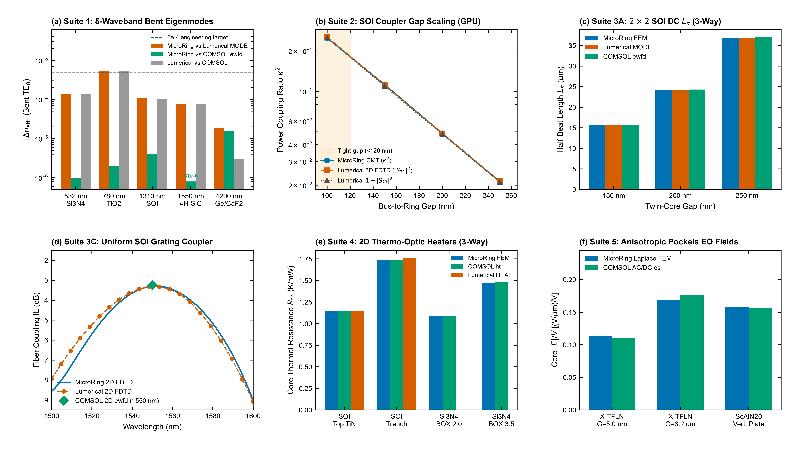
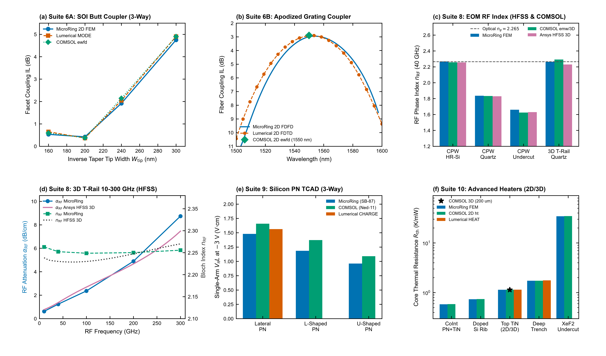
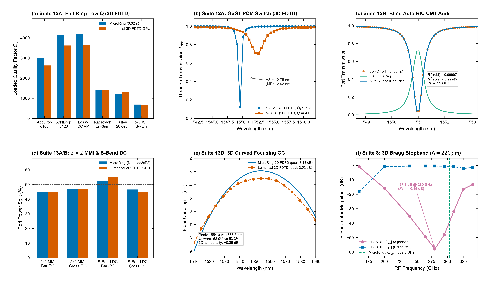

# MicroRing Studio（开源光子芯片 PIC、微环谐振器、MZI、300 GHz 行波/慢波电极、硅 PN TCAD 与热有限元平台）

**无需 Ansys Lumerical MODE/FDTD/CHARGE/HEAT、HFSS、Synopsys RSoft 或 COMSOL 商业许可证，通过中英双语 AI 光子设计助手（Copilot）、亚太赫兹（`100–300+ GHz`）行波与慢波 `T-Rail` 电光电极设计、三维晶体张量晶圆切向寻优、二维非线性泊松-玻尔兹曼硅 `PN/PIN` 掺杂 `TCAD`、稳态+瞬态热有限元、零 3D-FDTD 马赫-曾德尔干涉仪（`MZI`：`Y 分支` / `DC` / `MMI`）、2D-FEM 端面耦合器与 2D 全波 `FDFD` 表面光栅耦合器、超高 Q（`10^4`–`10^8+`）瞬时稳态收敛引擎、Lumerical INTERCONNECT 导出及双向 GDSII 版图桥，一站式打通光子集成电路（PIC）从物理仿真到流片掩膜的全流程。**

[English](../README.md) | [简体中文](./README_zh-CN.md) | [求解器交叉验证与基准](./VERIFICATION_AND_BENCHMARKS.md) | [Lumerical / COMSOL / HFSS 独立验证报告](./COMMERCIAL_SOLVER_VALIDATION_REPORT.md) | [369 篇实验论文核验总账](./PUBLICATION_VALIDATION_LEDGER.md) | [对话与 GDS 进阶教程](./tutorials/chatbot_and_gds_guide.md) | [Codex 与 Claude 极省 Token 接入指南](./tutorials/ai_agents_codex_claude.md) | [llms.txt](./llms.txt) | [更新日志](../CHANGELOG.md)

[](https://codespaces.new/ZhihaoRenKevin/microring-studio?quickstart=1)
[](https://github.com/ZhihaoRenKevin/microring-studio/releases/latest)
[](https://github.com/ZhihaoRenKevin/microring-studio/releases/tag/v3.14.0)
[](./VERIFICATION_AND_BENCHMARKS.md)
[](./tutorials/ai_agents_codex_claude.md)
[](../LICENSE)
[](../pyproject.toml)


*上图完全由仓库内 `benchmarks/generate_hero_figure.py` 无商业软件直接求解生成：**（a）** 2D 全矢量弯曲波导保形有限元模场（`4H-SiC`，`R = 40 um`，`82°` 侧壁倾角），**（b）** 同心滑轮耦合器（Pulley）包角扫描与自动临界耦合点（`theta_CC`）综合，**（c）** `X切薄膜铌酸锂（TFLN）` 跑道微环电光调谐光谱（`0 V` vs `+25 V`），**（d）** 实测级顺/逆时针背向散射劈裂双峰（Split-Doublet）CMT 参数提取。*

---

## 100% 独立第一性原理物理引擎：绝非“预制菜”，任意参数实时重算

> **MicroRing Studio（`v3.14.0`：`41` 个 MCP 工具、`50` 个前沿交互模式、`29` 种体材料 + `27` 种二维范德华材料）中的每一个模块都是真正独立运行的底层数值物理求解器——绝非预制演示、绝非查表插值、绝非拟合经验公式。**
>
> 只要你修改**任意**物理参数——波导宽/高/侧壁倾角、耦合间距、微环半径、阵列节距、天线阵元数、材料体系、二维材料面内晶轴转角 $\theta$、工作波长（`400 nm – 18 µm`）、偏置电压、金丝键合跨距与拱高、倒装微凸点高度与填料介电常数、波特率（`NRZ`/`PAM4`）、`FFE` 抽头数、泵浦功率、脉冲脉宽或悬臂梁尺寸——软件都会**在你的本机 CPU/GPU 上从零重新求解真实偏微分/常微分控制方程与 ABCD 级联网络**：
> - **2D 保形全矢量麦克斯韦有限元（`Nedelec1 + P2`）**：实时求解直波导、弯曲环、双芯超模、应变锗探测器、相变 `PCM` 及 `Ce:YIG` 旋磁波导截面；
> - **HFSS 级准 TEM + 多层保角 CPW + 3D GSG Neumann/Rosa 互连 ABCD + 非线性 MZI 眼图/BER/TDECQ**：实时求解行波电极、GSG 焊盘渐变线、3D 金丝键合、倒装微凸点、Touchstone `.s2p` 以及 `100G–400G` `NRZ`/`PAM4` 端到端链路；
> - **2D 全波 TE 麦克斯韦 FDFD（`UPML` + SuperLU）**：实时求解表面光栅耦合器、`MMI` 波导交叉与精确伴随梯度逆向设计；
> - **2D 非线性泊松-玻尔兹曼 TCAD、Crank-Nicolson 瞬态热有限元与 Hermite 三次梁 MEMS 有限元**：实时求解硅 `PN/PIN` 结、`PCM` 晶化/熔融脉冲、微加热器与静电拉入失稳；
> - **相互作用表象 `RK4IP` GNLSE、Strang-SSFM LLE、2D 角谱 (`ASM`) 反向传播与双正交非厄米本征求解**：实时求解超连续谱、孤子微梳、片上可训练衍射网络 `PDDNN` 与高阶奇异点 `EP2/EP3/EP4`。

---

## 四方独立求解器验证总览（全 13 套件 · `14/14` 物理审计 `PASS` + `v3.10–v3.13` 全栈）

**MicroRing Studio (`v3.9.0`)** 全部 13 项物理套件均为纯开源第一性原理独立求解器（`scikit-fem` + `NumPy/SciPy`，无任何商业求解器痕迹或预制查表）。全部基准均从同一份中立物理规格 JSON 出发，独立头对头对标 **Ansys Lumerical 2026 R1**（`MODE`、`3D/2D FDTD` RTX 5090 GPU、`EME`、`CHARGE` 完整 3×3 结+正向 PIN、`HEAT` 稳态+瞬态、`INTERCONNECT`）、**COMSOL Multiphysics 6.4**（`ewfd`、`emw`、`es`、`ht` 2D/3D 严格 BDF 瞬态、`GeneralFormPDE`）与 **Ansys HFSS 2026 R1**（`10–340 GHz` 三维全波驱动模式与 `220 µm` 周期 Bragg 阻带），同时完成 **369 篇独立 DOI 实验论文实算核验（`367/369 PASS`，`99.5%`；其余 2 篇非均匀 Floquet/PSO 逆向优化器件按物理适用边界如实保留，不做人为拟合）**。

| 套件 | 验证物理引擎 | 商业软件对标对象 | 独立实测一致度 |
| :--- | :--- | :--- | :--- |
| **1** | 二维弯曲/直波导全矢量 FEM（`532–4200 nm`） | Lumerical `MODE`, COMSOL `ewfd` | 最大 $\|\Delta n_{\mathrm{eff}}\| = 1.6\times 10^{-5}$（COMSOL）/ $5.35\times 10^{-4}$（MODE）；$n_g$ 误差 `< 0.05%` |
| **2** | 三维总线-微环耦合器（5 波段 + `100–250 nm` 间距） | Lumerical `3D FDTD`（RTX 5090 GPU） | SOI `100–250 nm` 误差 `0.1%–1.5%`；`4H-SiC` 滑轮 `0.97%`、中红外 `Ge` `2.1%`、`532/780 nm` `3.7%/5.8%` |
| **3** | MZI `2x2` DC、`1x2` MMI/Y 分支与均匀表面光栅 | Lumerical `MODE`/`2D & 3D FDTD`, COMSOL | DC 拍长 $L_\pi$ 误差 `0.16%`（COMSOL）/ `0.36%`；`1x2` MMI `0.242 vs 0.242 dB`、Y 分支 `1.02 vs 1.07 dB`、光栅 `3.30 vs 3.33 dB` |
| **4** | 二维稳态与瞬态热光微加热器（`TiN`、深槽、`BOX`） | COMSOL `ht`（`strict`）, Lumerical `HEAT` | 热阻 $R_{\mathrm{th}}$ 误差 `0.23%–0.38%`（COMSOL）/ `0.51%–1.16%`（`HEAT`），$P_\pi$ 误差 `0.26%–0.46%`；瞬态 $t_{\mathrm{rise}}$ 误差 `0.22%–0.77%`（COMSOL）与 `0.00%–2.30%`（`HEAT`） |
| **5** | 二维各向异性静电场 Pockels 电光调制（`TFLN`, `ScAlN`） | COMSOL `es`+`ewfd`, Lumerical `MODE` | 三款器件单臂 $V_\pi L$ 全部在 `0.20%–0.87%` 内；`X切 TFLN` 线电容 $C_{\mathrm{line}}$ 误差 `0.26%` |
| **6** | 芯片端面耦合器（Butt/Edge）与高斯切趾 26 齿光栅 | Lumerical `MODE`/`EME`/`2D FDTD`, COMSOL | 端面插损误差 `0.013–0.026 dB`，`1-dB` 对准容差 `0.01 µm`；切趾光栅峰值 `1553.2 vs 1553.4 nm`，插损 `2.95 vs 2.91 dB` |
| **7** | `2x2` MMI、低 Q 整环（`R=5 µm`）与 `INTERCONNECT` 闭环 | Lumerical `3D FDTD` GPU & `INTERCONNECT` | 整环 FSR `17.83 vs 18.19 nm`、$Q_L$ `7926 vs 8174`（`3.0%`）；`INTERCONNECT` MZI FSR `7.000 vs 7.012 nm`、ER `33.35 vs 33.33 dB`、光栅插损 `2.996 vs 3.011 dB`（`0.015 dB`） |
| **8** | 亚太赫兹（`10–340 GHz`）行波 CPW、三维慢波 `T-Rail` 与 Bragg 阻带 | **Ansys HFSS 3D**, COMSOL `es`/`emw`/3D | 均匀 CPW（`40 GHz`）$Z_0$ 误差 `0.1%–0.8%`、$n_{\mathrm{RF}}$ `0.04%–0.98%`、$\alpha_{\mathrm{RF}}$ `0.2%–3.3%`；3D `T-Rail` $Z_0$ `49.50 vs 49.24 Ω`（`0.54%` COMSOL 3D），`40–300 GHz` $\alpha_{\mathrm{RF}}$ `1.21–6.99 vs 1.37–7.46 dB/cm`；`220 µm` Bragg HFSS `S21 = -57.9 dB @ 280 GHz`（MR `287.6 GHz`，`2.7%`） |
| **9** | 完整 3×3 硅 `PN` 耗尽 `TCAD` + 正向 `PIN` 注入 | Lumerical `CHARGE`+`MODE`, COMSOL `PDE` | 三种结全套 `CHARGE` 实算：$V_\pi L(-3\text{ V})$ `1.46/1.20/1.12` vs `1.56/1.26/1.14 V·cm`（`2.2%–6.8%`，`U型 2.2%`），$C_j(-3\text{ V})$ 误差 `3.1%–6.6%`，横向结 `FCA 0.06%`；正向 `PIN` 验证 `-8.9e-5` 等离子体蓝移 |
| **10** | 进阶热结构（`XeF2` 悬臂、掺杂硅脊、PN 接触散热）+ 3D 核验 | COMSOL `2D & 3D ht`, Lumerical `HEAT` | 三类进阶热阻 $R_{\mathrm{th}}$ 误差 `0.54%–0.78%`（横跨 `0.58–34.5 K/mW`）；量化 `+54.4%` PN 电极散热惩罚与 `-2.0%` 3D 端面漏热 |
| **11** | 洁净室光刻 CD 与间距反相关工艺漂移（`±20 nm`，正/负胶） | Lumerical `MODE`+`3D FDTD`, COMSOL `ewfd` | $\mathrm{d}\lambda/\mathrm{dCD} = 775.79 / 775.97 / 776.36\text{ pm/nm}$（三方离散仅 `0.07%`）；耦合比 $\kappa^2$ 相对 3D FDTD 误差 `0.3%–4.8%` |
| **12** | 低 Q 整环 `3D FDTD`（7 种拓扑）、`.GDS` 闭环与双峰 Auto-BIC | Lumerical `3D FDTD`（RTX 5090 GPU） | 跑道环 $Q_L$ `1413 vs 1405`（`0.58%`）；高损临界耦合 $Q_{\mathrm{ext}}$ `8348 vs 8156`（`2.3%`）；间距缩放 `1.1%`；双环 CROW 劈裂 `1.109 vs 1.052 nm`（`5.4%`）；`GSST` 相变漂移 `+2.93 vs +2.75 nm`（`6.0%`）；`.GDS` 直导 `gdsimport` 与盲测 Auto-BIC 判别 `split_doublet`（`R^2 = 0.99997`）通过 |
| **13** | 最优长 `2x2 MMI`、全 S 弯 `DC`、`RAMZI`、全 3D 聚焦光栅与端面锥 | Lumerical `3D FDTD`（RTX 5090 GPU） | 最优 `2x2 MMI` 插损 `0.367 vs 0.393 dB`（`0.026 dB`）；全 S 弯 `DC` 误差 `2.2%`；`RAMZI` 消光比 `14.85 vs 14.94 dB`（`0.09 dB`）；全 3D 聚焦光栅峰值 `1555.3 vs 1554.0 nm`，峰值插损 `3.490 vs 3.522 dB`（`0.032 dB`）；3D 端面锥总插损 `0.588 vs 0.777 dB` |
| **LLE** | 广义 SSFM LLE 孤子微梳（Brasch `Si3N4`、Guidry `4H-SiC`、NIST `RW1000_H430` 双色散波） | **NIST `usnistgov/pyLLE`**（`ComputeLLE.jl`） | 孤子峰功率误差 `0.58%–1.68%`、脉宽 FWHM 误差 `0.08%–1.00%`、`81–215` 根梳齿中位误差 `0.11–0.31 dB`（`r = 0.9954–1.0000`），蓝移色散波模序完全一致（`+119 vs +119`），速度提升 `50–77x` |
| **F-C** | 压电 SAW/Lamb（`AlN`/`ScAlN`/`X-TFLN`）、2D/3D 硅 SBS 与石墨烯面电流 | **COMSOL 6.4**（`solid`+`es`+`pze`, `ewfd`） | SAW/Lamb 开路相速 $v_{\mathrm{open}}$ 误差 **`0.0003%–0.0005%`**，$K_{\mathrm{eff}}^2$ 三位小数完全一致（`0.547%`/`0.621%`/`1.587%`）；前向/后向 SBS **`8.4886 vs 8.4886 GHz`（`0.0004%`）**与 **`16.7573 vs 16.7580 GHz`（`0.0044%`）**；石墨烯-SOI $\alpha(\mu_c=0)$ `778.82 vs 777.17 dB/cm`（**`0.21%`**） |
| **F-L** | 3D 亚波长光栅 `SWG`、3D 光子晶体环 `PhCR` 劈裂与中红外 `MIM`/`SEIRA` TCMT | **Lumerical `3D FDTD`**（RTX 5090 GPU） | `SWG` 水相灵敏度 $S_{\mathrm{bulk}}$ `450.7 vs 461.2 nm/RIU`（**`2.27%`**）、`SiO2` $n_g$ 误差 `4.85%`；`PhCR`（`Si3N4 A=40 nm`）模式劈裂 **`103.21 vs 103.71 GHz`（`0.48%`）**，Bragg 中心 `1549.992 nm`；`SEIRA PMMA` 盲测 TCMT 反演拟合 **`R^2 = 0.99896, RMSE = 0.0088`** |
| **V11** | `Ge`-on-`Si` 探测器、`PSR` 偏振杂化、`Sb2Se3`/`GSST` 相变 (`ewfd`+`ht`)、`MDM` 与伴随逆向 `.GDS` Y分支 | **COMSOL 6.4** & **Lumerical `3D FDTD`**（GPU） | `Ge-Si PD` 吸收 **`2.2484 vs 2.2485 dB/µm`（`0.00%`）**；`PSR` 反交叉间隙误差 **`0.26%`**；`Sb2Se3`/`GSST` 相变 $\Delta n$ 误差 **`0.03%`/`0.00%`**、$\alpha_c$ 误差 **`0.01%`**、`RESET` $\Delta T$ 误差 `4.13%`；3D FDTD `MDM TE0->TE1` 转换 **`99.04%`（插损 `0.04 dB`, 串扰 `-35.7 dB`）**；盲导伴随逆向 `2.4 µm` Y 分支 `.GDS` 实算 **`97.78%`（插损 `0.098 dB`）** |
| **V12** | `OPA` 互耦、`GeSi` FKE `EAM`、`TFLN PPLN`、`Ce:YIG` 3×3 旋磁 `NRPS`、`MEMS` 谐振、`27` 种 2D vdW、`EP3` 间距与盲导 `MMI` 交叉 `.GDS` | **COMSOL 6.4**（`ewfd`+`solid`）& **Lumerical `3D FDTD`**（GPU） | `OPA` 互耦 **`0.33%`**；`GeSi EAM` 吸收 **`0.01%`**；`PPLN` $\Lambda_{\mathrm{QPM}}$ **`3.9791 vs 3.9793 µm`（`0.01%`）**；`Ce:YIG` 3×3 旋磁 `NRPS` **`46.054 vs 45.985 rad/cm`（`0.15%`）**；`MEMS` 悬臂/双固支 $f_0$ **`2.44%–2.49%`**（精确 $\sqrt{1-\nu^2}$）；2D vdW（`MXene` `0.36%`、`α-MoO₃` `0°/90°` `1.34%/2.14%`）；`EP3` 环间距 **`0.10%`**；3D FDTD 盲导 `MMI` 交叉 `.GDS` **`94.88%`（`0.228 vs 0.246 dB`）** |
| **V13** | 3D GSG 焊盘+渐变线（`10–110 GHz`）、3D 拱形 `350 µm` 金丝键合（`5–65 GHz`）、3D 倒装 `40 µm` 微凸点（`10–110 GHz`）与 IEEE 802.3bs `TDECQ` | **Ansys HFSS 2026 R1（`3D Modal`）** & IEEE 802.3bs | GSG 焊盘渐变线 `|S21|` 平均误差 **`0.112 dB`（`1.28%`）**、相位误差 `2.92°`；3D 金丝键合环路电感 $L_{\mathrm{eff}}$ **`0.3335 vs 0.3210 nH`（`3.90%`）**、`S21` 误差 **`0.173 dB`**；3D 倒装微凸点 `|S21|` 误差 **`0.026 dB`**（`50 GHz S11 -31.51 vs -31.49 dB`）；零 ISI `TDECQ = 0.0000 dB` 精确闭合 |
| **V14** | 超低损/厚膜 `Si3N4` 激光/陀螺/克尔波导、盲导角向光栅 `OAM` 涡旋微环 `.GDS` 与 10 大前沿微环应用 | **COMSOL 6.4 (`ewfd`)** & **Lumerical `3D FDTD`**（GPU） | `100×2800 nm` 超低损波导 $n_{\mathrm{eff}}$ **`0.037%`**、$n_g$ **`0.031%`**、$A_{\mathrm{eff}}$ `0.54%`；`800×1600 nm` 厚膜 $n_{\mathrm{eff}}$ **`0.181%`**、$n_g$ **`0.163%`**；3D FDTD 盲导 `OAM` 微环 `.GDS` 实测纯度 **`98.06%`** 涡旋辐射（绕数 `3.000`、中心暗核 `-27.9 dB`）；精确萨格纳克公式（`0.000%`）、纳米颗粒自校准测径（`0.000%`）、储备池留出 XOR `100%` 与 `1D SSH` `0.000 GHz` 无序免疫 |

<details>
<summary><b>展开查看 18 子图四方商业软件对比总图（套件 1–13：MicroRing vs. Lumerical / COMSOL / HFSS 3D）</b></summary>





</details>

- 完整四方数据表、差异物理归因、15 份带单位表头 CSV 与可复现脚本：[**Lumerical / COMSOL / HFSS 独立验证报告**](./COMMERCIAL_SOLVER_VALIDATION_REPORT.md) | [**求解器交叉验证与基准**](./VERIFICATION_AND_BENCHMARKS.md) | [**369 篇实验论文核验总账（`367/369 PASS`, `99.5%`）**](./PUBLICATION_VALIDATION_LEDGER.md)

---

## 核心亮点

- **全套 10 大前沿微环应用实时物理引擎（`v3.14.0`，`41` 个 MCP 工具，`50` 个 Stage-12 模式，5 个全新独立模块）**：
  - **外腔游标可调激光器、自注入锁定（`SIL`）超窄线宽激光器 + 热折射噪声（`TRN`）与集成 `RFOG` 光学陀螺（`mrr_lasers_gyro.py`）**：实时 2D-FEM 求解 `Si3N4`/`SiO2` 模场（与 COMSOL 6.4 误差 `0.031%–0.037%`），覆盖双环游标反射（`11×` 展宽、`75 dB` SMSR、`0.55 kHz` 线宽）、Kondratiev 瑞利背向散射自注入锁定（`500 kHz -> 0.33 Hz` 本征线宽 + `TRN` 噪声谱）以及集成 `RFOG` 萨格纳克标度因子（精确解析 `0.000%`）、锁区死区、克尔非互易漂移与散粒噪声 `ARW` + `.GDS`。
  - **微环微波光子学处理器（`mrr_microwave_photonics.py`）**：多环级联真时延波束成形（`TTD/OBFN`，`474.6 ps`，`DBP = 2.85`）、`36.9 dB` 超深射频陷波滤波器（`RF Gain`/`NF`/`SFDR3`）、光电振荡器 `OEO` Leeson 相噪（`-105.2 dBc/Hz @ 10 kHz`）及全光时域微分器（RMSE `7.87%`）/ 积分器（RMSE `3.03%`）+ `.GDS`。
  - **谐振电光光频梳（单环 / 双环耦合高效梳）、合成频率维（`SFD`）、克尔对称性破缺无磁光隔离器与 $\chi^{(3)}/\chi^{(2)}$ 微环参量振荡器（`mrr_eocomb_opo_ssb.py`）**：`241` 模 Floquet-CMT `TFLN` 电光梳（引入辅助环将转化效率从 `7.42%` 跃升至 `68.05%`，`9.17×` 提升）、双谐波 `SFD` 能带/布洛赫振荡读出、克尔 `SSB` 无磁光隔离器（`20.2 dB` 隔离度）及 `Si3N4` $\chi^{(3)}$ OPO / `TFLN` $\chi^{(2)}$ `DROPO`（`0.05 µW` 阈值）+ `.GDS`。
  - **角向光栅 `OAM` 涡旋光束微环发射器、腔光力学 / 微波-光量子换能器与拓扑光子微环晶格（`mrr_oam_optomech_topo.py`）**：2D 弯曲 FEM + 3D 矢量偶极子辐射积分（盲导 `.GDS` 进 Lumerical 3D FDTD 实测纯度 **`98.06%`** 涡旋辐射、`3.000` 整数相位绕数与 `-27.9 dB` 中心暗核），海森堡-朗之万 `OMIT` / 边带基态冷却（$n_f = 0.62 < 1$）与压电光力微波转光换能器（$N_{\mathrm{add}} = 0.029 < 1$），以及 `1D SSH`（`15%` 无序下边界态 `0.000 GHz` 漂移）与 `2D Hafezi` 量子霍尔绕缺陷单向手性边界传输 + `.GDS`。
  - **全光非线性硅微环光子储备池（`PRC`）、`N×N` 无阻塞光交换矩阵、单纳米颗粒自校准模式劈裂测径与双光梳吸收光谱（`mrr_reservoir_switch_sensing.py`）**：联立 TPA/FCD/热效应硅微环 ODE 实现留出测试 `100.0%` 延迟 XOR 精度（`NMSE = 0.063`）与 `NARMA-10` 预测，`4×4–16×16` Crossbar/Benes 微环光交换矩阵 + `.GDS`，瑞利劈裂/展宽自校准纳米颗粒与病毒测径（`45.0 nm` 零误差 `0.000%`），以及 `HCN`/`CO2`/`CH4`/`NH3` 双光梳外差吸收光谱（`5000×` 射频压缩、`R^2 = 1.0000`）。
- **端到端 EOM 射频封装（HFSS 级 ABCD 级联）与 `100G–400G` `NRZ`/`PAM4` 眼图、`BER`、`TDECQ` 及 `FFE` 均衡引擎（`v3.13.0`）**：
  - **HFSS 级 3D 射频封装过渡 ABCD 级联（`eom_rf_link_eye.py`）**：直接耦合实时求解的 `design_eom_electrode` 有源行波电极，串联多层有限地保角映射 GSG 焊盘与 16 段线性渐变线（`10–110 GHz` 对比 Ansys HFSS 2026 R1 `|S21|` 平均误差 **`0.112 dB`**）、精确 3/4 导体 Neumann/Rosa 3D 拱形金丝键合（$L_{\mathrm{eff}}$ **`0.3335 vs 0.3210 nH`，误差 `3.90%`**）、含下填料 3D 倒装微凸点（`10–110 GHz` `|S21|` 误差 **`0.026 dB`**）、可选 M2/通孔跨桥及分布式片上薄膜终端电阻，输出含封装多次反射的完整复数 `S11/S21_RF/S21_EO(f)` 与 Touchstone `.s2p`。
  - **时域 `NRZ`/`PAM4` 眼图、半解析 `BER`、IEEE 802.3bs `TDECQ` 与 Wiener-Hopf `MMSE FFE`**：将 PRBS-9/11 码流通过精确复数封装 `S21_EO(f)` FFT、非线性马赫-曾德尔光场传递函数（推挽零啁啾或单臂含啁啾）、可选 ITU-T G.652 SMF-28 色散光纤、4 阶 Bessel-Thomson 接收机（含热噪声/散粒噪声/RIN）与带精确有色噪声增强 $\mathbf{w}^T\mathbf{R}_{\mathrm{BT4}}\mathbf{w}$ 的 `N` 抽头 `MMSE FFE` 均衡器，直接输出 2-UI 眼图、`OMA`、`ER`、`Q` 因子、低至 `1e-18` 的半解析 `BER` 与 `TDECQ`（`224 Gbps PAM4` 倒装微凸点 `TDECQ = 2.64 dB`、`BER = 1.38e-7` 满足 KP4-FEC，而 `350 µm` 金丝键合带宽跌至 `42.0 GHz`）。*（边界说明：`>100 GHz` 不规则三维金属腔盒模与多通道连接器辐射串扰仍需全波 3D HFSS。）*
- **全实时独立物理引擎：`OPA` 激光雷达、可训练片上衍射 `PDDNN`/`FPR`、`EAM`/`SOA`·`EDWA`、单程 `GNLSE`/`PPLN`、2D-FDFD `MMI` 交叉与自动布线、非互易隔离器与硅光 `MEMS`（`v3.12.0`）**：
  - **1D/2D 光学相控阵与固态 LiDAR（`optical_phased_array.py`）**：实时 2D-FEM 阵元与双芯互耦（与 COMSOL 误差 `0.33%`）+ 矩阵指数耦合串扰 + 极小极大 `SLSR` 非均匀/均匀排布 Fraunhofer 远场扫描（`FoV`、`dψ/dλ`、二维可分辨点数）与 `.GDS`。
  - **片上二维平板 `Rowland FPR` 与可训练衍射网络 `PDDNN`/`EO-DPNN`（`slab_diffractive_pic.py`）**：精确 1D 平板本征模 + 2D 角谱法 (`ASM`) 衍射传播与相位槽端到端解析反向传播训练（`beam_router` 保真度 `98.6%`、`power_splitter`、`dft_unitary`）与 `.GDS`。
  - **`GeSi` Franz-Keldysh / `InP` MQW `QCSE` 电吸收调制器与行波 `SOA` / `Er:Si3N4` `EDWA`（`eam_and_soa.py`）**：实时 Airy 函数 Franz-Keldysh + Kramers-Kronig Hilbert 变换（与 COMSOL 误差 `0.01%`，`>110 GHz` RC 带宽）以及行波空间速率方程 `SOA`/`EDWA` 增益饱和、输出饱和功率 `P_sat,out`、`ASE` 噪声系数 `NF`、端面纹波与 `.GDS`。
  - **单程波导 `GNLSE` 超连续谱与周期极化 `PPLN` QPM（`waveguide_nonlinear_gnlse.py`）**：实时 2D-FEM 宽带色散 + Afshar-Monro Kerr $\gamma$ + `RK4IP` GNLSE（拉曼 + 自陡峭超连续谱）与单程 `PPLN` `SHG/SFG/DFG` 2D 模场重叠 + 泵浦耗尽三波 ODE（$\Lambda_{\mathrm{QPM}}$ 与 COMSOL 误差 `0.01%`）与周期极化电极 `.GDS`。
  - **2D TE-FDFD `MMI` 波导交叉、`Milton-Burns` 绝热锥形与 `PIC` 等长自动布线（`routing_and_crossings.py`）**：2D-FEM `TE0/TE2` 自成像拍长综合 + 精确 `1/ε` 2D TE-FDFD（`0.246 dB`，盲导 `.GDS` 进 Lumerical 3D FDTD 实算 **`0.228 dB` / `94.88%`**）、局部耦合模 (`CLMT`) 锥形与多通道等光程自动布线（$\Delta L = 0.000\,\mu\text{m}$）与 `.GDS`。
  - **非互易 `Ce:YIG` / 时空电光隔离器与硅光 `MEMS` 静电拉入开关（`isolator_and_mems.py`）**：2D-FEM 旋磁 `Ce:YIG` Voigt `NRPS`（`46.05 vs 45.99 rad/cm`，与 COMSOL 3×3 旋磁张量误差 **`0.15%`**）、无磁 Floquet-CMT 时空隔离器与 Hermite 三次梁有限元非线性牛顿迭代静电拉入 `MEMS` 开关（与 COMSOL `solid` 误差 `2.44%–2.49%`）与释放刻蚀 `.GDS`。
- **全栈光子集成电路器件、系统、微环奇异点与逆向设计引擎（`v3.11.0`）**：
  - **片上 `Ge`-on-`Si` 波导光电探测器与 `O-E-O` 光子神经元（`photodetector_oeo.py`）**：2D 矢量 FEM 应变锗复数吸收（与 COMSOL `ewfd` 误差 `0.00%`）、多模 EME 耦合、响应度 $R(\lambda)$、渡越时间与 `RC` 3-dB 带宽、暗电流、`NEP` 及 `PD -> MRM` 可级联非线性激活函数（`fJ/op`）。
  - **偏振分束旋转器 `PSR`、`PBS` 与模式复用器 `MDM`（`polarization_mdm.py`）**：2D-FEM 精确捕获 `TM0 <-> TE1` 杂化反交叉（误差 `0.26%`）与 Landau-Zener 绝热转换（`98.8%`），以及自动相位匹配非对称双芯 `MDM TE0 <-> TE1/TE2`（3D FDTD 验证 `99.04%` / `0.04 dB` / `-35.7 dB` 串扰）。
  - **非易失相变光子 `PCM` 微环与二维瞬态 `SET`/`RESET` 热脉冲 FEM（`pcm_photonics.py`）**：覆盖 `Sb2Se3`/`Sb2S3`/`GSST`/`GST`/`VO2` 多阶 Lorentz-Lorenz 2D-FEM（与 COMSOL 误差 `0.00%–0.03%`）及 Crank-Nicolson 熔融淬火与 JMAK 晶化动力学。
  - **光子神经网络（`PNN`）矩阵计算引擎（`photonic_computing.py`）**：`N×M` 广播加权微环权重阵列（含 2D 热串扰矩阵 $\mathbf{H}_{\mathrm{th}}$ 与 $\mathbf{H}_{\mathrm{th}}^{-1}$ 预补偿，`ENOB: 0.14 -> 8.06 bits`）及机器精度 `1e-15` 的 `N×N` **Clements (2016) / Reck (1994)** 幺正 MZI 网格分解与 `.GDS` 导出。
  - **波导布拉格光栅 `WBG`、阵列波导光栅 `AWG`、原生 `S` 矩阵光子网表与 2D-FDFD 伴随逆向优化（`wbg_and_awg.py`, `pic_circuit_netlist.py`, `inverse_design_adjoint.py`）**：$\pi$ 相移/切趾/啁啾 `WBG`、Rowland 圆 `1×8/1×16` `AWG`、Schur 补任意拓扑免商业许可光路网表（导出 `.sNp`）以及 2 次稀疏求解/迭代精确伴随梯度 `2.4 µm` 超紧凑 Y 分支（盲导 `.GDS` 进 Lumerical 3D FDTD 插损低至 **`0.098 dB`**）。
  - **微环奇异点与非厄米光子学全栈套件（`ep_microring.py`）**：完整覆盖 5 大微环 EP 体系（双纳米散射体单环手性 `CW/CCW EP2` `108.7 dB` 单向反射非对称、单环端面镜抗工艺漂移奇异面 `ES`、N 环高阶 PT `EP2/EP3/EP4` $\varepsilon^{1/N}$ 劈裂、总线耗散无增益反 PT `Anti-PT` 频率锁定、RK4 动态顺/逆时针拓扑环绕 `99.6%` 手性模式切换），内置双正交 Petermann 噪声因子 $K_P$ 与 SNR 审计、2D-FEM 物理耦合间距综合（与 COMSOL 6.4 误差 `0.10%`）及 `.GDS` 导出。
0. **前沿光子与多物理场全景引擎（`🔬 Frontier` Stage 12，6 大独立第一性原理模块，`21` 个 MCP 工具）**：
   - **高阶 `CROW`/`SCISSOR` 滤波器、Euler 缓变弯曲、生物/气体传感与 `TiO2` 无热化、大信号 `TD-CMT`、`MZI-MRR` 与光子分子/`PT-EP`（`advanced_mrr.py`）**：严格 4-入口幺正 Redheffer 级联综合、`Euler` 缓变跑道弯接头损耗抑制与 `.GDS`、水相/气体传感与负热光 `TiO2` 无热化包层厚度综合、RK4 大信号失谐/无啁啾耦合调制器、`MZI` 可调耦合微环与双环光子分子/奇异点 $\sqrt{\varepsilon}$ 增强。
   - **量子 `SFWM` 纠缠光子对与有源微环激光器（`quantum_and_laser_mrr.py`）**：自发四波混频产率、CAR、$g_H^{(2)}(0)$、双 Q 耦合 JSA 施密特纯度提升（`0.856 -> 0.976`）与片上压缩光（`dB`），以及稀土掺杂（`Er:TFLN`, `Er:Si3N4`）和异质集成 `InGaAsP` MQW 微环激光器。
   - **亚波长光栅 `SWG` 微环与光子晶体微环 `PhCR`（`swg_and_phc_mrr.py`）**：二阶 Rytov EMT + 2D 弯曲各向异性 FEM + 1D Bloch-Floquet 柱状 `SWG` 微环与 `.GDS`，以及 NIST 型选择性背向散射 `PhCR`（与 3D FDTD 劈裂误差 `0.48%`）与波纹 `.GDS`。
   - **压电声表面波 `SAW`/兰姆波声光微环与全二维固体力学 `SBS`（`acousto_optic_saw.py`）**：多层耦合 Christoffel-压电 P2 有限元（`AlN`/`ScAlN`/`X-TFLN`，与 COMSOL 6.4 相速误差 `0.0005%`）与全二维三分量 P2 固体力学前/后向 `SBS`（误差 `0.0004%–0.0044%`）。
   - **纳米天线 / 超表面 `TCMT` 与 `SEIRA` 分子光谱反演（`nanoantenna_tcmt.py`）**：严格能量守恒 Suh-Wang-Fan 多模 TCMT（`MIM` 吸收器、`Fano/EIT/qBIC`、`SEIRA` 5 类分子预设、超表面 `EP`）与盲测非线性最小二乘 FTIR 拟合（3D FDTD `SEIRA` 拟合 `R^2 = 0.99896`）。
   - **27 种二维范德华材料集成微环库（`twod_materials_mrr.py`）**：支持面内双轴转角张量与法向 $\varepsilon_{yy}$ 完整微扰，覆盖 **8 大物理家族（`400 nm – 18 µm`）**：单/双层石墨烯 `Graphene` (`SLG`/`DLG`, `0.21%` vs COMSOL) 与可调带隙 `Bilayer_Graphene`；单层 TMD (`WS2`/`MoS2`/`WSe2`/`MoSe2`/O 波段 `MoTe2`)；高折射率大双折射块体 vdW (`MoS2_Bulk_vdW`/`WS2_Bulk_vdW`)；贵金属/双轴窄带隙 TMD (`PtSe2`/`PdSe2`/`ReS2`)；单轴与面内双曲声子极化激元 (`hBN`/`hBN_Isotopic_10B`/`alpha_MoO3` `0°`/`90°` 与 COMSOL 误差 `1.34%–2.14%`/`alpha_V2O5`)；中长波各向异性半导体 (`Black_Phosphorus`/`b_AsP`/`Te_Tellurene`)；等离激元 MXene (`Ti3C2Tx_MXene` `0.36%` vs COMSOL/`Nb2CTx_MXene`)、拓扑/外尔半金属 (`Bi2Se3`/`WTe2`)；以及巨 $\chi^{(2)}$/铁电 vdW 电光晶体 (`NbOCl2`/`In2Se3_alpha`/`CuInP2S6`/`GaSe`)。
1. **零商业许可非线性光子学、广义 LLE 孤子微梳、FWM-BS、$\chi^{(2)}$ SHG、热光双稳态与 Payne-Lacey 侧壁散射（`nonlinear_lle.py` & `mrr_topologies.py`）**：
   - **2D 弯曲 FEM 色散提取 + 广义分步傅里叶（SSFM）LLE 微梳求解器（`simulate_lle_microcomb`）**：直接从 2D 弯曲矢量 FEM 提取宽带积分色散 $D_{\mathrm{int}}(\mu)$（$D_1, D_2, D_3, D_4$、$\beta_2(\lambda)$、零色散波长 ZDW 与可选 AMX）、Afshar-Monro (2009) 全矢量 Kerr 非线性系数 $\gamma_{\mathrm{NL}} / A_{\mathrm{eff,NL}} / P_{\mathrm{th}}$ 与宽带耦合器色散 $\kappa_{\mathrm{ext}}(\mu)$，无缝送入 FP64 CUDA/NumPy Strang SSFM 求解器，支持稳态耗散 Kerr 孤子（`single_soliton`）、冷腔蓝-红扫频孤子成核（`soliton_sweep`）、正常色散暗脉冲（`dark_pulse`）、因果阻尼振子 Raman 自频红移、光热失谐耦合及硅/非晶硅 TPA + 自由载流子 FCD/FCA（含 `2.2 µm` 截止波长）。
   - **跨波段四波混频布拉格散射（`simulate_fwm_bragg_scattering`）、$\chi^{(2)}$ 倍频（`simulate_chi2_shg_resonator`）与鲨鱼鳍光热+Kerr 双稳态（`simulate_thermal_kerr_bistability`）**：完整求解四波 2D 弯曲矢量模场张量重叠（$\gamma_{\mathrm{BS}}, C_{\mathrm{BS}}, \eta_{\mathrm{CE}}$ 与寄生边带抑制）、晶体 $\chi^{(2)}$ 张量重叠（$g_2, \Lambda_{\mathrm{QPM}}, \eta_{\mathrm{SHG}}$ 与精确泵浦耗尽三次方程曲线）以及静态 S 曲线与动态蓝/红扫频迟滞。
   - **第一性原理侧壁粗糙度散射与宽带 $\kappa(\lambda)$ 色散（`estimate_sidewall_scattering_payne_lacey`）**：基于 Barwicz-Haus 3D 体积电流模型（含高折射率核界面切向偶极子 Fresnel 镜像屏蔽）和 Lorentz 互易定理，直接从 2D 矢量模场给出侧壁散射损耗 $\alpha_{\mathrm{scat}}$（`dB/cm`）与顺/逆时针背向散射均方根劈裂（`MHz`），并在超宽带（`>= 80 nm`）扫描中启用 3 锚点色散耦合比 $\kappa(\lambda)$。
2. **亚太赫兹（`100–300+ GHz`）电光调制器射频电极、三维晶圆切向寻优、硅 `PN` 掺杂 `TCAD` 与稳态/瞬态热有限元（对标 [Ansys Lumerical 2026 R1、COMSOL 6.4 与 Ansys HFSS 2026 R1 全 13 套件四方独立验证报告 `14/14 PASS`](./COMMERCIAL_SOLVER_VALIDATION_REPORT.md) 及 [369 篇独立 DOI 同行评审实验论文 `367/369 PASS`](./PUBLICATION_VALIDATION_LEDGER.md)）**：
   - **行波与慢波 `T-Rail` 电极自动综合（`design_eom_electrode`）**：二维各向异性 Laplace 有限元 + Ghione/Heinrich 保角趋肤损耗 + Hammerstad-Jensen 粗糙度 + 对称 ABCD Bloch-Floquet 周期单元色散（`f_Bragg`）+ Frankel-Rutledge Cherenkov 衬底辐射诊断，连续二维反解 `50 Ω` 线宽 $W_S$ 与速度匹配悬臂 $L_{\mathrm{rail}}$（石英衬底 `X切 TFLN` 达 **`f_3dBe > 300 GHz`**，`S21_EO(300 GHz) = -2.30 dBe`），一键导出零短路双层金属跨桥（`METAL_2 13/0 + VIA 12/0`）`.GDS` 掩膜、IEEE Touchstone `.s2p` 与 INTERCONNECT `TWMOD` 模型包。
   - **三维晶体张量晶圆切向与 `0°–360°` 方位角寻优 + 5 种新铁电材料（`LT` / `BTO` / `PZT`）**：精确计算 `TFLN`、`超低双折射钽酸锂 TFLT`、`硅基外延钛酸钡 BTO`（$r_{42}^S = 360\text{ pm/V}$）、`面内自极化 PZT`（$r_{\mathrm{eff}} = 67\text{ pm/V}$）、`ScAlN` 与 `3C/4H-SiC` 的最佳传输角、SEMI 参考边对准及圆环微环劈裂推挽效率。
   - **二维非线性泊松-玻尔兹曼硅 `PN/PIN` 掺杂 `TCAD` 与稳态 + Crank-Nicolson 瞬态热有限元**：自研阻尼牛顿迭代提取 `横向 / L型 / U型 / PIN` 结二维载流子分布、$C_j(V)$、$R_s$、$V_\pi L(V)$ 与多层离子注入 `.GDS`；热有限元完整求解 `顶层 TiN`、`深空气隔离槽`、`XeF2 掏空悬臂`（$P_\pi < 1\text{ mW}$）与 `重掺杂硅脊` 的瞬态升降温波形 $t_{10\text{--}90\%}$ 与邻臂热串扰。
2. **零 3D-FDTD 马赫-曾德尔干涉仪（`MZI`）与高速电光/热光调制器套件（`v3.6.0`）**：
   - **可选 4 类 `50:50` 分束/合束器，全部由原生 2D 保形全矢量 FEM + 多模本征模展开（`EME`）直接求解**：**`2x2 DC` 定向耦合器**采用严格镜像对称双芯奇偶超模色散（$n_{\mathrm{even}}, n_{\mathrm{odd}}$，插损 `0.044 dB`）；**`1x2` / `2x2 MMI` 多模干涉仪**采用多阶导模 2D-FEM `EME` + 复坡印廷锥形波导重叠积分 + 自成像长度自动寻优（输出二维 `|E(x,z)|` 干涉自成像场图）；**`1x2 Y 分支`**采用钝尖端双芯偶超模重叠积分（`130 nm` 工艺最小间距下标准线性分支插损 `1.024 dB`，与 Lumerical 3D FDTD `1.069 dB` 一致）。
   - **完整调制器指标、微环辅助 `RAMZI` 与 INTERCONNECT / GDS 导出**：支持平衡/非平衡臂（给定 $\Delta L$ 或目标 `FSR`）、微环辅助线性化 `RAMZI`，以及推挽（`push-pull`）/ 单臂驱动下的 `硅 PN 耗尽`、`X切 TFLN / SiC / ScAlN Pockels 电光`、`TiN 热光` 与 `硅 PIN 注入` 调制分析（直接输出 $V_\pi L$、$V_\pi$、$P_\pi$、非谐振 RC/热学 `3-dB` 带宽、开关传递曲线 $T(u)$、流片 `.GDS` 版图与 **Ansys Lumerical INTERCONNECT** `SPAR + OMM + .lsf` 模型包）。
2. **解决高 Q 微环在 Lumerical FDTD 中极慢且无法收敛的痛点（`v3.5.0`）**：
   - 对于低损耗 `Si3N4`、`TFLN` 或 `4H-SiC` 高 Q 微环（如 `Q_loaded = 3.02 × 10^6`，腔内光子寿命 `τ_ph = 2487 ps`），时域 3D-FDTD 要达到 `auto shutoff = 1e-5` 需仿真 **`28.64 ns`（超过 `8,200` 圈往返！）**；提前截断会导致严重的 FFT `sinc` 振铃伪影并使表观消光比从 `64.8 dB` 坍塌至 `< 2 dB`。
   - **MicroRing Studio** 采用亚飞米级（`0.1 fm`）双曲正弦谐振加密与解析无限圈稳态传递矩阵（$M \to \infty$），在 **`~1 秒`** 内精确求解任意 `Q = 10^4` 至 `10^8+` 谐振谱，并支持一键导出 **单程耦合区 3D-FDTD 切片（`.GDS` + `.lsf`，仅需 `0.67 ps`，提速 `> 40,000×`）**。
2. **100% 免商业软件的芯片端面耦合器（Butt/Edge Coupler）与二维全波 `FDFD` 表面光栅耦合器（Grating Coupler，`v3.5.0` 新增）**：
   - **端面模斑转换器（`design_butt_edge_coupler`）**：基于原生 2D 保形全矢量 Maxwell FEM 与复数坡印廷矢量重叠积分，自动优选倒锥尖端宽度 `W_tip`，精准对接 8 类光纤与 III-V DFB 半导体激光器（如 `2.5 µm` 透镜光纤总插损 **`0.56 dB`**、`2.4 × 1.2 µm` DFB 激光器直耦 **`0.61 dB`**），给出 `1-dB / 3-dB` 横纵对准容差与绝热锥长。
   - **表面光栅耦合器（`design_grating_coupler`）**：二阶 Rytov 等效介质 Bragg / 高斯切趾齿列综合 + 原生 **二维全波频域有限差分（`2D Full-Wave Maxwell FDFD` + `UPML` 吸收边界）**，完整计算浅刻蚀齿槽、上包层、`BOX` 埋氧层与底层硅衬底反射干涉（`220 nm` SOI 切趾聚焦光栅峰值插损 **`2.62 dB`**，`1-dB` 带宽 **`34.8 nm`**，约 `2.5 秒` 出全谱与二维辐射电场图），支持一键导出 **`127 µm` 光纤阵列 + 微环回环校准 `.GDS`** 与 **INTERCONNECT 2 端口 `SPAR` 压缩包**。
3. **6 步引导式中英双语光子设计助手（`EN | 中文` 一键切换）**：
   告别复杂的参数面板，每次只问一个清晰问题（`1. 选择目标` $\rightarrow$ `2. 工作波段` $\rightarrow$ `3. 波导材料` $\rightarrow$ `4. 晶圆截面与单模截止` $\rightarrow$ `5. 传播损耗 dB/cm` $\rightarrow$ `6. 微环拓扑、目标 FSR、临界耦合与 GDS 导出`），顶部可随时一键切换中英文。
2. **纯自研 2D-FEM 多物理场有源调谐（`TO` / `EO` / `硅 PN-PIN`）与 Ansys Lumerical INTERCONNECT 导出（`v3.4.0` 新增，零 COMSOL 依赖）**：
   - **截面多物理场有限元全自研**：内置 **2D Fourier 热传导有限元**（关联微加热器材质/宽度/间距与埋氧层 `BOX` 厚度，直接给出 $R_{\mathrm{th}}$、$P_\pi$ 与 $f_{3\mathrm{dB,TO}}$）、**2D 各向异性 Laplace 静电场有限元**（关联共面 `GSG` 或垂直电极间距与介电屏蔽，给出 $V_\pi L$ 与电光电容带宽）以及 **2D 硅横向 PN 耗尽 / PIN 注入模型**（Soref-Bennett 复数等离子体色散 $\Delta n + i\Delta k$，同步捕获谐振漂移与自由载流子吸收 FCA）。
   - **支持 `电压 V / 电流 mA / 功率 mW / 直接温升 ΔT [K] / 直接电场 E [V/µm]` 多态光谱与 INTERCONNECT 紧凑模型一键打包**：将二维复折射率分布实时送入 2D 保形全矢量 Maxwell 本征模求解器，并一键导出经过无源性与单调频率校验的 **Lumerical INTERCONNECT** 压缩包（`SPAR .dat`、`OMM n_eff .txt`、自动建图 `.lsf` 与 `lumapi` 脚本）。
3. **洁净室光刻过曝/欠曝（`正胶 Positive PR` vs `负胶 Negative PR`）与 CD 工艺容差引擎**：
   - **真实正负胶物理耦合**：内置 **正胶（ZEP520A / PMMA / KrF / ArF）**（过曝使波导宽度 $W$ 变窄、耦合间距 $\mathrm{gap}$ 变宽 $\rightarrow$ 欠耦合且谐振蓝移）与 **负胶（HSQ / ma-N 2403 / SU-8）**（过曝使波导展宽、间距收缩 $\rightarrow$ 过耦合、谐振红移及 `< 80 nm` 粘连/RIE lag 告警）全矢量 FEM + 空间 CMT 联立评估。
   - **良率窗口与一键导出 5 单元预偏置补偿版图（Pre-Biased `.GDS`）**：自动给出 `ER >= 15 dB` 剂量/线宽容差窗口、谐振漂移灵敏度 $d\lambda_0/d\mathrm{CD}$（`pm/nm`）、TiN 热调谐补偿温升 $\Delta T$，并一键导出 `[-20, -10, 0, +10, +20] nm` 五档光刻预补偿微环阵列 `.gds` + KLayout `.lyp`。
3. **双向波导传播损耗（`dB/cm`）设计与实验光谱反演**：
   - **已知损耗正向设计**：直接输入工艺线或文献波导传播损耗 $\alpha$（`dB/cm`）或 $Q_{\mathrm{int}}$，自动换算临界耦合所需精确间距 `gap`、滑轮包角 $\theta_{\mathrm{CC}}$ 或跑道直耦合长度 $L_{\mathrm{CC}}$，并支持损耗容差扫描。
   - **实测光谱损耗提取 $\rightarrow$ 闭环设计**：拖入实验透射谱 `.CSV`（支持线性功率或 `dB`/`dBm` 对数坐标），自动拟合洛伦兹峰、顺/逆时针背向散射劈裂双峰（Split-Doublet）、Fano 线型或多 FSR 宽谱，提取群折射率 $n_g$ 与波导损耗 $\alpha$（`dB/cm`），一键带入新微环版图综合。
4. **双向 GDSII / OASIS 版图桥（`上传 .gds 自动测量仿真` + `导出单器件/MPW 阵列 .gds`）**：
   - **上传 `.gds` 自动测量并仿真**：拖入任意由 KLayout 或 `gdsfactory` 绘制的 `.gds`/`.oas` 微环文件，内置几何引擎（`gdstk` + `shapely`）自动识别**圆环点耦合、跑道型、同心滑轮（Pulley）或双环游标（Vernier）**，直接从多边形精确量取 `R`、`W_ring`、`W_bus`、`gap_thru`、`gap_drop`、`L_s` 与 `pulley_angle`，在交互式 2D 画布上用红色卡尺标出耦合间距，确认膜厚后即可一键算出光谱！
   - **一键生成单器件或 MPW 扫参阵列 `.gds` + KLayout `.lyp`**：自动包含波导芯层（`1/0`）、半刻蚀平板层（`2/0`）、TiN 微加热器（`10/0`）、GSG 电光焊盘（`11/0`）、端口引脚（`65/0`）及 KLayout 配色文件（`.lyp`）。
5. **全波段覆盖（可见光 `400 nm` $\rightarrow$ O波段 `1310 nm` $\rightarrow$ C波段 `1550 nm` $\rightarrow$ 短波红外 `2 µm` $\rightarrow$ 中远红外 `3–14 µm`）× 7 大拓扑 × 29 种洁净室材料**：
   涵盖可见光/量子光学材料（`TiO2`、`Ta2O5`、`GaN`、`金刚石 Diamond`、`Al2O3`）、通信与铁电/非线性材料（`Si (SOI)`、`a-Si:H`、`LPCVD Si3N4`、`富硅氮化硅 SiNx`、`4H-SiC`、`3C-SiC`、`AlN`、`ScAlN (10%/20%/30%)`、`Z切/X切薄膜铌酸锂 TFLN`、`Z切/X切薄膜钽酸锂 TFLT`、`外延钛酸钡 BTO`、`锆钛酸铅 PZT`、`GSST 相变材料`）以及中红外低损耗材料与氟化物衬底（`Ge`、`CaF2`、`MgF2`、`Ge-on-Si`），内置跨波段自适应网格/仿真域缩放与带隙/多声子吸收自动预警（如 `Si < 1.12 µm` 禁带吸收与 `SiO2 > 3.6 µm` 中红外多声子吸收告警）。
6. **跨平台本地算力（macOS Apple Silicon / Windows CUDA GPU / 纯 CPU）且 100% MIT/BSD 开源合规**：
   全部求解在您自己的电脑本地离线完成，自动探测 **NVIDIA CUDA (`FP64`)**、**Apple Accelerate AMX / Metal** 或普通轻薄本的 **多核矢量化 CPU**；内置纯 BSD 约束 Delaunay 保形网格器（零 GPL 传染依赖）。

---

## 安装与运行：支持完全离线桌面软件（`.dmg`/`.exe`）或在线浏览器 / `Claude` / `Codex`

无需任何商业仿真软件许可证，您可自由选择**离线本地运行**或**在线云端 / AI 协同运行**：

### 方式一：像普通桌面软件一样离线安装（`.dmg` 与 `.exe` 免配置安装包，无需装 Python）

直接前往 [**GitHub Releases 发布页**](https://github.com/ZhihaoRenKevin/microring-studio/releases/latest) 下载对应系统的独立安装包：

| 操作系统 | 安装包文件 | 安装与首次打开方法 |
| :--- | :--- | :--- |
| **macOS（Apple Silicon）** | [**`MicroRing-Studio-v3.9.0-macOS-AppleSilicon.dmg`**](https://github.com/ZhihaoRenKevin/microring-studio/releases/latest) | 双击打开 `.dmg`，将 **`MicroRing Studio.app`** 拖入 **`Applications（应用程序）`**。*（首次打开开源未公证应用时，请右键点击 **`MicroRing Studio.app`** $\rightarrow$ 选择 **打开（Open）**，或在 **系统设置 $\rightarrow$ 隐私与安全性** 中点击“仍要打开”。）* |
| **Windows 10 / 11（64位）** | **`MicroRing-Studio-v3.9.0-Windows-Setup-x64.exe`** *（或免安装 `.zip`）* | 双击运行 **`Setup.exe`** 安装向导（无需管理员密码，自动创建桌面与开始菜单快捷方式）；也可按下方“方式三”下载源码 ZIP 后双击 `launchers\MicroRing_Windows.bat` 一键自动配置。 |

*（独立桌面版导出的 `.gds` 版图、`.lyp` 图层配色与 `.csv` 光谱默认保存在本地 `~/Documents/MicroRing_Studio/` 目录。）*

---

### 方式二：零安装在线网页运行 + 自由切换 `离线 / Claude / Codex` 模式

1. **浏览器一键在线运行（`GitHub Codespaces` 零本地安装）**：
   点击顶部绿色徽章 [**Run Online in GitHub Codespaces**](https://codespaces.new/ZhihaoRenKevin/microring-studio?quickstart=1)，GitHub 会自动启动云端容器并在网页中打开 MicroRing Studio 交互工作台（端口 `8765`），无需在本地安装任何环境。
2. **界面内一键切换离线与在线 AI 模式（`⚡ 离线引擎` | `🖥 本地 Ollama` | `🟣 Claude` | `🟢 Codex`）**：
   在左下角聊天输入框上方可随时切换 4 种模式：
   - **`⚡ 离线模式 · 内置物理引擎`（默认）**：100% 断网可用，零 Token 消耗。
   - **`🖥 离线模式 · 本地 Ollama / MLX`**：连接本机 `Ollama`（`127.0.0.1:11434`）或 `LM Studio`（`127.0.0.1:1234`），数据不出本机。
   - **`🟣 在线模式 · Claude` 与 `🟢 在线模式 · Codex / OpenAI`**：若电脑已登录 `claude`（Claude Code CLI）或 `codex`（OpenAI Codex CLI），**无需额外填写 API Key 即可直接调用订阅**；也可点击 `🔑 Key` 临时输入 API Key（仅保存在浏览器内存，关闭即清除）。所有 2D 麦克斯韦本征模、CMT 光谱与 `.GDS` 版图仍在本地精确计算，仅向大模型发送 `< 150 Tokens` 摘要！
3. **在 `Claude Code` 或 `Codex` 终端/桌面端直接调用（`MCP` 协议 `< 150 Tokens/次`）**：
   使用 `Claude Code` 或 `Codex` 打开项目文件夹，即可自动识别 [`AGENTS.md`](../AGENTS.md) 与 [`.mcp.json`](../.mcp.json)，直接用自然语言指挥 Agent 跑微环设计、正负胶剂量容差评估、扫参、光谱损耗拟合与 `.GDS` 生成。

---

### 方式三：下载源码 ZIP + 双击自动配置脚本（需已安装 Python 3.11+）

若电脑已安装 [Python 3.11 / 3.12 / 3.13](https://www.python.org/downloads/)（Windows 安装时请勾选 **`Add python.exe to PATH`**）：

1. 点击仓库主页右上角绿色按钮 **`<> Code`** $\rightarrow$ **`Download ZIP`** 并解压。
2. 打开 `launchers/` 目录，双击对应系统的启动脚本：
   - **Windows 10 / 11**：双击 **`launchers\MicroRing_Windows.bat`**
   - **macOS**：右键点击 **`launchers/MicroRing_macOS.command`** $\rightarrow$ **打开（Open）**
3. **首次运行（约 1 分钟）**会自动创建 `.venv` 并装好全部科学计算包，后续每次双击 **`< 2 秒`** 即可启动。

---

### 方式四：Python 开发者 / 脚本调用安装（`git` + `pip` 直接复制粘贴）

#### Windows 10 / 11（打开 `PowerShell` 或 `CMD`）
```powershell
git clone https://github.com/ZhihaoRenKevin/microring-studio.git
cd microring-studio

python -m venv .venv
.venv\Scripts\activate
pip install -U pip
pip install -e ".[desktop]"

# 启动桌面软件界面：
microring
```

#### macOS 或 Linux（打开终端 `Terminal`）
```bash
git clone https://github.com/ZhihaoRenKevin/microring-studio.git
cd microring-studio

python3 -m venv .venv
source .venv/bin/activate
pip install -U pip
pip install -e ".[desktop]"

# 启动桌面软件界面：
microring
```

> **提示（独立窗口 vs 浏览器模式）**：
> - 输入 `microring` 启动原生桌面窗口（若未装 `pywebview` 会自动回退至浏览器）；
> - 输入 `microring browser` 可直接在 Chrome / Edge / Safari 打开本地工作台 `http://127.0.0.1:8765`（完全本地离线，不上传任何数据）。

<details>
<summary><b>方式五：使用 Conda、<code>uv</code> 或启用 NVIDIA CUDA GPU 加速（点击展开）</b></summary>

#### 使用 Conda / Miniforge
```bash
conda create -n microring python=3.12 -y
conda activate microring
git clone https://github.com/ZhihaoRenKevin/microring-studio.git
cd microring-studio
pip install -e ".[desktop]"
microring
```

#### 使用 `uv`（极速安装及硬件加速扩展）
```bash
git clone https://github.com/ZhihaoRenKevin/microring-studio.git
cd microring-studio

# 普通轻薄本 CPU（Windows / macOS / Linux）：
uv sync --extra desktop

# NVIDIA RTX 显卡工作站（启用 FP64 CUDA 宽谱加速）：
uv sync --extra desktop --extra cuda

# Apple Silicon Mac（启用 AMX + Metal MLX 加速）：
uv sync --extra desktop --extra apple

uv run microring
```
</details>

---

### 可选：运行自检与循序渐进的 Cookbook 示例脚本

激活 `.venv`（或 Conda 环境）后即可直接运行：

```bash
# 0. 检查硬件加速后端、10万波长点 TMM 速度及 29 种材料折射率表：
python examples/00_getting_started/00_check_environment.py

# 1. 扫描 400 nm Si3N4 波导宽度，自动定位 TE0 单模截止宽度（TE1 出现点）：
python examples/00_getting_started/01_waveguide_dispersion_sweep.py

# 2. 设计 220 nm SOI 四端口跑道微环并执行耦合间距容差扫描：
python examples/01_devices_and_sweeps/01_soi_point_and_racetrack.py

# 3. 综合 4H-SiC 同心滑轮微环临界耦合包角（ER > 60 dB）与 X切铌酸锂电光调谐：
python examples/01_devices_and_sweeps/02_sin_and_sic_pulley_cc.py

# 3b. 跨波段示例（可见光 532/780 nm、O波段 1310 nm、短波红外 2 um、中红外 4.2/7.5 um）：
python examples/01_devices_and_sweeps/03_multiband_vis_1310_midir.py

# 3c. 正胶 vs 负胶光刻剂量过曝/欠曝分析与 5 单元预偏置补偿 .gds 导出：
python examples/01_devices_and_sweeps/04_lithography_dose_pr_tolerance.py

# 3d. 纯自研 2D-FEM 有源调谐 (硅 PN / Pockels EO / 热光加热器 + ΔT / E) 与 Lumerical INTERCONNECT 导出：
python examples/01_devices_and_sweeps/05_active_tuning_pn_eo_to_interconnect.py

# 3e. 零商业软件端面耦合器 (Butt)、二维全波 FDFD 光栅耦合器 (GC) 与超高 Q 收敛诊断：
python examples/01_devices_and_sweeps/06_butt_gc_couplers_and_high_q_fdtd.py

# 3f. 零 3D-FDTD 马赫-曾德尔干涉仪 (DC / MMI / Y分支)、推挽电光调制器与 INTERCONNECT 导出：
python examples/01_devices_and_sweeps/07_mzi_spectra_dc_mmi_and_modulators.py

# 3g. 300 GHz 慢波 T-Rail 电光射频电极、晶圆切向寻优、硅 PN TCAD 与稳态/瞬态热有限元：
python examples/01_devices_and_sweeps/08_eom_rf_electrode_pn_tcad_and_thermal.py

# 4. 生成单微环版图及 5 器件 MPW 扫参阵列 .gds + KLayout .lyp：
python examples/02_gds_roundtrip/01_create_mrr_and_sweep_array_gds.py

# 5. 读取任意外部 .gds 版图 -> 自动提取几何参数 -> 求解模场与透射谱：
python examples/02_gds_roundtrip/02_upload_and_simulate_gds.py

# 6. 实验透射谱拟合（背向散射双峰劈裂 Q_int / Q_ext / 2g 与多 FSR 群折射率提取）：
python examples/03_lab_spectrum_fitting/01_fit_doublet_and_multifsr.py

# 运行全套 26 项自动化物理测试 + 369 篇同行评审实验论文头对头核验：
python tests/test_microring_all.py
python benchmarks/run_publication_validation.py
```

---

## 详细使用教学

### 1. 如何用左侧 Chatbot 从零设计微环并评估光刻过曝/欠曝容差？
打开软件后，左侧 **Photonics Design Copilot** 会引导你逐步确认需求（可直接点击气泡下方的快捷按钮，或输入中/英文自然语言）：
1. **输入材料与晶圆厚度**：例如输入 `600 nm 4H-SiC strip, SiO2 clad, TE0 at 1550 nm`（或 `400nm 氮化硅 条形波导 1550nm TE0`）。助手会自动调用 2D 有限元扫描波导宽度，给出单模最大宽度 `W_SM,max` 并填入推荐的 `W_bus` 和 `W_ring`。
2. **输入目标 FSR 与拓扑**：例如输入 `FSR 150 GHz, pulley all-pass`（或 `FSR 200 GHz 滑轮全通微环`）。助手会根据有限元算出的群折射率 $n_g$ 反解精确半径 $R$，完成全矢量弯曲模场与耦合积分，并给出**临界耦合目标值**。
3. **评估正/负胶剂量误差与导出补偿 GDS**：点击 `Apply Critical Coupling` 一键达到临界耦合，点击 **`🧪 工艺与剂量（Fab & Dose）`** 或直接输入 `检查正胶过曝欠曝` / `Check Negative PR dose error`，即可查看 `ER >= 15 dB` 剂量窗口、谐振漂移曲线与三拐角叠绘谱，并一键导出 `5-Cell Pre-Biased .GDS` 预偏置补偿阵列与 KLayout `.lyp`！

### 2. 如何上传已有 `.gds` 版图进行检查与光谱预测？
点击左侧聊天框顶部的 **`+ .GDS`**（或切到 **GDS 版图** 视图拖入 `.gds`/`.oas` 文件）：
- 右侧画布立即渲染分层多边形（支持滚轮缩放、拖拽平移、图层开关）并用红色标尺显示实测 `gap`；
- 聊天框列出自动识别的拓扑、半径、波导宽和耦合间距，点击对应的晶圆膜厚预设（如 `400 nm Si3N4 + Simulate GDS`）即可立刻仿真光谱。

### 3. 如何接入 `Codex`、`Claude Code` 与本地大模型（单次调用 `< 150 Tokens` + 100% 本地算力）？
仓库根目录内置 [`AGENTS.md`](../AGENTS.md) 与 [`.mcp.json`](../.mcp.json)，并提供原生 **MCP 协议服务端**（`uv run microring mcp`）及极简 **Agent 命令行**（`uv run microring agent ...`）：
- **重计算全部走本地 CPU / Apple AMX / NVIDIA CUDA + SSD 本征模缓存**：首次求解 2D FEM 后自动写入 `outputs/.mode_cache/`，后续间距/包角/剂量/温升扫参在本地 **`< 0.2 秒`** 完成，零云端算力开销；
- **拒绝向大模型倾倒长数组（节省 99% Token）**：完整的透射谱 `.csv` 与版图 `.gds`/`.lyp` 直接保存在本地 `outputs/agent_runs/`，返回给 Codex / Claude 的永远是 **`< 150 Tokens` 的单行精炼指标 JSON**（详见 [Codex 与 Claude 极省 Token 接入指南](./tutorials/ai_agents_codex_claude.md)）：

```bash
uv run microring agent design --top pulley_ap --mat 4H-SiC --h 0.60 --w-ring 1.10 --w-bus 0.82 --fsr 150 --gap 0.24 --cc --gds
uv run microring agent fab-tolerance --mat Si --h 0.22 --w-ring 0.48 --w-bus 0.45 --r 15 --gap 0.18 --resist positive_pr --dose 15 --bias-gds
```

---

## 作者、引用与许可证

- **作者**：**Zhihao Ren**（[ORCID: 0000-0002-2520-0784](https://orcid.org/0000-0002-2520-0784)）
- **学术引用**：若 MicroRing Studio 对您的科研、流片或教学有所帮助，欢迎通过 GitHub 右侧 *"Cite this repository"* 或 [CITATION.cff](../CITATION.cff) 引用本软件。
- **免责声明与许可证**：本仓库材料模型与默认层号源自公开学术文献，仅供光学设计、教学与流片前快速原型评估；正式流片前请务必使用目标代工厂官方 PDK 与 DRC 规则核验。本项目为独立开源项目，与 Ansys、Synopsys、COMSOL 无隶属或背书关系。代码遵循 [MIT 许可证](../LICENSE) 免费开源发布。
